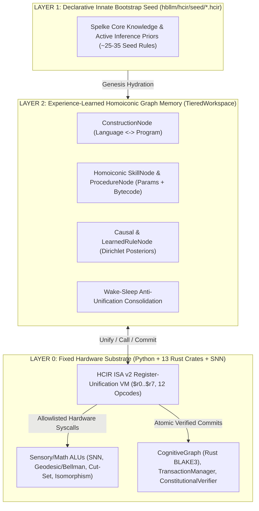

# ADR 005: Homoiconic Symbolic VM & Experience-First Cognition

- **Status**: Accepted (Target Architecture — Phase 3)
- **Deciders**: HBLLM Core Architecture Team
- **Date**: 2026-11-25
- **Technical Area**: HCIR ISA v2, Language Construction Grammar, Skill Consolidation, Cortical World Model (`hbllm/hcir/`)
- **Builds On**: [ADR 004: Pure-HCIR Cognitive OS](0004-pure-hcir-cognitive-os.md)

---

## Context and Problem Statement

ADR 004 consolidated `reasoning`, `language`, `snn`, `grounding`, `world`, and `capabilities` under `hbllm.hcir` with zero runtime LLM dependencies. While that established a unified, event-sourced `TieredWorkspace` and strong embodied benchmarks (`eval-phase2-r10`), a critical architectural asymmetry remains: **the core still relies heavily on hardcoded Python logic for concepts, linguistic parsing, skill predicates, and planning rules**, rather than executing homoiconic symbolic programs learned and composed from experience.

Specifically, four structural gaps prevent unknown future instructions from being resolved dynamically through earlier grounded knowledge:

1. **Flat, Non-Binding ISA (`hbllm/hcir/bytecode.py`, `hbllm/hcir/interpreter.py`):**
   - The 8 v1 opcodes (`ASSERT`, `RETRACT`, `QUERY`, `EXECUTE`, `WAIT`, `FORK`, `MERGE`, `ROLLBACK`) execute as a flat sequential loop over static parameter dicts.
   - `HCIRInterpreter` has **no working-memory registers**, **no pattern unification (`?x`)**, **no conditional branching**, and **no subroutine `CALL`** to invoke learned skills. Because step *N* cannot pass bound variables to step *N+1*, developers are forced to write imperative Python glue around bytecode.

2. **`EXECUTE` Syscall Escape Hatch (`hbllm/hcir/stdlib.py`, `hbllm/hcir/world/cortical_pipeline.py`):**
   - High-level cognitive macros in `stdlib.py` (such as `planning.decompose` and `reasoning.compare`) do not express cognitive strategies in symbolic bytecode — they immediately escape back into Python via `EXECUTE(capability="planning.decompose")`.
   - Similarly, ~15,000 LOC across `hbllm/hcir/world/` (`autonomous_epistemic_engine.py`, `assimilation/assimilator.py`, `planning/mental_simulation.py`, `deliberation/engine.py`) encode epistemic arbitration, subgoal scheduling, and gating directly in procedural Python classes instead of symbolic programs running over `FrozenGraphView`.

3. **Hardcoded Lexical & Predicate Rules in Python (`hbllm/hcir/compiler.py`, `hbllm/hcir/language/reading_curriculum.py`, `hbllm/hcir/skills/declarative.py`):**
   - `HCIRCompiler` hardcodes English verb lists (`"push"`, `"move"`, `"find why"`), spatial prepositions (`"left of"`), color maps, and 10 fixed `_compile_*` methods.
   - `ReadingCurriculumIngestor` uses hardcoded regexes (`_IS_A_RE`, `_CAUSES_RE`).
   - `declarative.py` implements predicates (`CutSetPredicate`, `SymmetryPredicate`, etc.) as Python subclasses rather than serializable graph expressions.
   - When an unseen instruction arrives outside those `if/elif` branches, the system cannot compose earlier learned knowledge to interpret and execute it.

4. **Non-Homoiconic Skill Persistence (`hbllm/hcir/nodes.py`, `hbllm/hcir/learning_loop.py`):**
   - `SkillNode` (`preconditions: list[str]`, `postconditions: list[str]`), `ProcedureNode` (`steps: list[str]`), and `LearnedRuleNode` (`condition: str`, `prediction: str`) store flat strings and metadata.
   - `SkillCompiler.compile_receipt_to_skill()` discards the actual parameterized bytecode, preventing future instructions from querying, unifying, composing, or calling learned skills as executable programs.

---

## Decision — The Three-Layer Cognitive Computer ("Code = CPU, Graph = Symbolic OS")

HBLLM Core graduates to a **homoiconic neuro-symbolic architecture** where Python and Rust serve strictly as the deterministic **hardware CPU, sensory-motor ALU, math coprocessor, and constitutional kernel**, while all concepts, language constructions, causal laws, reasoning strategies, and skills live as **executable symbolic data inside `TieredWorkspace`**.

### Layer 0 — Fixed Hardware Substrate ("Silicon / Microcode")

1. **HCIR Register-Unification VM (ISA v2):**
   - **Working-Memory Register File (`$r0`..`$r7`):** Bounded slot registers holding bound node IDs, entity references, coordinates, or match sets across instructions.
   - **Call Stack (`CallFrame`):** Bounded recursion stack (`max_depth=16`) with cycle guards and instruction fuel budgets so every program terminates deterministically.
   - **12 Canonical Opcodes:**
     - *8 v1 Core Primitives (upgraded to accept `$rN` and `?var` bindings):* `ASSERT`, `RETRACT`, `QUERY`, `EXECUTE`, `WAIT`, `FORK`, `MERGE`, `ROLLBACK`.
     - *4 Composition & Control Primitives:*
       - `UNIFY`: Pattern-match a `GraphPattern` against the workspace or register contents, binding `?var` slots into `$r0`..`$r7`.
       - `BRANCH`: Conditional control transfer on register emptiness, truth value, Dirichlet confidence threshold, or surprise level.
       - `CALL`: Invoke a homoiconic `SkillNode` / `ProcedureNode` by ID or by **postcondition unification** (binding arguments into a child `CallFrame`).
       - `RETURN`: Pop the `CallFrame` and yield output register bindings to the caller.
2. **Strict Hardware `EXECUTE` Syscall Boundary:**
   - `EXECUTE` is restricted by an explicit `SyscallAllowlist` to irreducible physical, sensory, math, and sandbox primitives (`motor.*`, `sensor.*`, `math.*`, `tool.sandboxed.*`, `web.sandboxed.*`, `memory.*`).
   - High-level cognitive strategies (`planning.*`, `reasoning.*`, domain heuristics) must be composed as HCIR bytecode programs rather than hidden inside Python capability handlers.
3. **Stateless Sensory-Motor & Math Coprocessors (ALUs):**
   - Continuous, matrix, and inner-loop graph math remains in native Rust/NumPy/SNN kernels to preserve sub-millisecond inner loops and the `CPU p95 <= 45ms` runtime invariant: SNN feature encoders, coordinate lifting, topological cut-sets, geodesic/A*/risk-weighted Bellman backups, collision cones, Dirichlet/Beta Bayesian updates, subgraph isomorphism (`hbllm_structure_matcher`), and parallel counterfactual rollouts (`hbllm_simulation_engine`).
4. **Constitutional & Multi-Tenant Kernel:**
   - Read-only `CognitiveGraph` views (`MappingProxyType`), frozen/copy-on-write `HCIRNode` branching, fail-closed `ConstitutionalVerifier`, atomic `TransactionManager`, strict `tenant_id` isolation across all `TieredWorkspace` tiers, and two-tier subprocess sandboxing.

### Layer 1 — Declarative Innate Bootstrap Seed (`hbllm/hcir/seed/`)

- Strictly bounded by the Spelke Core Knowledge catalog in [`docs/architecture/priors.md`](../architecture/priors.md) (spatiotemporal objectness, elementary spatial topology, agency detection, discrete numerosity, temporal precedence, Pearl's *do(a)* intervention, and expected free energy / active inquiry).
- Expressed as ~25–35 declarative `.hcir` symbolic seed rules and structural priors loaded transactionally at genesis — **zero domain ontology, color meanings, or hardcoded English keyword tables in Python**.

### Layer 2 — Experience-Learned Homoiconic Graph Memory (`TieredWorkspace`)

1. **Homoiconic Executable Nodes:**
   - `SkillNode`, `ProcedureNode`, and `LearnedRuleNode` carry typed `parameters` (`SymbolicParam`), `precondition_pattern` (`GraphPattern`), `postcondition_pattern` (`GraphPattern`), Dirichlet reliability posteriors `(alpha_success, beta_failure)`, and executable `bytecode_stream` (`InstructionStream` v2).
2. **Embodied Construction Grammar (`ConstructionNode`):**
   - Bidirectional mappings `(Language + Syntactic Template + Slot Constraints <-> Parameterized HCIR Program Template)` stored in `TieredWorkspace` across `en`, `si`, and `ta`.
   - Prose ingestion (`ReadingCurriculumIngestor`, `ExpositoryProseProcessor`) and interactive teaching (`LexiconAcquisitionLoop`) compile definitions and procedural sentences directly into `ConstructionNode` + `SkillNode` proposals.
3. **Unknown-Instruction Resolution via Earlier Knowledge:**
   When an unfamiliar utterance or task instruction arrives:
   1. *Partial Unification:* Bind all recognized entities, relations, and constructions into registers; isolate the unknown span as an `UnknownNode` with an inferred `(InputTypes -> GoalConstraint)` signature.
   2. *Memory & Reading Recall:* `QUERY` `TieredWorkspace` (`Brain` + `Persistent`) for prior definitions, hypernyms, or episodic rules matching the stem/context.
   3. *Structural Analogy:* Invoke `hbllm_structure_matcher` / `AnalogyOperator` to align existing `SkillNode` `(precondition -> postcondition)` schemas with the current scene affordances.
   4. *Active Inquiry & Consolidation:* If epistemic uncertainty remains above threshold, `FORK` a simulation/probe or emit `REQUEST_EVIDENCE`, verify against `PredictionErrorNode`, and commit the newly grounded `ConstructionNode` + `SkillNode` so future compositional instructions reuse it automatically.
4. **Wake–Sleep Library Learning:**
   - During `ExecutiveRuntime` offline idle consolidation and `HippocampalReplayConsolidator` SWR replay, successful `ExecutionReceipt` traces are anti-unified (abstracting episode-specific entity IDs and coordinates into typed `?var` parameters) and committed as reusable `SkillNode`s when Minimum Description Length (MDL) compression improves.

---

## Consequences & Non-Negotiable Guardrails

- **Latency Invariant Preserved:** Bytecode orchestrates symbolic control flow, bindings, and macro composition; tight spatial/numerical loops remain in Layer-0 Rust/SNN/NumPy ALUs so `32x32` execution stays within `CPU p95 <= 45ms`.
- **LLM Independence Preserved:** `hbllm/hcir/**` remains 100% LLM-free (`test_loc_budget.py`). External LLMs may act only as optional meta-compilers or out-of-core development scaffolds.
- **No Surface-ID Poisoning:** Anti-unification strips episode-local color/entity IDs into relational `?role` variables at `EpisodeBoundary(same_level=False)` so learned programs transfer cleanly across seeds.
- **Migration Tracked End-to-End:** All phases (`M0`–`M6`), dual-run compatibility rules, and exit gates are specified in [`homoiconic-vm-migration-plan.md`](../architecture/homoiconic-vm-migration-plan.md).

---

## References

- [Homoiconic VM Migration Plan (M0–M6)](../architecture/homoiconic-vm-migration-plan.md)
- [Core Knowledge & Innate Priors Declaration](../architecture/priors.md)
- [HCIR Cognitive OS Kernel](../architecture/hcir-kernel-os.md)
- [Language & Reading Comprehension](../architecture/language-and-reading.md)
- [2026-11-24 Full Project Audit](../../reports/audit/2026-11-24_full_project_audit.md)

