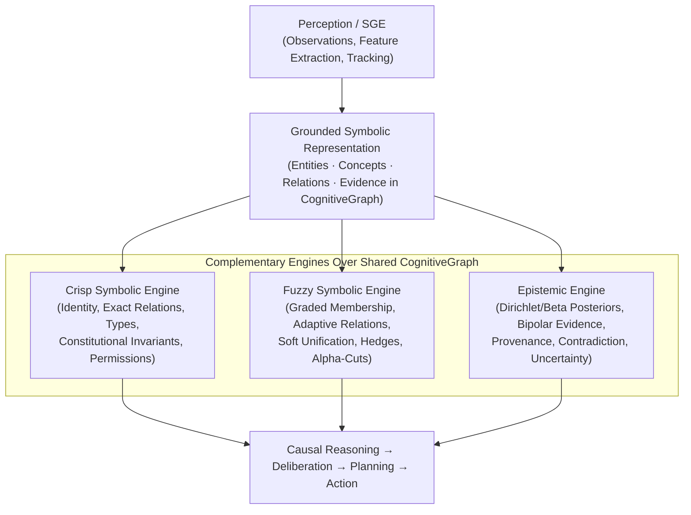

# ADR 006: Fuzzy Symbolic Cognition & Adaptive Semantics

- **Status**: Accepted (Contracts Frozen — Phase 4 Target Architecture `F0`–`F3`)
- **Deciders**: HBLLM Core Architecture Team
- **Date**: 2026-11-26
- **Technical Area**: Symbol Grounding (`hbllm/hcir/grounding/`), Core Types & Algebras (`hbllm/hcir/`), Reasoning Operators (`hbllm/hcir/reasoning/`), Language Grounding (`hbllm/hcir/language/`), Layer-0 Math ALUs (`hbllm/hcir/capabilities/`, `rust/`)
- **Builds On**: [ADR 004: Pure-HCIR Cognitive OS](0004-pure-hcir-cognitive-os.md), [ADR 005: Homoiconic Symbolic VM & Experience-First Cognition](0005-homoiconic-symbolic-vm-and-experience-first-cognition.md), [Core Knowledge & Innate Priors](../architecture/priors.md)

---

## 1. Architectural Objective

> **HBLLM represents a dynamic environment using grounded symbols whose meanings can be graded, contextualized, and adapted through experience, while preserving deterministic symbolic execution and independently managed epistemic beliefs.**

This ADR defines the formal semantic contract linking **perception (SGE)**, **grounded symbolic representation (`CognitiveGraph`)**, **crisp and fuzzy evaluation**, **bipolar Bayesian epistemics**, and the **Homoiconic Symbolic VM (ISA v2)** — with zero runtime LLM dependencies.

---

## 2. Context and Problem Statement

While [ADR 005](0005-homoiconic-symbolic-vm-and-experience-first-cognition.md) (`M0`–`M6`) established the Three-Layer Cognitive Computer (*Code = CPU/ALU & Constitutional Kernel; Graph = Symbolic Mind*), four structural gaps prevent HBLLM's symbolic core from operating smoothly over continuously varying concepts and spatial/kinematic relationships:

1. **Winner-Take-All Concept Discretization (`hbllm/hcir/grounding/concepts/concept_learner.py`):**
   - `ConceptLearner` forces each incoming `PerceptualFeatureVector` into a single cluster using a hard distance cutoff (`assignment_threshold`) and overwrites a scalar `feature_concept_ids[rc_feat]`.
   - An observed entity cannot simultaneously hold overlapping graded memberships (e.g., `CONTAINER=0.97`, `CUP=0.91`, `CYLINDER=0.72`, `BOTTLE=0.31`), causing premature cluster fragmentation under appearance or viewpoint shifts.

2. **Scale-Blind Crisp Relations & Disconnected SGE Read Path (`hbllm/hcir/grounding/relations/relation_learner.py`, `hbllm/hcir/world/grounding/bridge.py`, Audit `H-3`):**
   - `RelationLearner` defines spatial relations via fixed unnormalized distance intervals (e.g., `NEAR` with `distance_bounds=(0.1, proximity_threshold)`) rather than context- and scale-normalized memberships learned from experience.
   - `HCIRCommitter` collapses relation satisfaction and epistemic belief into a single `HCIREdge.weight`, and downstream cortical stages largely bypass SGE outputs — yielding `Δ = 0.0000` on dev, widened, and held-out suites (see 2026-11-24 Full Project Audit (`reports/audit/2026-11-24_full_project_audit.md`)).

3. **Cliff-Edge Symbolic Unification & Unconstrained Composition (`hbllm/hcir/unification.py`, `hbllm/hcir/skills/declarative.py`, `hbllm/hcir/reasoning/operators/spatial.py`):**
   - `SymbolicExpr.evaluate()` and `unify_pattern()` evaluate attributes and thresholds as discontinuous binary predicates (e.g., `dev <= 2.0` snaps from `True` to `False` at `2.01`).
   - `SpatialOperator._infer_relations()` applies uniform symmetry/transitivity tables without relation-specific geometric, directional, or scale-ratio composition guards.

4. **Premature Referent Ambiguity & Legacy LLM `FuzzyNode` (`hbllm/hcir/language/core/grounding.py`, `hbllm/actions/fuzzy_node.py`):**
   - `GroundingResolver` raises `AMBIGUOUS_REFERENCE` whenever multiple entities share discrete tags rather than ranking candidates by graded property/relation fit (e.g., `"the large block near the door"`).
   - Legacy `hbllm/actions/fuzzy_node.py` lives in the unshipped legacy `hbllm/actions/` tree and prompts an external LLM twice to construct a `scikit-fuzzy` control system, violating Invariant #3 (Zero LLM in Core) and State Ownership.

---

## 3. Decision — Four-Mechanism Architecture & Seven Commitments (`D1`–`D7`)

HBLLM elevates fuzzy symbolic cognition to a first-class execution mode over the **same** canonical HCIR graph, alongside crisp symbolic execution and Bayesian epistemics.



### Complementary Mechanism Responsibilities

| Mechanism | Responsibility | Substrate / Canonical Store |
| :--- | :--- | :--- |
| **Neural / Perceptual** | Extract continuous/spiking features and tracklets from observations | `FeatureExtractor` (`snn`, `learned`, `handcrafted`), `ThreeTierEntityTracker` |
| **Symbolic** | Represent entities, types, exact relations, rules, and executable bytecode | `CognitiveGraph` (`HCIRNode`, `HCIREdge`, `SkillNode`, `ConstructionNode`) |
| **Fuzzy** | Represent gradable concept/relation memberships, similarity, and linguistic hedges | `FuzzyAssertion`, `AdaptiveMembershipModel`, `FuzzyLogicProfile`, `math.fuzzy.*` ALU |
| **Bayesian / Epistemic** | Represent belief posteriors, evidence provenance, contradiction, and ignorance | `BeliefNode`, `TransitionKnowledgeBase` (`DirichletOutcomePosterior`), `BipolarEvidenceState` |

### Seven Binding Architectural Commitments (`D1`–`D7`)

| Decision | Architectural Commitment |
| :--- | :--- |
| **D1 — Representation** | Crisp and fuzzy assertions coexist in the same HCIR world (`CognitiveGraph` / `TieredWorkspace`). There is no shadow graph or separate fuzzy reality. |
| **D2 — Semantics** | Fuzzy truth (graded satisfaction $\mu \in [0, 1]$ of a vague concept/relation given complete observation) is strictly distinct from Bayesian probability (epistemic uncertainty or stochastic transition frequency $P \in [0, 1]$). |
| **D3 — Execution** | Fuzzy algebra executes deterministically through ontology-blind Layer-0 ALUs (`math.fuzzy.*` in Python/NumPy + Rust `compute_kernel`), with zero LLM calls and zero `scikit-fuzzy` dependency. |
| **D4 — VM Compatibility** | Preserve the 12 canonical ISA v2 opcodes (`ASSERT`, `RETRACT`, `QUERY`, `EXECUTE`, `WAIT`, `FORK`, `MERGE`, `ROLLBACK`, `UNIFY`, `BRANCH`, `CALL`, `RETURN`). |
| **D5 — Adaptation** | Membership models (`AdaptiveMembershipModel`) are contextual, learned from grounded dimensionless experience (`priors.md`), and immutably versioned in HCIR. |
| **D6 — Epistemics** | Supporting and refuting evidence remain independently represented and correlation-de-duplicated before computing paraconsistent conflict or epistemic ignorance. |
| **D7 — Governance** | Entity identity (`SAME_AS`), `Scope` / `tenant_id` isolation, `PermissionEngine`, `SyscallAllowlist`, `TransactionManager` atomicity, and `ConstitutionalVerifier` rules remain strictly crisp boolean. |

---

## 4. Formal Mathematical & HCIR Data-Model Contracts

### 4.1 `FuzzyLogicProfile` (Complete Residuated Lattice Algebras)

Fuzzy operators **must never be mixed arbitrarily** across algebras within an expression. Every fuzzy evaluation binds an explicit `FuzzyLogicProfile` defining a complete residuated lattice $\mathcal{L} = ([0, 1], \top, \bot, \neg, \Rightarrow)$:

| Profile ID | Conjunction $\top(a, b)$ | Disjunction $\bot(a, b)$ | Negation $\neg(a)$ | Residuum $a \Rightarrow b$ | Intended Cognitive Use |
| :--- | :--- | :--- | :--- | :--- | :--- |
| **`godel`** | $\min(a, b)$ | $\max(a, b)$ | $1 - a$ *(standard)* / $1 \text{ if } a=0 \text{ else } 0$ *(strict)* | $1 \text{ if } a \le b \text{ else } b$ | Idempotent, conservative constraint checking |
| **`product`** | $a \cdot b$ | $a + b - a \cdot b$ | $1 - a$ *(standard)* | $1 \text{ if } a \le b \text{ else } \min(1, b/a)$ | Accumulating graded compatibility & soft ranking |
| **`lukasiewicz`** | $\max(0, a + b - 1)$ | $\min(1, a + b)$ | $1 - a$ | $\min(1, 1 - a + b)$ | Bounded conjunction & metric similarity ($a \Leftrightarrow_L b = 1 - \|a - b\|$) |

**Monotonic Linguistic Hedges** transform $\mu \in [0, 1]$ prior to lattice combination:
- `very`: $\mu^2$, `extremely`: $\mu^3$, `somewhat` / `slightly`: $\mu^{0.5}$, `intensify`: $2\mu^2$ if $\mu \le 0.5$ else $1 - 2(1 - \mu)^2$, `identity`: $\mu$.

### 4.2 Strict Separation: `FuzzyAssertion` vs. `EpistemicBelief`

`FuzzyAssertion` **never** carries a `confidence` scalar. Concept/relation fit and epistemic belief are separate HCIR contracts:

```python
FuzzyAssertion:
    assertion_id: str
    subject_ref: str
    target_ref: str | None          # None for unary concept membership; entity ID for binary relations
    semantics: str                  # e.g., "concept:CONTAINER" or "relation:NEAR"
    degree: float                   # [0.0, 1.0] fuzzy membership degree
    degree_interval: tuple[float, float] | None  # Optional [lower, upper] under bounded sensor resolution
    profile_id: str                 # "godel" | "product" | "lukasiewicz"
    context_ref: str                # Contextual scope / world regime ID
    model_id: str                   # ID of AdaptiveMembershipModel used
    model_version: int              # Exact immutable version used at evaluation time
    evidence_refs: tuple[str, ...]  # Provenance IDs of sensory/observation inputs
    snapshot_sequence: int
    timestamp: Timestamp

EpistemicBelief (BeliefNode / TransitionBelief contract):
    proposition: str
    posterior: DirichletOutcomePosterior | BetaPosterior
    supporting_evidence: tuple[str, ...]
    contradicting_evidence: tuple[str, ...]
    bipolar_evidence: BipolarEvidenceState
    provenance: Provenance
```

- When sensory input is noisy or partially occluded, perceptual uncertainty lives in `PerceptualEpistemicProfile` (`hbllm/hcir/types.py`) and `EpistemicBelief` — or as an explicit `[lower, upper]` resolution bound on `degree_interval`, never as a conflated `confidence` scalar on `FuzzyAssertion`.

### 4.3 Correlation-Normalized Bipolar Evidence & Paraconsistent Contradiction

Standard fuzzy negation $\mu_{\neg A} = 1 - \mu_A$ satisfies $\top_L(\mu_A, 1 - \mu_A) = \max(0, \mu_A + (1 - \mu_A) - 1) \equiv 0$, so it **cannot detect contradiction**. Furthermore, naive summation across consecutive frames inflates confidence from correlated observations of the same static scene.

HBLLM resolves both via a **two-stage correlation-aware bipolar evidence model** (`BipolarEvidenceState`):

1. **Stage 1 — Within-Cluster Idempotence (Anti-Correlation Guard):**
   - Group evidence records by correlation cluster key `(dependency_group, source_channel_id, tracklet_epoch)`.
   - Within cluster $C_k$, discount redundant observations using `NoveltyPolicy` temporal decay $n_t = 1 - 2^{-\Delta t / T_{1/2}}$ (`hbllm/hcir/types.py`) and combine correlated support/refutation via **Gödel idempotence**:
     $$\mu_k^+ = \max_{e \in C_k^+} \big(\text{strength}(e) \cdot \text{novelty\_factor}(e)\big), \qquad \mu_k^- = \max_{e \in C_k^-} \big(\text{strength}(e) \cdot \text{novelty\_factor}(e)\big)$$
   - Observing the same static object for 100 identical frames yields **one** cluster contribution, not 100 independent confirmations.

2. **Stage 2 — Cross-Cluster Bipolar Aggregation, Ignorance & Conflict:**
   - Aggregate across **independent** clusters $k$ with source-reliability weights $w_k \in (0, 1]$:
     $$E^+ = \sum_{k \in \mathcal{I}^+} w_k^+ \mu_k^+, \qquad E^- = \sum_{k \in \mathcal{I}^-} w_k^- \mu_k^-$$
   - Let $\kappa_0 > 0$ be the explicit prior pseudo-count (`ignorance_prior`, e.g., $\kappa_0 = 2.0$) and $\tau > 0$ be the evidence saturation scale:
     - **Normalized Evidential Shares:**
       $$s = \frac{E^+}{E^+ + E^- + \kappa_0}, \qquad r = \frac{E^-}{E^+ + E^- + \kappa_0}$$
     - **Epistemic Ignorance ($\iota$):**
       $$\iota = 1 - s - r = \frac{\kappa_0}{E^+ + E^- + \kappa_0} \in (0, 1]$$
       $\iota = 1$ when no independent evidence exists; $\iota \to 0$ only as independent evidence grows relative to $\kappa_0$.
     - **Channel Saturations & Paraconsistent Conflict ($\chi$):**
       $$\tilde{s} = 1 - \exp(-E^+ / \tau) \in [0, 1), \qquad \tilde{r} = 1 - \exp(-E^- / \tau) \in [0, 1)$$
       $$\chi = \top_{\text{profile}}(\tilde{s}, \tilde{r})$$
       Conflict $\chi > 0$ fires **only** when substantial independent supporting evidence *and* substantial independent refuting evidence coexist.

### 4.4 `AdaptiveMembershipModel` & Non-Retroactive Versioning

Hardcoded environmental thresholds (such as `near = distance < 2.0`) violate domain independence because `2.0` means completely different things in desktop manipulation, indoor navigation, and high-speed vehicle navigation.

All continuous concept and relation memberships are parameterized by a graph-persisted `AdaptiveMembershipModel`:

```python
AdaptiveMembershipModel:
    model_id: str
    target_id: str                  # Concept ID or relation ID (e.g., "rel_near", "C-1A2B3C")
    contextual_scope: str           # Context regime key (e.g., "manipulation", "navigation", "kinematic_closing")
    kernel_family: str              # "gaussian" | "trapezoidal" | "sigmoid" | "mahalanobis_rbf"
    reference_scale_kind: str       # Dimensionless normalizer compliant with priors.md
    learned_parameters: dict[str, float]  # e.g., {"center": 0.0, "sigma": 1.2} or {"a": 0.0, "b": 0.4, "c": 1.2, "d": 2.5}
    sample_count: int
    version: int                    # Monotonically incremented on parameter update
    parent_version: int | None
    parent_hash: str | None
    created_at: Timestamp
    provenance: Provenance
```

**Permitted Dimensionless Reference Scales (`priors.md` compliant):**
1. **`entity_extent`**: Ratio $d / \max(\epsilon, L_{\text{sub}} + L_{\text{obj}})$, where $L_i = \sqrt{w_i^2 + h_i^2}$ (scale-invariant manipulation/contact proximity).
2. **`navigable_diameter`**: Ratio $d / \max(\epsilon, D_{\text{partition}})$ over the reachable topological component from `math.topology_cuts` / `math.geodesic_field`.
3. **`closing_ttc`**: Kinematic time-to-contact $d / \max(\epsilon, v_{\text{closing}})$ along relative velocity projection.
4. **`feature_zscore`**: Per-feature Welford mean/variance $(\mu_j, \sigma_j^2)$ already tracked on `GroundedConcept` (`hbllm/hcir/grounding/concepts/model.py`).

**Immutability & Replay Guarantee:**
- Parameter adaptation **never mutates an existing `AdaptiveMembershipModel` version in place**. Updates commit a new `version = v + 1` (linking `parent_version = v` and emitting an `AdaptationEventNode`) via `TransactionManager`.
- Historical `FuzzyAssertion`s permanently record `(model_id, model_version = v)`. Replaying past events in `ReplayDebugger` evaluates identically against version `v`; re-interpreting old observations under `v + 1` emits *new* `FuzzyAssertion`s with `model_version = v + 1`.

### 4.5 Declarative `RelationCompositionPolicy`

Generic graph transitivity is mathematically invalid for fuzzy spatial and functional relations: `NEAR(A, B)` and `NEAR(B, C)` do **not** entail `NEAR(A, C)` (Sorites drift), and `NEAR(A, B)` with `INSIDE(B, C)` does **not** entail `NEAR(A, C)` when $C$ is a large building containing a small object $B$ unless $A$ is also within the scale-bounded neighborhood of $C$.

Relation composition is governed by a declarative, testable `RelationCompositionPolicy` stored as graph/seed data:

```python
RelationCompositionRule:
    first_relation: str             # R1(A, B)
    second_relation: str            # R2(B, C)
    composed_relation: str | None   # R3(A, C), or None when explicitly forbidden
    directionality: str             # "forward" | "symmetric" | "directional_axis"
    geometric_guard: str            # "topological_closure" | "triangle_inequality_bound" | "extent_bounded" | "none"
    max_scale_ratio: float | None   # e.g., diam(B) / L_ref(C, context) <= max_scale_ratio
    contextual_scope: str           # "*" or specific context regime
    composition_operator: str       # "godel" | "product" | "lukasiewicz" | "attenuated_product"
    attenuation_factor: float       # [0.0, 1.0] slack penalty per geometric hop
```

**Canonical Seed Policy Semantics:**

| Composition $R_1(A, B) \circ R_2(B, C)$ | Result $R_3(A, C)$ | Geometric / Scale Guard | Operator |
| :--- | :--- | :--- | :--- |
| `INSIDE ∘ INSIDE` | `INSIDE` | `topological_closure` (universal containment) | `godel` ($\min$) |
| `CONTAINS ∘ CONTAINS` | `CONTAINS` | `topological_closure` | `godel` ($\min$) |
| `ABOVE ∘ ABOVE` *(same frame)* | `ABOVE` | `directional_axis` (vertical projection preserved) | `product` |
| `INSIDE(A, B) ∘ NEAR(B, C)` | `NEAR(A, C)` | `triangle_inequality_bound`: $\text{diam}(B) / L_{\text{ref}}(C) \le \rho_{\max}$ | `attenuated_product` |
| `NEAR(A, B) ∘ INSIDE(B, C)` | **Forbidden (`None`)** by default *(allowed only if $C$'s exterior boundary satisfies explicit proximity)* | `extent_bounded`: fails when $\text{scale}(C) \gg \text{scale}(B)$ | — |
| `NEAR ∘ NEAR` | **Forbidden (`None`)** | Prevents Sorites drift across chains | — |

---

## 5. Homoiconic VM Execution Contract (ISA v2 Compatibility)

Per **D3** and **D4**, HBLLM does **not** add 9 arithmetic opcodes to `Opcode` (`hbllm/hcir/bytecode.py`), which would inflate VM fuel/call-stack accounting and fragment `anti_unify_streams()` macro compression. Instead, fuzzy cognition integrates into ISA v2 through two deterministic mechanisms:

1. **Homoiconic `FuzzyExpr` AST + Layer-0 `math.fuzzy.*` ALU:**
   - Symbolic concepts, skill preconditions, and linguistic constructions store serializable `FuzzyExpr` / `SymbolicExpr` ASTs referencing an explicit `profile_id` and `AdaptiveMembershipModel` `(model_id, model_version)`.
   - `Opcode.EXECUTE` invokes allowlisted Layer-0 capabilities (`math.fuzzy.membership`, `math.fuzzy.eval`, `math.fuzzy.compose`, `math.fuzzy.hedge`, `math.fuzzy.bipolar`) in **1 VM step** — preserving `SyscallAllowlist` (`math.*` prefix) and sub-millisecond inner loops.
   - Conceptual VM mapping:

| Conceptual Operation | ISA v2 Realization |
| :--- | :--- |
| `FUZZY.MEMBERSHIP` | `EXECUTE(capability="math.fuzzy.membership", params={value, model_id, version, scale_ctx}, bind="$rN")` |
| `FUZZY.AND` / `OR` / `NOT` / `IMPLIES` / `HEDGE` / `EVALUATE` | `EXECUTE(capability="math.fuzzy.eval", params={expr, profile_id, bindings}, bind="$rN")` |
| `FUZZY.COMPOSE` | `EXECUTE(capability="math.fuzzy.compose", params={rel_ab, rel_bc, policy_id, geom_ctx}, bind="$rN")` |
| `FUZZY.ALPHA_CUT` | `BRANCH(condition="if_degree_gte" \| "if_degree_lt", register="$rN", threshold=alpha, target_label=...)` |

2. **Dual-Mode Native `UNIFY`, `BRANCH`, and `CALL`:**
   - `Opcode.UNIFY` preserves crisp structural and type safety while scoring graded semantic alignment:
     ```python
     MatchResult:
         structure_valid: bool   # Crisp: required node types, edges, none_of guards satisfied
         binding_valid: bool     # Crisp: variable consistency & distinct_nodes satisfied
         semantic_degree: float  # Fuzzy [0, 1]: t-norm over graded node/edge/attribute fits
         profile_id: str         # Algebra used to aggregate semantic_degree
         bindings: dict[str, Any]
     ```
   - `Opcode.CALL` postcondition matching requires `structure_valid and binding_valid` before entering a child `CallFrame`, using `semantic_degree` for candidate skill ranking (kept distinct from epistemic `reliability_mean`).

---

## 6. Validation Protocol (2×2 Experimental Matrix & Gates)

To prove causally where improvements originate without confounding grounding changes with reasoning/policy changes, validation uses a **2×2 experimental design** with the **Bayesian/Dirichlet epistemic engine held invariant across all four runs**:

| Experiment | Grounding | Reasoning | Downstream $\alpha$-Cut Policy | Purpose |
| :---: | :---: | :---: | :---: | :--- |
| **A** | Existing Crisp | Existing Crisp | Crisp baseline | Control baseline (`dev` / `widened_dev`) |
| **B** | **Fuzzy** | Existing Crisp | **Frozen** $\alpha$-cuts | Isolates Fuzzy SGE impact (Audit `H-3` fix) |
| **C** | Existing Crisp | **Fuzzy** | Graded VM / Composition | Isolates Soft Unification & Composition impact |
| **D** | **Fuzzy** | **Fuzzy** | End-to-end adaptive | Measures full neuro-fuzzy-symbolic synergy |

### Required Evaluation Dimensions & Performance Gates
1. **Task & Generalization Suites:** Concept recognition under scale/viewpoint/quality variation; relation recognition across environmental scales; symbolic matching under perceptual perturbation; open-world concept discovery & split/merge stability; downstream planning with graded affordances; `dev.yaml` and `widened_dev.yaml`.
2. **R1 Ablation Gate:** Experiment **B** must achieve `Δ > 0` over **A** on scale/appearance-shifted benchmarks and non-regressive/positive `Δ` on `widened_dev` before advancing to **F2**.
3. **Separated Latency Profiling:**
   - Measure **scalar/batch Layer-0 ALU time** (`< 0.05ms` is an **experimental target**, not an assumed guarantee) separately from **Python/VM syscall dispatch overhead**.
   - Enforce the system-level **`32×32` `CPU p95 <= 45ms`** runtime invariant via `python -m hbllm bench profile`.

---

## 7. Consequences & Rollout

- **Positive:** Resolves Audit `H-3` by giving SGE continuous, scale-invariant semantics consumed natively by the graph; prevents Sorites drift and false contradiction math; preserves deterministic replay via immutable `AdaptiveMembershipModel` versioning; retires legacy LLM/SFT-coupled `FuzzyNode`.
- **Trade-offs & Risks:** Adds schema and serialization discipline (`FuzzyAssertion`, `AdaptiveMembershipModel`, `RelationCompositionRule`); if poorly cached, continuous scoring on every entity pair could erode the `45ms` budget — mitigated via unmoved-entity caching in `CorticalGroundingBridge` and Rust `compute_kernel` / `structure_matcher` parity.
- **Execution Plan:** Detailed phase-by-phase file targets, exit gates, and rollback rules are frozen in the [Fuzzy Symbolic Cognition Migration Plan (`F0`–`F3`)](../architecture/fuzzy-cognition-migration-plan.md).

---

## 8. References

- [Fuzzy Symbolic Cognition Migration Plan (`F0`–`F3`)](../architecture/fuzzy-cognition-migration-plan.md)
- [ADR 005: Homoiconic Symbolic VM & Experience-First Cognition](0005-homoiconic-symbolic-vm-and-experience-first-cognition.md)
- [ADR 004: Pure-HCIR Cognitive OS](0004-pure-hcir-cognitive-os.md)
- [Core Knowledge & Innate Priors Declaration](../architecture/priors.md)
- [Symbol Grounding Architecture (SGE)](../architecture/grounding.md)
- 2026-11-24 Full Project Audit: `reports/audit/2026-11-24_full_project_audit.md`

