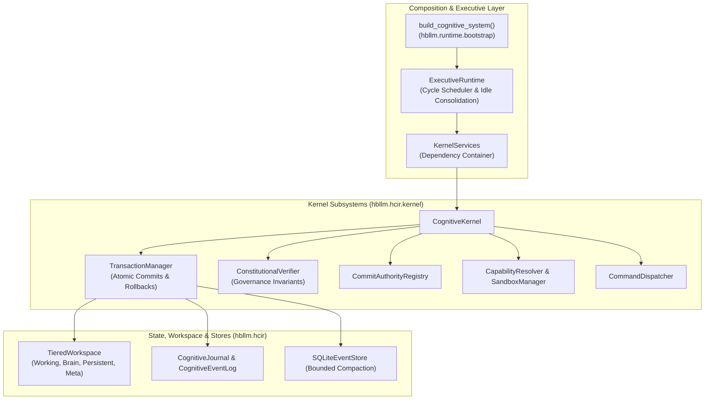

# HCIR Cognitive OS Kernel API

The **Human-Cognitive Intermediate Representation (HCIR)** is the canonical event-sourced execution substrate for HBLLM Core.

**Package:** `hbllm.hcir`

---

## Architecture Components



---

## `CognitiveKernel`

**Module:** `hbllm.hcir.kernel.cognitive_kernel.CognitiveKernel`

Lightweight execution boundary and governance facade for invoking verified capabilities against an HCIR workspace:

```python
from hbllm.hcir.kernel.cognitive_kernel import CognitiveKernel
from hbllm.hcir.kernel.services import KernelServices
from hbllm.hcir.workspace import HCIRWorkspaceState

workspace = HCIRWorkspaceState()
services = KernelServices.create_default(workspace=workspace)
kernel = CognitiveKernel(workspace=workspace, services=services)

receipt = await kernel.execute_async(
    capability_name="world.query_state",
    arguments={},
)
print(f"Status: {receipt.status}, Elapsed: {receipt.elapsed_ms}ms")
```

### Methods

| Method | Signature | Description |
|---|---|---|
| `execute_async()` | `async (capability_name: str, arguments: dict[str, Any], context: Any = None) -> KernelExecutionReceipt` | Evaluates governance policies and executes a sandboxed capability asynchronously |
| `execute()` | `(capability_name: str, arguments: dict[str, Any], context: Any = None) -> KernelExecutionReceipt` | Synchronous wrapper over `execute_async()` |
| `workspace` / `governance` / `services` | Properties | Expose the bound `HCIRWorkspaceState`, `GovernanceEngine`, and `KernelServices` |

---

## `ExecutiveRuntime`

**Module:** `hbllm.hcir.kernel.executive_runtime.ExecutiveRuntime`

Owns the cognitive cycle lifecycle, session tracking, and idle offline consolidation (`run_offline_consolidation()`, `start_autonomous_loop()`):

```python
from hbllm.hcir.kernel.executive_runtime import ExecutiveRuntime

runtime = ExecutiveRuntime(services=services)
await runtime.start()
cycle_result = await runtime.run_cycle()
await runtime.stop()
```

---

## `TieredWorkspace`

**Module:** `hbllm.hcir.workspace_tiers.TieredWorkspace`

Organizes cognitive graph state into four lifetime tiers (`WorkspaceTier.WORKING`, `WorkspaceTier.BRAIN`, `WorkspaceTier.PERSISTENT`, `WorkspaceTier.META`) with retention budgets and event-store compaction:

```python
from hbllm.hcir.workspace_tiers import TieredWorkspace, WorkspaceTier

workspace = TieredWorkspace()

# Promote a verified node between tiers
workspace.promote(
    node_id="concept-101", from_tier=WorkspaceTier.WORKING, to_tier=WorkspaceTier.PERSISTENT
)

# Enforce per-tier/world node budgets and run memory hygiene
workspace.enforce_node_budgets(max_nodes_per_world=5000)
workspace.run_memory_hygiene_cycle()
```

### Tiers

| Tier | Enum | Lifetime | Purpose |
|---|---|---|---|
| **Working** | `WorkspaceTier.WORKING` | Active `TaskFrame` | Ephemeral task scratchpad and active observations |
| **Brain** | `WorkspaceTier.BRAIN` | Active Session | Promoted session hypotheses and working concepts |
| **Persistent** | `WorkspaceTier.PERSISTENT` | Permanent | Consolidated beliefs, `TransitionKnowledgeBase`, ontologies |
| **Meta** | `WorkspaceTier.META` | Permanent | Tier stats, competence profiles, capability metrics |

---

## `TransactionManager` & `ConstitutionalVerifier`

**Modules:** `hbllm.hcir.kernel.transaction_manager`, `hbllm.hcir.kernel.governance.constitutional_verifier`

All mutations are proposed as `TransactionOperation`s, verified by `ConstitutionalVerifier` + pipeline stages (`create_default_pipeline`), and committed atomically with compensating rollback support:

```python
from hbllm.hcir.kernel.governance.constitutional_verifier import ConstitutionalVerifier
from hbllm.hcir.kernel.transaction_manager import TransactionManager
from hbllm.hcir.kernel.verification import create_default_pipeline
from hbllm.hcir.transactions import TransactionOp, TransactionOperation
from hbllm.hcir.workspace import HCIRWorkspaceState

ws = HCIRWorkspaceState()
verifier = ConstitutionalVerifier()
tx_mgr = TransactionManager(
    workspace=ws,
    verification_stages=create_default_pipeline(constitutional_verifier=verifier),
)

async with tx_mgr.begin_transaction(author="api_demo") as tx:
    tx.add_operation(TransactionOperation(op=TransactionOp.INSERT_NODE, node=my_node))
    await tx.commit()
```

---

## HCIR Bytecode ISA v2 (`hbllm.hcir.bytecode`, `hbllm.hcir.interpreter`)

The **12-opcode ISA v2 Register-Unification VM** executes deterministic, fuel-bounded `InstructionStream`s (with canonical `compute_hash()` and `semantic_hash()`) over a register file (`$r0`..`$r7`, `RegisterFile`), bounded `CallStack` (`max_depth=16`), and `GraphPattern` unification (`hbllm.hcir.unification`):

- **Transactional & Execution Opcodes (8):** `ASSERT`, `RETRACT`, `QUERY`, `EXECUTE`, `WAIT`, `FORK`, `MERGE`, `ROLLBACK` — supporting dynamic `$rN`/`?var` resolution and tenant-scoped `HCIRTransaction` commits.
- **Unification & Control Opcodes (4):** `UNIFY` (pattern-match into `$r0`..`$r7`), `BRANCH` (conditional jump), `CALL` (invoke a homoiconic `SkillNode`/`ProcedureNode` by ID or postcondition unification), and `RETURN` (yield register bindings).
- **Strict Syscall Enforcement:** `SyscallAllowlist` and `HCIRInterpreter` default to `strict=True`, restricting `Opcode.EXECUTE` strictly to allowlisted Layer-0 hardware/ALU/sandbox capabilities and rejecting unallowlisted high-level Python escapes.
