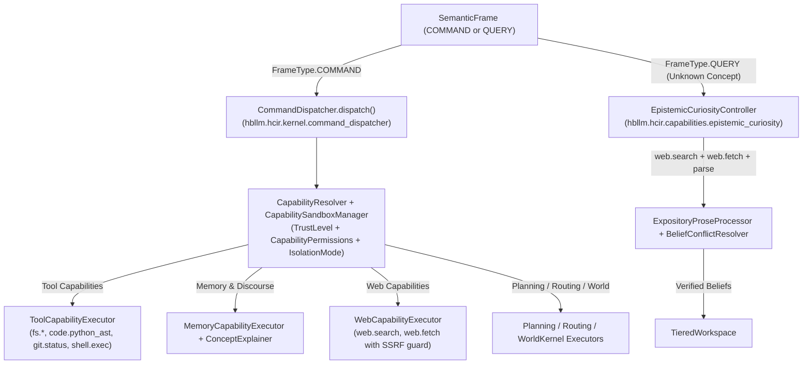

# Capabilities, Command Dispatch & Curiosity (`hbllm.hcir.capabilities`)

In HBLLM's Pure-HCIR Cognitive OS, tool execution, memory operations, planning queries, and autonomous web research are all expressed as **governed kernel capabilities** checked by `CapabilitySandboxManager` and `CapabilityResolver` inside `KernelServices`.

---

## 1. Command & Query Execution Flow

---

## 2. Governed Capability Modules (`hbllm.hcir.capabilities`)

When `KernelServices.create_default()` boots, it registers capabilities across six executor families, each paired with a `SandboxedCapabilityPolicy`:

| Module | Executor / Engine | Registered Capabilities | Sandbox Permissions |
|---|---|---|---|
| `tool_capabilities.py` | `ToolCapabilityExecutor` | `fs.read`, `fs.list`, `fs.search`, `code.python_ast`, `git.status`, `shell.exec` | `filesystem=True`, `subprocess=True` only for `git.status` / `shell.exec`, `network=False` |
| `memory_capabilities.py` | `MemoryCapabilityExecutor` | `memory.store`, `memory.recall`, `memory.forget`, `knowledge.ingest`, `knowledge.explain`, `knowledge.explain_why`, `knowledge.explain_how` | Least-privilege in-memory (`IN_PROCESS`) |
| `web_capabilities.py` | `WebCapabilityExecutor` | `web.search`, `web.fetch` | `network=True` with `is_safe_url()` SSRF validation |
| `planning_capabilities.py` | `PlanningCapabilityExecutor` | `planning.generate_candidates`, `planning.validate`, `planning.expand` | Least-privilege in-memory (`IN_PROCESS`) |
| `routing_capabilities.py` | `RoutingCapabilityExecutor` | `routing.resolve_route`, `execution.sandbox_run` | `execution.sandbox_run` enforces `IsolationMode.SUBPROCESS` |
| `world_capabilities.py` | `WorldKernelCapabilityExecutor` | World state inspection, prediction (`world_prediction`), & simulation capabilities | Least-privilege in-memory (`IN_PROCESS`) |
| `math_capabilities.py` | `MathCapabilityExecutor` | Connected components, topology cuts, symmetry, geodesic/Bellman/Bayesian ALUs, and `math.fuzzy.{membership,eval,compose,hedge,bipolar}` | Stateless Layer-0 ALU (`IN_PROCESS`) |

---

## 3. Discourse Explanation & Belief Revision

### `ConceptExplainer` (`hbllm.hcir.capabilities.concept_explainer`)

Performs multi-hop traversal across `TieredWorkspace` (`Working`, `Brain`, `Persistent` — including `web_concept` nodes) and `LexicalOntologyStore` to build a structured `ConceptKnowledgeSnapshot` (`definition`, `hypernyms`, `synonyms`, `causes`, `caused_by`, `requires`, `required_by`, `beliefs`):
- `explain(concept_query)` — synthesizes fluent definitions and taxonomic summaries.
- `explain_why(concept_query, max_depth=3)` — traces causal antecedent chains.
- `explain_how(concept_query, max_depth=3)` — traces prerequisite/procedural chains.

### `EpistemicCuriosityController` (`hbllm.hcir.capabilities.epistemic_curiosity`)

Activated when `enable_autonomous_curiosity=True` in `CognitiveSystemConfig` and a `QUERY` frame produces high epistemic uncertainty (`not epistemic_state.is_known`, `uncertainty >= uncertainty_threshold`):
1. Checks `should_research(concept, uncertainty)` and session query budget (`max_session_queries`).
2. Runs governed `web.search` and optional `web.fetch` via `CapabilityResolver`.
3. Ingests verified facts into `TieredWorkspace` and returns `CuriosityResult` (`propositions_ingested`, `sources`, `summary`).

### `BeliefConflictResolver` (`hbllm.hcir.capabilities.belief_revision`)

Evaluates newly proposed `BeliefNode`s against existing graph beliefs (`evaluate_belief()`), clustering observations by `(dependency_group, source_channel_id, tracklet_epoch)` into correlation-normalized `BipolarEvidenceState` (`support_share`, `refutation_share`, ignorance $\iota$, conflict $\chi$) so repeated correlated reports cannot flood independent refutations, and proposing calibrated `TransactionOperation` updates (`BeliefRevisionReport`).

---

## 4. `AutonomyTracker` Graduation Telemetry

`AutonomyTracker` (`hbllm.hcir.kernel.autonomy_tracker`) meters how reliably the Pure-HCIR core operates without an optional LLM scaffold:
- `hcir_parse_autonomy_rate` ($\alpha_{\text{parse}}$)
- `hcir_plan_autonomy_rate` ($\alpha_{\text{plan}}$)
- `hcir_realize_autonomy_rate` ($\alpha_{\text{realize}}$)
- `overall_autonomy_rate` & `can_retire_llm` (checks $\min \ge \text{retirement\_threshold}$ after `min_turns_for_retirement`).

