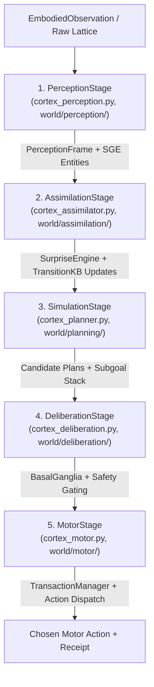
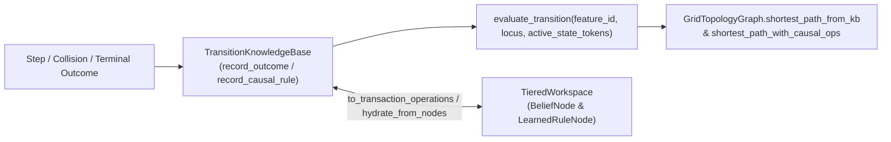

# Cortical World Model (`hbllm.hcir.world`)

> **Core Invariants:**
> - **LLM-Free Core (Invariant 3):** Zero external LLM imports or network calls in `hbllm.hcir.world`.
> - **Domain-Agnostic (Invariant 7):** Operates solely on universal physical/topological primitives (`SpatialEntity`, `PlaceLocus`, `CausalPredicate`, `TransitionOutcome`, collision cones, symmetries, cut sets) — never hardcoded game or task rules.
> - **Internal Memory Governance (Invariant 8):** Learned ontology lives in `HCIRSymbolicWorldTheory` (`TransitionKnowledgeBase` + `CausalPredicate`s); transient working state and salience live in `PrefrontalWorkingMemory`; procedural programs live in `DeclarativeNeuroSymbolicSkill` / `procedural_library`.

The **Cortical World Model** (`hbllm.hcir.world`) is HBLLM's embodied active-inference and causal discovery engine, orchestrated by `AutonomousEpistemicEngine` over the 5-stage `CorticalPipeline`.

---

## 1. The 5-Stage Cortical Epistemic Loop (`CorticalPipeline`)

Defined in `hbllm.hcir.world.cortical_pipeline`, `CorticalPipeline.run(ctx)` executes five deterministic stages per step and records per-stage latency (`stage_timings_ms`):

| Stage | Facade & Subpackage | Core Responsibilities |
|---|---|---|
| **1. `PerceptionStage`** | `cortex_perception.py` `world/perception/` (`engine.py`, `diff.py`, `gestalt.py`, `thalamus.py`) | Extracts background feature, connected `SpatialEntity` components, pixel/frame diffs, gestalt groupings, and thalamic attention gating. Integrates `CorticalGroundingBridge` (`world/grounding/bridge.py`) when grounding is enabled. |
| **2. `AssimilationStage`** | `cortex_assimilator.py` `world/assimilation/` (`assimilator.py`) | Binds motor diffs to `action_deltas` and `ActionDynamicsModel`, detects surprise (`SurpriseEngine`), attributes terminal/hazard/distal outcomes into `TransitionKnowledgeBase`, and shifts `EpistemicPhase`. |
| **3. `SimulationStage`** | `cortex_planner.py` `world/planning/` (`mental_simulation.py`, `goal_scheduler.py`, `frontopolar_mcts.py`, `dynamic_replanner.py`, `kinematics.py`, `affordances.py`) | Performs counterfactual rollouts (`WholeGridPredictor`, `PhysicsPredictor`, `SNNTemporalPredictor`), BA10 recursive subgoal scheduling, geodesic manifold routing (`GeodesicManifoldRouter`), and dead-end pruning. |
| **4. `DeliberationStage`** | `cortex_deliberation.py` `world/deliberation/` (`engine.py`, `basal_ganglia.py`, `neuromodulation.py`, `safety_predicates.py`) | Arbitrates candidate utilities via `BasalGangliaGatingCircuit`, evaluates `AnteriorCingulateConflictMonitor` conflict, projects collision cones (`SpatiotemporalHazardTracker`), and vetoes lethal or inhibited actions. |
| **5. `MotorStage`** | `cortex_motor.py` `world/motor/` (`dispatcher.py`, `effector.py`, `curiosity.py`, `conflict.py`) | Scores epistemic probes (`PlanEpistemicProbe`), runs `CapabilityResolver` / motor dispatch, updates visit counts and `HabenularIOR`, and commits transactional workspace deltas. |

---

## 2. Package Architecture (17 Domain Subpackages)

`hbllm/hcir/world/` is organized into 17 focused subpackages plus root pipeline facades:

| Subpackage | Key Modules & Roles |
|---|---|
| `assimilation/` | `EpistemicFeedbackAssimilator` (`assimilator.py`): motor calibration, outcome attribution, continuous-frame assimilation guards |
| `causal/` | `TransitionKnowledgeBase` (`transition_kb.py`), `HCIRSymbolicWorldTheory` (`theory.py`), `affordances.py`, `axioms.py`, `discovery.py`, `mediation.py`, `predicates.py` |
| `deliberation/` | `PrefrontalDeliberationEngine` (`engine.py`), `BasalGangliaGatingCircuit` (`basal_ganglia.py`), `AdaptiveNeuromodulationGovernor` (`neuromodulation.py`), `safety_predicates.py` |
| `episodic/` | `HippocampalEpisodicCortex` (`cortex.py`), `attractor.py`, `replay.py`, `models.py` |
| `grounding/` | `CorticalGroundingBridge` (`bridge.py`), `state.py` |
| `hypothesis/` | Hypothesis generation, PCFG (`pcfg.py`), compositional observers (`observers.py`), `engine.py`, `models.py` |
| `learning/` | `CausalTheoryPlanner` (`causal_planner.py`), `meta.py`, `transfer.py` |
| `macro/` | `MacroPlanSynthesizer` (`planner.py`), `custom.py`, `driver.py`, `primitives.py`, `models.py` |
| `motor/` | `dispatcher.py`, `effector.py`, `curiosity.py`, `conflict.py` |
| `objects/` | `ObjectStateGraphPlanner` (`planner.py`), `ledger.py`, `relational.py`, `risk.py`, `models.py` |
| `perception/` | `engine.py`, `diff.py`, `gestalt.py`, `thalamus.py` |
| `planning/` | `mental_simulation.py`, `goal_scheduler.py`, `frontopolar_mcts.py`, `dynamic_replanner.py`, `kinematics.py`, `affordances.py` |
| `prediction/` | `PredictionEvaluationEngine` (`engine.py`), `budget.py`, `lifecycle.py`, `weights.py`, `models.py` |
| `predictors/` | `PhysicsPredictor` (`physics.py`), `SNNTemporalPredictor` (`snn.py`), `WholeGridPredictor` (`whole_grid.py`) |
| `spatial/` | `ParietalCoordinateTransformer` (`coordinate_transform.py`), `transforms.py`, `models.py` |
| `state/` | `EngineState` (`state.py`), `CognitiveContext` (`context.py`), `views.py` (`GovernedSetView`), `models.py` |
| `working_memory/` | `PrefrontalWorkingMemory` (`memory.py`), `PBWMWorkingMemoryBuffer` (`buffer.py`), `models.py` |

---

## 3. `TransitionKnowledgeBase` & `HCIRSymbolicWorldTheory`

`TransitionKnowledgeBase` (`hbllm.hcir.world.causal.transition_kb`) is the **single source of truth** inside `HCIRSymbolicWorldTheory` (`hbllm.hcir.world.causal.theory`) for empirical transition outcomes, causal rules, and traversability beliefs.

### Core Data Model

- **`TransitionOutcome` (`StrEnum`):** Empirical transition classes (`TRAVERSABLE`, `BLOCKED`, `LETHAL`, `GOAL`, `CARGO`, `RECEPTACLE`, `ACTUATOR`, `STATE_TRANSFORM`, etc.) recorded per `scope` (`"feature"`, `"locus"`, `"context"`).
- **`DirichletOutcomePosterior` / `TransitionBelief`:** Tracks Dirichlet/Beta empirical outcome counts (`alpha_pass`, `beta_block`, `gamma_lethal`, `delta_goal`), `observed_effects`, `evidence_log`, and epoch stamps (`verified_epoch`, `outcome_epochs`). Computes `traversability_posterior()`, `outcome_prob()`, `epistemic_uncertainty()`, and `confidence()`, and serializes cleanly to/from HCIR `BeliefNode` (`to_belief_node()`, `from_belief_node()`).
- **`CausalEffectRule`:** Records conditional transformations (`trigger_key`, `effect_signature`, `precondition_tokens`, `occurrences`, `confidence`) and serializes to/from HCIR `LearnedRuleNode`.
- **Stateless Layer-0 Math ALUs & Homoiconic World Programs:** Spatial geodesics (`math.geodesic_field`), Bellman risk backup (`math.bellman_risk_backup`), collision cones (`math.collision_cone`), and Bayesian posterior updates (`math.bayesian_posterior_update`) run deterministically in Layer-0 ALUs (`MathCapabilityExecutor`), while epistemic phase arbitration, subgoal scheduling, curiosity probing, and deliberation gating are evaluated as homoiconic HCIR programs (`hbllm.hcir.world.cortical_programs`) over `FrozenGraphView`, returning only `StageResult.operations`.
- **`TransitionEdgeEvaluation`:** Returned by `TransitionKnowledgeBase.evaluate_transition(...)` with `traversable`, `step_cost`, `risk_cost`, `goal_value`, `info_gain`, `mutates_state`, and `confidence`.

### Key Architectural Properties

1. **Ontology-Free Path & Causal Operator Search:** `GridTopologyGraph` (`hbllm.hcir.world.topological_graph_induction`) routes via `shortest_path_from_kb` and `shortest_path_with_causal_ops`, querying empirical `TransitionEdgeEvaluation` directly instead of relying on hardcoded role flags.
2. **Epoch & Locus Isolation:** `begin_context_epoch()`, `clear_context_beliefs()`, and `clear_locus_beliefs()` prevent stale surface-feature bindings from poisoning new procedural seeds (`EpisodeBoundary`), while `invalidate_stale_context_ontology()` handles non-stationary label shifts cleanly.
3. **Locus-Aware Lethal Gating:** Both feature-level and coordinate/locus-level (`PlaceLocus`) hazard beliefs are evaluated simultaneously so stationary collisions and unseen lethal loci are gated safely without overwriting valid feature priors across layouts.

---

## 4. `PrefrontalWorkingMemory` & Faculty Roster

- **`PrefrontalWorkingMemory` (`world/working_memory/memory.py`):** Governs action inhibitions (`inhibit_action`, `decay_inhibited_actions`), homeostatic state (`consume_energy`, `replenish_energy`), held inventory (`acquire_item`, `expend_item`), domain competence tracking (`record_domain_episode`), `SkillNode` / `DeclarativeNeuroSymbolicSkill` synthesis (`synthesize_skill_from_schema`, `find_matching_skill`), and schema failure backoff.
- **`GovernedSetView` (`world/state/views.py`):** Exposes ontology views (`learned_goal_features`, `learned_barrier_features`, `learned_walkable_features`, `learned_cargo_features`, `learned_receptacle_features`, `verified_safe_features`) backed by `HCIRSymbolicWorldTheory` without mutable set drift.
- **`CorticalGroundingBridge` (`world/grounding/bridge.py`):** Maps scene entities and natural-language goals via `HCIRCompiler` construction intent parsing (`IntentType.ACT`) without hardcoded verb lists.
- **Measured Faculty Roster (`2026-11-24` / `2026-11-25` R1 Ablations on `dev` + `widened_dev`):** Stage owners (`perception`, `assimilator`, `deliberation_engine`, `planner`, `motor`, `episodic_cortex`, `working_memory`, `symbolic_theory`) plus measured `keep` faculties (`body_schema`, `habenular_ior`, `remote_causal`, `object_planner`, `prediction_budget`, `budget_governor`, `acc_conflict_monitor` `Δgen=+0.0527`, `hazard_tracker` `Δgen=+0.0238`, `subgoal_stack` `Δgen=+0.0044`); `option_discovery` and `grounding_bridge` remain `experimental` (`Δgen=0.0000`).

---

## 5. Runtime Budget & Verification

- **Latency Target:** Native Rust spatial/graph kernels run in `< 0.2ms`; the full 5-stage `AutonomousEpistemicEngine.step()` at `32×32` is profiled via `hbllm bench profile` (`p50 ~ 10–16ms / p95 <= 45ms` ungrounded baseline).
- **Diagnostics:** Run `pytest tests/unit/world/ tests/unit/hcir/ -q` and `hbllm bench dev` to validate world-model reasoning and latency.

