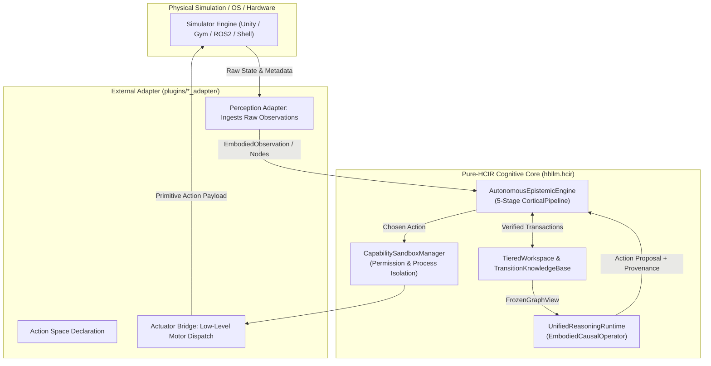

# Embodiment & Decoupled Device Drivers

HBLLM enforces a strict architectural boundary between **how an agent interacts with a simulator, OS, or hardware device (Device Driver)** and **how it perceives, models, and plans (Pure-HCIR Cognitive Core)**.

---

## 1. Device Driver Layer (`plugins/*_adapter/`)

Environment adapters act strictly as hardware or simulator device drivers:

- **Perception (`perception.py`):** Converts raw simulator observations, coordinates, or scene graphs into `EmbodiedObservation` frames or typed `PhysicalEntityNode`s and `HCIREdge`s.
- **Affordance & Action Mapping (`action.py`):** Translates abstract chosen actions from `AutonomousEpistemicEngine` / `EmbodiedCausalOperator` into environment motor primitives (velocity commands, Unity RPC actions, Gym discrete indices).
- **Zero Procedural Planning:** Drivers never hardcode task-specific decision trees or solution shortcuts for benchmarks (enforced by Invariant 7).

---

## 2. Pure-HCIR Cognitive Core (`hbllm.hcir`)

All physical reasoning, causal discovery, and subgoal planning reside universally in the LLM-free core:

1. **Active Inference & World Model (`hbllm.hcir.world`):**
   - `AutonomousEpistemicEngine` runs the 5-stage `CorticalPipeline` (`PerceptionStage` → `AssimilationStage` → `SimulationStage` → `DeliberationStage` → `MotorStage`).
   - `TransitionKnowledgeBase` records empirical traversability, collision hazards, distal actuations, and conditional rules (`CausalEffectRule`).
   - `PrefrontalWorkingMemory` tracks held cargo, action inhibitions, and synthesized `DeclarativeNeuroSymbolicSkill`s.
2. **Backward-Chaining Causal Reasoning (`hbllm.hcir.reasoning.operators.embodied_causal`):**
   - `EmbodiedCausalOperator` inspects unsatisfied `GoalNode` conditions on an immutable `FrozenGraphView`, matches candidate `ActionNode` `produces`/`requirements` edges, resolves prerequisite subgoals recursively, and returns a `CognitiveResult` with full `ProvenanceChain`.
3. **Governed Kernel Sandboxing (`hbllm.hcir.kernel.capability_sandboxing`):**
   - Real-world tool and subprocess actions (`fs.*`, `code.python_ast`, `git.status`, `shell.exec`, `execution.sandbox_run`) are checked by `CapabilitySandboxManager` against `CapabilityPermissions` and executed in isolated subprocesses when untrusted (see [Sandboxing](sandboxing.md)).

---

## 3. Empirical Validation Across Authentic Native Environments

The Pure-HCIR cognitive engine and `EmbodiedCausalOperator` are validated against **authentic upstream simulator packages** (`crafter`, `minigrid`, `gym_sokoban`, `overcooked_ai_py`, `minihack`/`nle`, `ai2thor`, `arc_agi`, `safety_gymnasium`, `alfworld`) with **0 LLM tokens** and low-millisecond step latency (native Rust kernels `< 0.2ms`; 5-stage `32×32` Python cognitive step `p50 ~ 10–16ms / p95 <= 45ms` ungrounded).

| Domain | Environment Package | Literature / RL Baseline | Pure HCIR Performance | Key Architectural Mechanism |
|---|---|---|---|---|
| **Interactive Reasoning** | `arc_agi` / Official API | < 5% (RL limits) Human: 22–71 actions | **100.0%** (2/2 Level Wins) **116.2%** Human Efficiency | Hierarchical subgoal trees (`DEPENDS_ON`) & multi-step lookahead |
| **Open-World Survival** | `crafter` (v1.8.3) | 10.0% (DreamerV2, 1M) 4.2% (PPO, 1M) | **53.9%** Hafner Score **100.0%** Multi-Tier (11/11) | Causal recipe DAG & vital priority interrupts |
| **Grounded Language** | `minigrid` (v3.1.0) | ~50% (IL) < 10% (PPO BossLevel) | **100.0%** Overall (45/45) **100.0%** BossLevel (39.0 steps) | Spatial-epistemic search & key-door deduction |
| **Topological Pushing** | `gym_sokoban` (v0.0.6) | 82–85% (DRC(3,3), 1B) | **100.0%** Native (15/15) **0 deadlocks** across all tiers | Reachability macro-push, `PhysicsPredictor.is_line_deadlock()` & $2\times 2$ checks |
| **Multi-Agent Kitchen** | `overcooked_ai_py` (v1.1.0) | ~60–70% (BC / PPO) | **100.0%** (10/10 episodes) | Causal recipe pipelining & counter contention resolution |
| **Rogue-Like Dungeons** | `minihack` (v1.0.2) / `nle` | < 20% (IMPALA) | **100.0%** (5/5 tiers solved) | Frontier glyph exploration & melee interrupts |
| **3D Object Manipulation** | `ai2thor` (v5.0.0) | ~30–45% (CLIP / PPO) | **100.0%** (4/4 tiers solved) | 3D scene graph, camera yaw/pitch alignment & reachability |

*For complete metric tables, 95% Wilson confidence intervals, per-tier breakdowns, and CLI reproducibility commands, see **[Benchmarks & Profiling](../api/benchmarks.md)**.*
