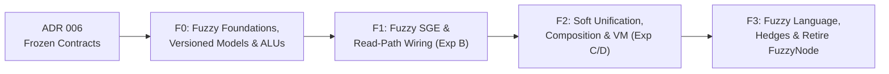

# Fuzzy Symbolic Cognition Migration Plan (`F0`–`F3`)

> **Status:** Implemented & Verified (`F0`–`F3` complete on `feat/fuzzy-symbolic-cognition`; 2×2 report archived at `reports/ablation/2026-11-26_adr006_fuzzy_2x2_ablation.md`)  
> **Authority:** [ADR 006: Fuzzy Symbolic Cognition & Adaptive Semantics](../adr/0006-fuzzy-symbolic-cognition-and-adaptive-semantics.md)  
> **Foundation Baseline:** [ADR 005: Homoiconic Symbolic VM](../adr/0005-homoiconic-symbolic-vm-and-experience-first-cognition.md) (`M0`–`M6`)  
> **Triggering Finding:** Audit `H-3` in `reports/audit/2026-11-24_full_project_audit.md` (`grounding_bridge` `Δ = 0.0000`)

---

## 1. Migration Strategy, Non-Confounding Discipline & Rollback Gates

Every phase (`F0`–`F3`) executes under a **Strangler-Fig + Experimental-Isolation** discipline:

1. **Zero Regression & Controlled 2×2 Switches:**
   - Existing crisp behavior remains the default (`Experiment A`) until each phase passes its ablation and latency gates.
   - `CognitiveSystemConfig` (`hbllm/runtime/bootstrap.py`) exposes independent boolean flags `enable_fuzzy_grounding` and `enable_fuzzy_reasoning` so all four experimental configurations (`A`, `B`, `C`, `D`) execute reproducibly from the single composition root.
2. **Non-Confounding Policy Freeze (Experiment B):**
   - During `F1` (**Experiment B**: Fuzzy Grounding + Crisp Reasoning), all downstream crisp decision thresholds ($\alpha$-cuts) and reasoning operators remain **frozen** to isolate whether fuzzy grounding alone improves downstream cognition.
3. **Architecture & Debt Ratchets:**
   - Every PR must pass `pytest tests/unit/hcir/ tests/unit/architecture/ -q` with zero new LLM imports in `hbllm/hcir/**`, zero raw graph mutations outside the kernel, zero `Confidence` conflation on `FuzzyAssertion`, and zero hardcoded domain constants outside `docs/architecture/priors.md`.
4. **Three-Tier Latency Profiling & Rollback Rule:**
   - Measure separately: (a) raw Layer-0 ALU scalar/batch latency (experimental target `< 0.05ms` per op), (b) Python/VM `EXECUTE` dispatch overhead, and (c) full `32×32` cognitive step latency via `python -m hbllm bench profile` (`CPU p95 <= 45ms` system gate).
   - Any phase PR that breaks replay bit-exactness, breaches `CPU p95 <= 45ms`, or leaks domain thresholds into Layer 0 is reverted or gated off before proceeding.

---

## 2. Phase-by-Phase Execution Plan

### Phase `F0` — Completed — Fuzzy Foundations, Versioned Models & Deterministic ALUs

**Goal:** Freeze the mathematical primitives, HCIR contracts, bipolar evidence aggregation, versioned adaptive membership schemas, and Layer-0 `math.fuzzy.*` ALUs with zero changes to live SGE or VM behavior.

- **Exact Files Touched:**
  - **New:** `hbllm/hcir/fuzzy.py`
  - `hbllm/hcir/types.py`, `hbllm/hcir/nodes.py`
  - `hbllm/hcir/capabilities/math_capabilities.py`
  - `rust/compute_kernel/src/lib.rs` (optional PyO3 batch parity path)
  - **New:** `tests/unit/hcir/test_fuzzy_foundations.py`
- **Concrete Changes:**
  1. Implement `FuzzyLogicProfile` (`godel`, `product`, `lukasiewicz`) with coherent `(t_norm, t_conorm, negation, residuum, bi_residuum)` and monotonic hedge transforms (`very`, `extremely`, `somewhat`, `intensify`).
  2. Implement `MembershipDegree` (`[0.0, 1.0]`), `FuzzyAssertion` (explicitly omitting any `confidence` scalar; supporting optional `degree_interval` and mandatory `(model_id, model_version, profile_id, context_ref, evidence_refs)`), and `BipolarEvidenceState` (correlation-clustered Gödel idempotence + cross-cluster ignorance $\iota$ and conflict $\chi$).
  3. Implement `AdaptiveMembershipModel` + `AdaptiveMembershipNode` persistence schema with immutable `version` increments (`parent_version`, `parent_hash`) and dimensionless scale normalizers (`entity_extent`, `navigable_diameter`, `closing_ttc`, `feature_zscore`).
  4. Implement `FuzzyExpr` serializable AST and `RelationCompositionRule` / `RelationCompositionPolicy` declarative contract.
  5. Expose stateless Layer-0 syscalls in `MathCapabilityExecutor`: `math.fuzzy.membership`, `math.fuzzy.eval`, `math.fuzzy.compose`, `math.fuzzy.hedge`, `math.fuzzy.bipolar`.
- **Exit Gate:**
  - Hypothesis property tests verify lattice laws (commutativity, associativity, monotonicity, boundary conditions, residuation adjunction), correlation idempotence across repeated identical observations, and non-retroactive `AdaptiveMembershipModel` replay across `CognitiveGraph.fork()`.
  - Microbenchmark report separates raw ALU kernel time from `Opcode.EXECUTE` dispatch overhead.

---

### Phase `F1` — Completed — Fuzzy Grounded Cognition (SGE Concepts, Adaptive Relations & Read-Path Wiring)

**Goal:** Replace winner-take-all concept assignment and scale-blind relation boxes in SGE with overlapping graded memberships and versioned adaptive models, and wire `CognitiveGraph` read paths so existing crisp reasoning consumes SGE outputs (`Experiment B`).

- **Exact Files Touched:**
  - `hbllm/hcir/grounding/concepts/model.py`, `hbllm/hcir/grounding/concepts/concept_learner.py`, `hbllm/hcir/grounding/concepts/store.py`
  - `hbllm/hcir/grounding/relations/relation_learner.py`
  - `hbllm/hcir/grounding/committer/committer.py`
  - `hbllm/hcir/world/grounding/bridge.py`
  - `hbllm/runtime/bootstrap.py`
  - **New:** `tests/unit/hcir/test_fuzzy_grounding.py`
- **Concrete Changes:**
  1. Extend `ConceptLearner` (`concept_learner.py`) to return `MultiConceptMembership` (all candidate `GroundedConcept` degrees $\mu_C(x) \in [0, 1]$ derived from online Welford `(mean, variance)` via `mahalanobis_rbf`), eliminating forced single-cluster fracture on boundary exemplars while maintaining crisp exemplar tracking.
  2. Upgrade `RelationLearner` (`relation_learner.py`) to compute continuous memberships (`NEAR`, `ON`, `IN`, `TOUCHING`, `FOLLOWS`) over dimensionless scales (`entity_extent`, `navigable_diameter`, `closing_ttc`) using versioned `AdaptiveMembershipModel`s adapted through experience.
  3. Upgrade `HCIRCommitter` (`committer.py`) so committed `PhysicalEntityNode`s and `HCIREdge`s preserve **both** `FuzzyAssertion` payloads (`degree`, `model_id`, `model_version`, `profile_id`) and separate `EpistemicBelief` posteriors (`posterior_belief`, `BipolarEvidenceState`) without collapsing them into a single ambiguous `weight`.
  4. Wire `CorticalGroundingBridge` (`bridge.py`) and `bootstrap.py` (`enable_fuzzy_grounding`) so downstream cortical stages read graded concept/affordance/relation memberships through a **frozen $\alpha$-cut policy** (preserving Experiment `B` isolation) with unmoved-entity caching to protect the `45ms` budget.
- **Exit Gate (`Experiment B vs. A`):**
  - Downstream crisp reasoning & $\alpha$-cut thresholds held strictly constant.
  - Measurable `Δ > 0` for **B** over **A** on scale-shifted, viewpoint/appearance-shifted, and open-world prototype stability benchmarks, plus non-negative/positive `Δ` on `widened_dev`.
  - `32×32` `CPU p95 <= 45ms` verified via `python -m hbllm bench profile`.

---

### Phase `F2` — Completed — Fuzzy Symbolic Reasoning, Declarative Relation Composition & Soft VM Unification

**Goal:** Enable the Homoiconic VM and reasoning operators to evaluate graded `SymbolicExpr` ASTs, rank structural matches by `semantic_degree` without weakening structural/identity invariants, compose relations safely under `RelationCompositionPolicy`, and revise beliefs via correlation-normalized bipolar conflict (`Experiments C & D`).

- **Exact Files Touched:**
  - `hbllm/hcir/unification.py`, `hbllm/hcir/interpreter.py`
  - `hbllm/hcir/skills/declarative.py`
  - `hbllm/hcir/reasoning/operators/spatial.py`, `hbllm/hcir/reasoning/operators/deduction.py`
  - `hbllm/hcir/capabilities/belief_revision.py`
  - `hbllm/hcir/seed/core_priors.hcir.yaml`
  - `rust/structure_matcher/src/matcher.rs`
  - **New:** `tests/unit/hcir/test_fuzzy_unification_and_reasoning.py`
- **Concrete Changes:**
  1. Upgrade `unify_pattern` (`unification.py`) and Rust `matcher.rs` with dual-mode matching returning `structure_valid: bool`, `binding_valid: bool`, `semantic_degree: float`, and `profile_id`. Crisp `structure_valid` and `binding_valid` remain hard requirements; `semantic_degree` ranks candidate bindings and skill `CALL` targets (`interpreter.py`) separately from `reliability_mean`.
  2. Add `if_degree_gte` and `if_degree_lt` branch conditions (`ALPHA_CUT`) to `HCIRInterpreter` `Opcode.BRANCH` (`interpreter.py`).
  3. Add `SymbolicExpr.evaluate_degree(ctx, profile_id="product") -> float` (`skills/declarative.py`), keeping `evaluate(ctx) -> bool` as its backward-compatible $\alpha$-cut.
  4. Replace generic transitive closures in `SpatialOperator` (`spatial.py`) with declarative `RelationCompositionPolicy` rules (seeded in `core_priors.hcir.yaml`), enforcing directionality, geometric guards, and `max_scale_ratio` checks (`NEAR ∘ NEAR -> None`; `NEAR ∘ INSIDE` guarded).
  5. Upgrade `DeductionOperator` (`deduction.py`) to support residuated fuzzy modus ponens under the active `FuzzyLogicProfile`, and upgrade `BeliefConflictResolver` (`belief_revision.py`) to compute correlation-normalized `BipolarEvidenceState` ($\iota, \chi$).
- **Exit Gate (`Experiments C & D vs. A & B`):**
  - Full 2×2 matrix (`A`, `B`, `C`, `D`) benchmarked and archived under `reports/ablation/`.
  - `ReplayDebugger` bit-exact replay verified across `AdaptiveMembershipModel` version transitions.
  - Zero regressions on `tests/unit/hcir/test_hcir_interpreter.py` and `tests/unit/architecture/test_homoiconic_invariants.py`.

---

### Phase `F3` — Completed — Fuzzy Language Grounding, Multilingual Hedges & Legacy `FuzzyNode` Retirement

**Goal:** Treat natural-language gradable adjectives, spatial references, and hedges (`en`/`si`/`ta`) as consumers of the unified Fuzzy SGE + Fuzzy VM substrate, and retire legacy LLM/SFT `FuzzyNode`.

- **Exact Files Touched:**
  - `hbllm/hcir/language/core/grounding.py`, `hbllm/hcir/language/core/gateway.py`, `hbllm/hcir/language/core/epistemic_policy.py`, `hbllm/hcir/language/core/universal_engine.py`, `hbllm/hcir/language/english/realizer.py`
  - `hbllm/hcir/compiler.py`
  - `hbllm/hcir/seed/constructions_en.yaml`, `hbllm/hcir/seed/constructions_si.yaml`, `hbllm/hcir/seed/constructions_ta.yaml`
  - Removed `hbllm/actions/fuzzy_node.py` & `scikit-fuzzy` dependency (`hbllm/actions/__init__.py`, `hbllm/serving/chat.py`, `hbllm/serving/pipeline.py`, `pyproject.toml`)
  - `tests/unit/architecture/test_homoiconic_invariants.py`, `tests/unit/actions/test_action_nodes_coverage.py`
  - **New:** `tests/unit/hcir/test_fuzzy_language_grounding.py`
- **Concrete Changes:**
  1. Update `GroundingResolver` (`grounding.py`) to rank candidate referents via `FuzzyLogicProfile` t-norms over SGE concept/relation memberships (e.g., `"the large block near the door"`), emitting `AMBIGUOUS_REFERENCE` only when the top two candidates fall within a tie margin $\Delta \mu < \epsilon$.
  2. Express gradable hedges across `en`/`si`/`ta` declaratively in `constructions_*.yaml` (`ConstructionNode` templates invoking `math.fuzzy.hedge` / `math.fuzzy.eval`) with zero hardcoded Python keyword tables (`compiler.py`).
  3. Extend `HCIRGateway` (`gateway.py`) and `EpistemicRealizationPolicy` (`epistemic_policy.py`) for two-dimensional verbalization distinguishing low epistemic support (*"I am not certain whether..."*) from high-evidence intermediate degree (*"The cup is somewhat near the edge"*).
  4. Remove all runtime imports/wiring of legacy `FuzzyNode` (`scikit-fuzzy` + LLM JSON prompt wrapper) and add an invariant check in `test_homoiconic_invariants.py` barring legacy `FuzzyNode` / `skfuzzy` reintroduction into serving or core.
- **Exit Gate:**
  - Multilingual gradable grounding tests pass across `en`, `si`, and `ta`.
  - Zero `FuzzyNode` or `skfuzzy` runtime references in `hbllm/serving/`, `hbllm/brain/`, or `hbllm/hcir/`.
  - Full `pytest tests/unit/architecture/ tests/unit/hcir/ -q` and `python -m hbllm bench profile` pass.

---

## 3. 2×2 Experimental Benchmark Protocol

All four configurations run through `build_cognitive_system()` with identical `TransitionKnowledgeBase` Bayesian/Dirichlet parameters:

| Config | `enable_fuzzy_grounding` | `enable_fuzzy_reasoning` | Key Evaluation Suites | Primary Metrics & Pass Criterion |
| :---: | :---: | :---: | :--- | :--- |
| **A** | `False` | `False` | `dev.yaml`, `widened_dev.yaml`, scale/shift synthetic suite | Baseline solve rate, generality, deaths, CPU p50/p95 |
| **B** | `True` | `False` | Same + frozen $\alpha$-cuts downstream | **Gate:** `Δ > 0` on scale/viewpoint/appearance-shift; `p95 <= 45ms` |
| **C** | `False` | `True` | Same + noisy symbolic matching & multi-hop spatial tasks | **Gate:** Isolates soft `UNIFY` & `RelationCompositionPolicy` gains |
| **D** | `True` | `True` | Full suite + open-world concept stability & affordance planning | **Gate:** `D >= max(A, B, C)` on generality; `p95 <= 45ms`; `0` LLM tokens |

### Mandatory Per-Run Telemetry
- **Solve & Safety:** zero-shot solve rate, cross-seed transfer rate, generality score, exploration death count.
- **Concept & Relation Stability:** cluster split/merge churn rate under viewpoint/scale shifts, cross-scale relation F1.
- **Separated Latency:** raw `math.fuzzy.*` ALU median/p95 ($\mu\text{s}$), VM syscall dispatch overhead ($\mu\text{s}$), and end-to-end `32×32` step CPU p50/p95 ($\text{ms}$).

---

## 4. Verified Completion Summary (`F0`–`F3`, 2026-11-27)

- **Commits (`feat/fuzzy-symbolic-cognition`):** `05b719a9` (`F0` + `F1`), `27a931af` (`F2` + `F1` committer/cache fix + 2×2 report), `dd5849c1` (`F3` + `FuzzyNode`/`scikit-fuzzy` retirement).
- **2×2 Matrix Results (`reports/ablation/2026-11-26_adr006_fuzzy_2x2_ablation.md`, `0` LLM tokens, `0` errors):**
  - **A (Crisp / Crisp):** dev ZS `19/20 (0.9500)`, dev CS `16/16 (1.0000)`, scale/appearance shift `0/20`, soft unification/composition `0/20`, `32×32` CPU `24.73 / 34.36 ms`.
  - **B (Fuzzy / Crisp, `α=0.65`):** dev ZS `19/20 (0.9500)`, dev CS `16/16 (1.0000)`, scale/appearance shift **`20/20 (1.0000)`**, soft unification/composition `0/20`, `32×32` CPU `30.78 / 41.92 ms`.
  - **C (Crisp / Fuzzy):** dev ZS `19/20 (0.9500)`, dev CS `16/16 (1.0000)`, scale/appearance shift `0/20`, soft unification/composition **`20/20 (1.0000)`**, `32×32` CPU `25.55 / 32.53 ms`.
  - **D (Fuzzy / Fuzzy):** dev ZS `19/20 (0.9500)`, dev CS `16/16 (1.0000)`, scale/appearance shift **`20/20 (1.0000)`**, soft unification/composition **`20/20 (1.0000)`**, `0` false-positive compositions, `32×32` CPU `30.01 / 43.72 ms`.

