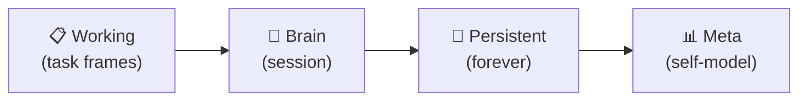
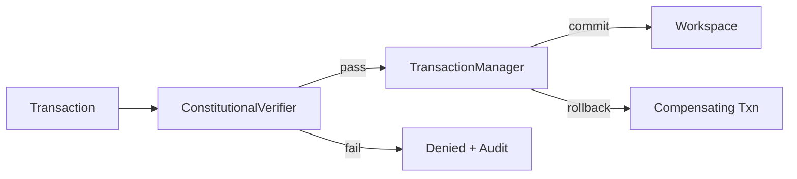
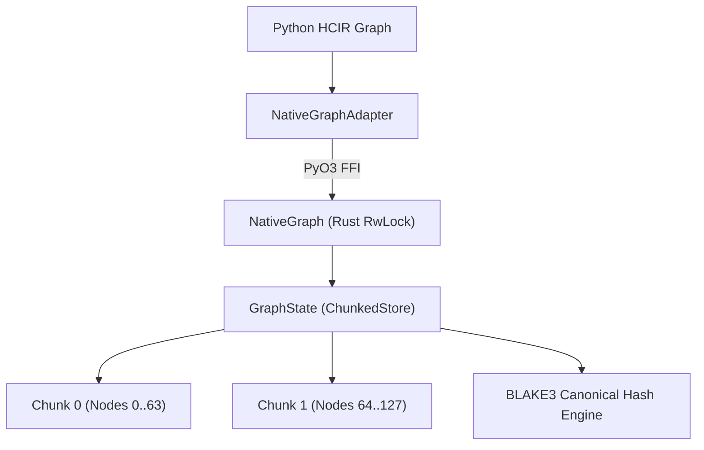

# HCIR Cognitive OS Kernel & Executive Runtime

> **Human-Cognitive Intermediate Representation (HCIR) & Kernel Architecture**
>
> The HCIR is the **canonical execution substrate** for HBLLM Core. All cognitive state — memory, goals, beliefs, capabilities, governance — lives in the HCIR workspace as typed graph nodes managed through event sourcing and transactional commits.
>
> **Architectural Invariant:** Nodes emit intent. HCIR owns state.

---

## Architecture

```
  ┌───────────────────────────────────────────────────────────────────┐
  │                      ExecutiveRuntime                             │
  │        (Lifecycle Owner, Cycle Scheduler & Execution Mode)        │
  └────────────────────────────────┬──────────────────────────────────┘
                                   │
  ┌────────────────────────────────▼──────────────────────────────────┐
  │                       KernelServices                              │
  │       (Dependency Container for Cognitive OS ABI Execution)       │
  ├──────────────┬──────────────┬──────────────┬─────────────────────┤
  │ Workspace    │ TxManager    │ Resolver     │ Scheduler           │
  │ State        │ (Transactions│ (Capability  │ (Instruction        │
  │ (HCIR Graph) │ & Rollbacks) │ Sandboxing)  │ Scheduler)          │
  ├──────────────┼──────────────┼──────────────┼─────────────────────┤
  │ Executor     │ Persistence  │ Telemetry    │ EventBus            │
  │ (CPU / I/O   │ (Managed DB  │ (Sliding     │ (Kernel Pub/        │
  │ Pools)       │ Pools)       │ Latencies)   │ Sub Trie)           │
  └──────────────┴──────────────┴──────────────┴─────────────────────┘
                                   │
  ┌────────────────────────────────▼──────────────────────────────────┐
  │                    HCIR Cognitive OS                               │
  ├──────────────┬──────────────┬──────────────┬─────────────────────┤
  │ Tiered       │ Cognitive    │ Constitutional│ Memory              │
  │ Workspace    │ Journal +    │ Governance    │ Backend +           │
  │ (4 tiers)    │ Event Log    │ + Transaction │ Migration Proxy     │
  ├──────────────┼──────────────┼──────────────┼─────────────────────┤
  │ Declarative  │ Bus Bridge   │ Federation   │ Semantic            │
  │ Capabilities │ (HCIR↔Bus)   │ Sync Proto   │ Normalizer          │
  └──────────────┴──────────────┴──────────────┴─────────────────────┘
```

---

## Key Subsystems

### 1. Tiered Workspace & ISA v2 Homoiconic VM

The workspace organizes cognitive state into four tenant-isolated tiers with different lifetimes, executing learned symbolic programs on the **12-opcode ISA v2 Register-Unification VM** (`hbllm.hcir.bytecode`, `hbllm.hcir.interpreter`, `hbllm.hcir.registers`, `hbllm.hcir.unification`):

- **Working-Memory Registers & Call Stack:** Bounded register file (`$r0`..`$r7`) and `CallStack` (`max_depth=16`, cycle detection, instruction fuel limits).
- **12 Canonical Opcodes:** 8 v1 transactional primitives (`ASSERT`, `RETRACT`, `QUERY`, `EXECUTE`, `WAIT`, `FORK`, `MERGE`, `ROLLBACK` with dynamic `$rN`/`?var` resolution and tenant-scoped `sys_assert`/`sys_retract`) plus 4 symbolic composition opcodes (`UNIFY`, `BRANCH`, `CALL`, `RETURN`).
- **Dual-Mode Crisp & Fuzzy VM Execution (`hbllm.hcir.fuzzy`, `enable_fuzzy_reasoning`):** Executing `FuzzyLogicProfile` algebras (`godel`, `product`, `lukasiewicz`) via stateless `math.fuzzy.*` Layer-0 ALUs, `unify_pattern_graded` (`MatchResult` combining crisp `structure_valid` / `binding_valid` with graded `semantic_degree`), `BRANCH` `if_degree_gte` / `if_degree_lt` (`ALPHA_CUT`), `CALL` skill ranking by `semantic_degree` (strictly separate from epistemic `reliability_mean`), `SymbolicExpr.evaluate_degree`, and version-pinned `AdaptiveMembershipModel` replay (`ReplayDebugger`).
- **Strict Hardware `EXECUTE` Boundary:** `SyscallAllowlist(strict=True)` and `HCIRInterpreter(..., strict=True)` permit only irreducible hardware/math/sandbox capabilities (`motor.*`, `sensor.*`, `math.*`, `world.predict`, `tool.sandboxed.*`, `web.sandboxed.*`, `memory.*`), blocking legacy high-level cognitive escape names.
- **Protected System Priors:** `TieredWorkspace` (`apply_exponential_decay`, `prune_interfering_memories`) and `HCIRWorkspaceState.consolidate_node_budget()` explicitly preserve `SecurityLevel.SYSTEM` / `"core_prior"` seed nodes (`prior_skill_count_entities`) and enforce tenant-scoped compaction summaries.



| Tier | Lifetime | Contents |
|------|----------|----------|
| **Working** | Task | TaskFrames, scratchpad nodes |
| **Brain** | Session | Promoted reasoning results |
| **Persistent** | Forever | All memory types, knowledge graph |
| **Meta** | Forever | Performance stats, capability metrics |

**Code:** `hbllm.hcir.workspace_tiers.TieredWorkspace`

### 2. Event Sourcing (CognitiveJournal + EventLog)

Every state mutation is captured as an immutable event:


- **CognitiveJournal**: Append-only journal of workspace mutations
- **CognitiveEventLog**: Structured event stream with causality tracking
- **Semantic Events**: Normalized via `SemanticNormalizer` before journaling

**Code:** `hbllm.hcir.cognitive_journal.CognitiveJournal`, `hbllm.hcir.cognitive_event_log.CognitiveEventLog`, `hbllm.hcir.stores.sqlite_event_store.SQLiteEventStore`

### 3. Constitutional Governance

All workspace modifications pass through constitutional verification:



- **ConstitutionalVerifier**: Validates transactions against governance rules and `CommitAuthorityRegistry` grants
- **TransactionManager**: Atomic commits with compensating rollbacks and verification stages (`ScopeVerifier`, `SchemaVerifier`, `ResourceVerifier`, `PolicyVerifier`, `BranchModeVerifier`)
- **Governance Constraints**: Budget limits, capability checks, tenant isolation

**Code:** `hbllm.hcir.kernel.governance.constitutional_verifier.ConstitutionalVerifier`, `hbllm.hcir.kernel.transaction_manager.TransactionManager`, `hbllm.hcir.kernel.commit_authority.CommitAuthorityRegistry`

### 4. Declarative Capabilities & Command Dispatch

Capabilities declare permissions and resource budgets via a typed system (`CapabilityManifest`, `CapabilityPermissions`, `SandboxedCapabilityPolicy`):

| Component | Role |
|---|---|
| `CognitiveBudget` | Resource limits (compute, memory, time) |
| `NodeAdapter` | Adapts nodes to the HCIR ABI |
| `CapabilityResolver` | Resolves and sandboxes capability requests (`CapabilitySandboxManager`) |
| `CommandDispatcher` | Routes parsed `COMMAND` `SemanticFrame`s to governed capabilities |
| `AutonomyTracker` | Tracks native HCIR parse/plan/realize autonomy rates |

**Code:** `hbllm.hcir.capabilities`, `hbllm.hcir.kernel.command_dispatcher`, `hbllm.hcir.kernel.autonomy_tracker`

### 5. HCIR Memory Backend & Bounded Event Storage

The `HCIRMemoryBackend` stores episodic, semantic, procedural, value, and belief memories as typed graph nodes inside `TieredWorkspace`, backed by `SQLiteEventStore` with bounded event-store compaction (`max_events`, hysteresis, and per-tier/world node budgets via `enforce_node_budgets()`):

| Memory Type | Node Type | Store Method | Recall Method |
|---|---|---|---|
| Episodic | `EpisodeNode` | `store_episode()` | `recall_episodes()` |
| Semantic | `ConceptNode` | `store_concept()` | `recall_concepts()` |
| Procedural | `SkillNode` | `store_skill()` | `recall_skills()` |
| Value | `ValueNode` | `store_value()` | `recall_values()` |
| Knowledge Graph | `BeliefNode` | `store_belief()` | `recall_beliefs()` |

**Cross-memory search**: `search_across_memory_types()` queries all types with a single call.

**Code:** `hbllm.hcir.adapters.hcir_memory_backend.HCIRMemoryBackend`

### 6. Memory Migration Proxy

The `MemoryMigrationProxy` managed the 5-phase transition from legacy SQLite stores to HCIR:

| Phase | Mode | Behavior |
|---|---|---|
| 1 | READ_THROUGH | Legacy authoritative, HCIR warmed |
| 2 | DUAL_WRITE | Both written, legacy reads |
| 3 | SHADOW_READ | Both read, divergence tracked |
| 4 | HCIR_PRIMARY | HCIR authoritative, legacy rollback |
| **5** | **LEGACY_REMOVED** | **HCIR only (current default)** |

**Code:** `hbllm.hcir.adapters.memory_migration_proxy.MemoryMigrationProxy`

### 7. Bus Bridge (`HCIRBusBridge`)

Bridges the HCIR workspace with the `MessageBus`, converting bus events into workspace mutations:

- **Inbound**: Bus messages → `SemanticNormalizer` → workspace nodes
- **Outbound**: Workspace mutations → bus notifications

**Code:** `hbllm.hcir.adapters.hcir_bus_bridge.HCIRBusBridge`

### 8. Consensus & Delta Transport

Coordinates multi-branch and distributed workspace state synchronization:

- **`CognitiveConsensusEngine`** (`hbllm.hcir.kernel.consensus_engine`): Arbitrates competing `CandidateBelief` proposals cleanly into verified transactions.
- **`DeltaTransportProtocol`** (`hbllm.hcir.delta_transport`): Compact delta exchange and synchronization across workspace peers.

---

## `KernelServices` Dependency Container

Every cognitive node receives `KernelServices` via the ABI `execute()` contract:

| Service | Description |
|---------|-------------|
| `workspace` | Active `HCIRWorkspaceState` (graph nodes, edges, goals) |
| `transaction_manager` | Atomic state modifications with rollbacks |
| `capability_resolver` | Permission enforcement (filesystem, network, subprocess, db) |
| `scheduler` | Attention-driven instruction dispatcher (`CognitiveScheduler`) |
| `executor` | Priority thread pools for CPU- and I/O-bound tasks |
| `persistence` | Managed database connection pools |
| `telemetry` | Micro-second latency and throughput metrics |

---

## `KernelExecutor` Thread Pools

Offloads heavy synchronous operations off the main `asyncio` event loop:
- **`run_cpu_bound()`**: Embedding calculations, matrix operations, tokenization
- **`run_io_bound()`**: File I/O, workspace serialization, disk reads

---

## `PersistenceService` & Workload-Specific SQLite Profiles

Managed persistence layer providing workload-tuned SQLite connection PRAGMAs:

| Profile | mmap | Cache | Mode |
|---------|------|-------|------|
| `semantic_memory` | 512MB | 64MB | WAL |
| `knowledge_graph` | 1GB | 64MB | WAL |
| `event_log` | 32MB | 4MB | WAL |
| `scheduler` | — | 2MB | NORMAL |

---

## Cross-Modal Hyperedges & Perception Transactions

HCIR serves as the unified representational graph for perceptual observations across modalities (vision, audio, touch, etc.).

### 1. Invariant: Evidence vs. Belief
Perception providers produce structured evidence; HCIR transactions commit typed observation nodes (`VisualObservationNode`, `AudioObservationNode`). The system avoids premature factual collapse by preserving competing hypotheses and measurable correlations.


### 2. Edge Semantics

| Edge Type | Nature | Description |
| :--- | :--- | :--- |
| `CORRELATES_WITH` | Temporal / Spatial | Measurable association only. Does **not** assert causality or semantic identity. |
| `OBSERVED_AS` | Classifier Relationship | Connects observation to competing classification hypotheses with individual confidences. |
| `FALSIFIES` / `PREDICTS` | Epistemic | Scientific reasoning relationships managed by the Epistemic Subsystem. |
| `STRENGTHENS` / `WEAKENS` | Epistemic | Confidence revision edges linking observations to working beliefs. |

### 3. Transactional Commitment (`CorrelationTransaction`)
The `CorrelationTransaction` atomically commits `CORRELATES_WITH` hyperedges with geometric properties (`confidence`, `temporal_overlap`, `spatial_overlap`, `delta_time_ms`, `created_by`), leaving observations as independent graph nodes for higher-order reasoning.

---

## Native Persistent Graph Substrate (`NativeGraphAdapter`)

To scale HCIR graph state to millions of active cognitive nodes without GC pauses or Python memory overhead, HBLLM provides a **chunked structural-sharing native Rust substrate** (`hbllm_hcir_graph` / `rust/hcir_graph`):



### Key Architectural Properties
1. **$O(1)$ Root Snapshotting**: Instant branch clones for counterfactual simulation via chunk-granular pointer bumping.
2. **Chunk-Level Structural Sharing**: Updates to a single node or hyperedge only copy the affected 64-item chunk rather than cloning the entire graph.
3. **Canonical BLAKE3 Hashing**: Invariant-preserving canonical hash calculation across nodes and edges, providing instantaneous equality checks and deterministic state validation.
4. **Transparent Python Interop**: `NativeGraphAdapter` implements the standard Python dictionary / HCIR graph interface with transparent fallback when native extensions are not compiled.

---

## Composition Root Integration

The HCIR Cognitive OS is wired exclusively through `build_cognitive_system()` (`hbllm.runtime.bootstrap`):

```python
from hbllm.runtime.bootstrap import CognitiveSystemConfig, build_cognitive_system

system = build_cognitive_system(CognitiveSystemConfig(world_id="example", memory_dir=None))
receipt = system.runtime.kernel.execute("world.query_state", {})
print(receipt.status, system.tiered_workspace.populate_meta_stats())
```

---

## Diagnostics CLI

Inspect system runtime health, event loop engine (`uvloop`), SQLite version, and native Rust acceleration crates:

```bash
hbllm diagnostics
hbllm kernel status
```
