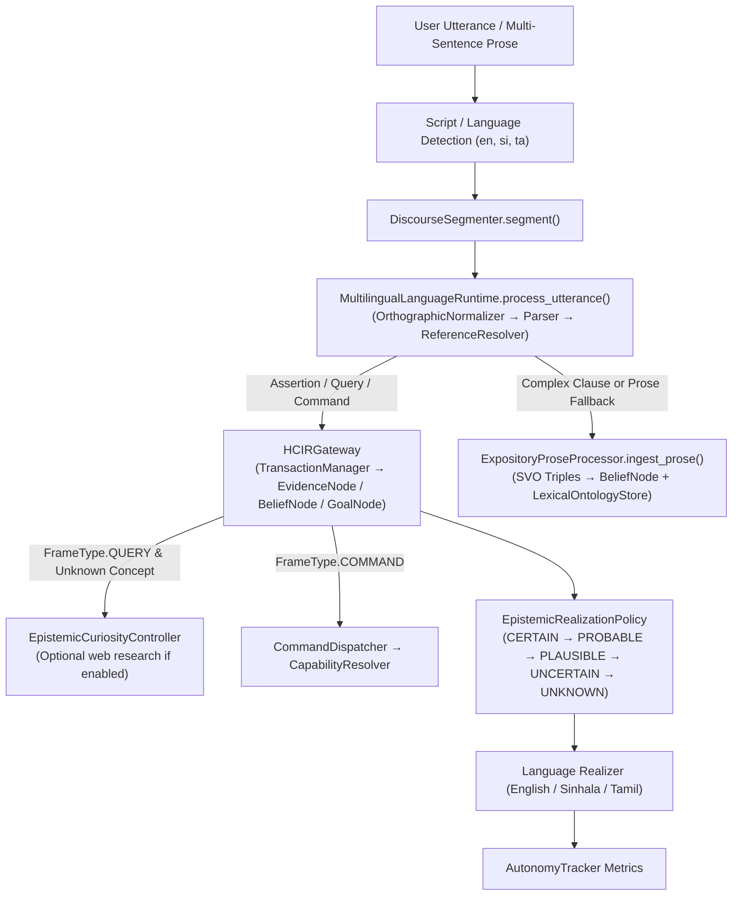

# Language & Reading Comprehension (`hbllm.hcir.language`)

> **Core Thesis:** Language parsing, reference resolution, expository knowledge ingestion, and calibrated surface realization belong inside the deterministic, LLM-free HCIR substrate (`hbllm.hcir.language`) — not inside external prompt wrappers.

`hbllm.hcir.language` implements HBLLM's **Wernicke (comprehension) + Broca (realization)** cognitive language stack across English (`en`), Sinhala (`si`), and Tamil (`ta`) with **zero external LLM calls**.

---

## 1. End-to-End Dialogue Pipeline (`CognitiveSystem.process_dialogue`)

When `CognitiveSystem.process_dialogue(text, speaker_id=..., language=...)` (`hbllm.runtime.bootstrap`) receives natural language input, it runs a deterministic multi-stage loop:

---

## 2. Core Components

### 2.1 `MultilingualLanguageRuntime` (`hbllm.hcir.language.runtime`)

The unified runtime orchestrates parsing, reference tracking, HCIR commitment, epistemic lookup, realization, and cross-lingual translation:

- **Built-in Languages:**
  - **English (`en`):** `EnglishParser` (`english/parser.py`), `EnglishSyntaxParser` (`english/syntax.py`), `EnglishMorphology` (`english/morphology.py`), `EnglishLexicon` (`english/lexicon.py`), `EnglishRealizer` (`english/realizer.py`).
  - **Sinhala (`si`):** `SinhalaParser`, `SinhalaLexicon`, `SinhalaRealizer` (`sinhala/`).
  - **Tamil (`ta`):** `TamilParser`, `TamilLexicon`, `TamilRealizer` (`tamil/`).
- **Extensible Language Profiles (`core/profile.py`, `core/universal_engine.py`):** New typologies (SVO, SOV, VSO) can be registered declaratively via `LanguageProfile` + `UniversalLanguageParser` / `UniversalLanguageRealizer`.

### 2.2 Orthographic Normalization & SymSpell Fuzzy Index (`core/normalizer.py`)

`BaseOrthographicNormalizer` repairs typos and morphological variations deterministically before parsing using:
- Bounded Damerau-Levenshtein matching (`damerau_levenshtein`) and a `_Delete1Index` SymSpell delete-1 index.
- Dynamic vocabulary synchronization (`set_dynamic_vocabulary`, `set_word_frequencies`) from `LexicalOntologyStore` and active graph concepts.
- Protected closed-class tokens and command verbs so syntactic structure is never corrupted by fuzzy correction.

### 2.3 `SemanticFrame` & Discourse Coreference (`core/semantic_frame.py`, `core/reference.py`)

Parses map surface text into typed `SemanticFrame` structures:
- **`FrameType`:** `ASSERTION`, `QUERY`, `COMMAND`, etc.
- **`ThematicRole`:** `AGENT`, `PATIENT`, `THEME`, `RECIPIENT`, `LOCATION`, `SOURCE`, `DESTINATION`, `INSTRUMENT`, `TIME`, `MANNER`, `CAUSE`, `CONDITION`, etc.
- **`ReferenceResolver` (`core/reference.py`):** Tracks `DiscourseEntity` mentions across turns (`next_turn()`) to resolve anaphora (`"it"`, `"that"`, `"the object"`) and bind `EntityReference` slots to graph entity IDs via `GroundingResolver` (`core/grounding.py`).

### 2.4 `HCIRGateway` (`core/gateway.py`)

Translates `GroundedSemanticFrame` instances into verified HCIR graph operations:
- `process_assertion()` → commits `EvidenceNode` / proposition edges via `TransactionManager`.
- `process_query()` → evaluates stored graph priors, ontology hypernyms/causes, and `TieredWorkspace` (`Brain` + `Persistent`) to emit a `CognitiveEpistemicState`.
- `process_command()` → constructs a `GoalNode` in the workspace for either physical execution (`AutonomousEpistemicEngine`) or kernel capability dispatch (`CommandDispatcher`).

### 2.5 Calibrated `EpistemicRealizationPolicy` (`core/epistemic_policy.py`)

Prevents overclaiming by mapping `CognitiveEpistemicState` (`confidence`, `uncertainty`, `support_count`, `contradiction_count`, `freshness`, `source_quality`, `is_known`) to calibrated hedge bands (`EpistemicVerbalizationLevel`):
- `CERTAIN` ($\ge 0.92$, zero contradictions)
- `PROBABLE` ($\ge 0.70$)
- `PLAUSIBLE` ($\ge 0.40$)
- `UNCERTAIN` ($< 0.40$)
- `CONFLICT` / `CONTRADICTED` (conflicting evidence exceeds/matches support)
- `INSUFFICIENT_EVIDENCE` (unknown concept or zero support)

### 2.6 Embodied Construction Grammar & 4-Step Unknown-Instruction Resolution

Bidirectional linguistic mappings (`en`, `si`, `ta`) live as homoiconic `ConstructionNode` entries hydrated from `hbllm/hcir/seed/constructions_{en,si,ta}.yaml` (`HCIRCompiler`, `hbllm.hcir.language`) rather than hardcoded Python keyword/verb lists. Transactions in `HCIRGateway` (`core/gateway.py`) and `GroundingResolver` (`core/grounding.py`) inherit `workspace.tenant_id` (`Scope(tenant_id=...)`). When an unseen instruction arrives, the VM executes the **4-Step Unknown-Instruction Resolution** pipeline:
1. **Partial Unification:** Bind known slots into `$r0..$rk` and isolate the unknown span as an `UnknownNode` `(InputTypes -> GoalConstraint)`.
2. **Memory & Reading Recall:** `QUERY` `TieredWorkspace` (`Brain` + `Persistent`) for previously ingested definitions or hypernyms (`ReadingCurriculumIngestor`).
3. **Structural Analogy:** Match existing `SkillNode` `(precondition -> postcondition)` schemas via `hbllm_structure_matcher` / `AnalogyOperator`.
4. **Active Inquiry & Consolidation:** `FORK` simulation or emit `REQUEST_EVIDENCE`, verify outcomes against `PredictionErrorNode`, and commit the grounded `ConstructionNode` + parameterized `SkillNode`.

---

## 3. Open-Ontology Reading Comprehension (Track T4)

To learn general world knowledge from textbooks, documentation, and multi-sentence prose without hardcoded domain enums:

1. **`DiscourseSegmenter` & `ExpositoryProseProcessor` (`hbllm.hcir.language.core.discourse`):**
   - Splits multi-clause text into clean segments and runs parser-driven SVO / relational triple extraction (`ingest_prose`) on complex expository assertions.
2. **`ReadingCurriculumIngestor` (`hbllm.hcir.language.reading_curriculum`):**
   - Scans corpora (`ingest_directories`) using `extract_propositions_from_text(..., parser=...)` to extract taxonomic (`is_a`), causal (`causes`), dependency (`requires`), and general SVO relational `ExtractedProposition` records with polarity and modifiers.
   - Commits batches atomically via `commit_propositions()` into `TieredWorkspace` (`ConceptNode`, `BeliefNode`, typed `HCIREdge`s) and updates `LexicalOntologyStore`.
3. **`OntologyBootstrapper` & `LexicalOntologyStore` (`ontology_bootstrap.py`, `hbllm.hcir.stores.ontology_store`):**
   - SQLite-backed lexical/taxonomic index supporting `lookup()`, `is_a()`, `get_hypernyms()`, `fuzzy_lookup()`, and corpus frequency tracking.

---

## 4. Interactive Lexicon Acquisition (`hbllm.hcir.language.acquisition`)

Grounded vocabulary can also be acquired interactively from perceptual scenes (`LexiconAcquisitionLoop` in `acquisition/lexicon_acquisition_loop.py`):
- **`CrossSituationalLearner`:** Tracks word–entity co-occurrence across ambiguous scenes.
- **`ContrastiveLearner`:** Disambiguates competing lexical hypotheses from minimal contrast pairs.
- **`OstensiveTeacher`:** Handles explicit `"this is X"` demonstrations (`teach_ostensive`) and mistake corrections (`correct_mistake`).
- **`GroundedLexicon`:** Stores stabilized word-to-concept/predicate bindings with confidence scores.

---

## 5. Optional Shadow Distillation Boundary

If `enable_brain_llm=True` and an isolated `llm_scaffold` extension is explicitly attached outside `hbllm/hcir/`, `CognitiveSystem.process_dialogue()` consults it **only** when native HCIR parsing fails (`not turn.is_success`), recording the fallback in `AutonomyTracker` (`shadow_invocations`, `distilled_lessons`). The `hbllm.hcir.language` package itself contains zero LLM imports.

