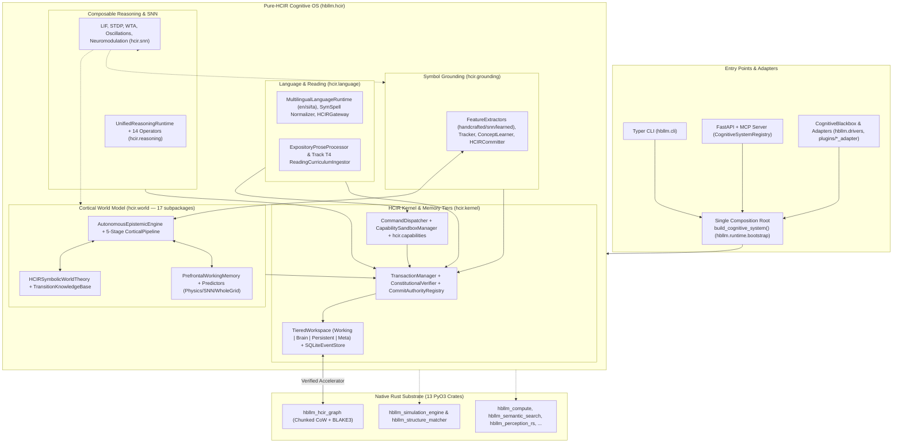

# Architecture Overview

> [!NOTE]
> For formal architectural decisions, see **[ADR 006: Fuzzy Symbolic Cognition & Adaptive Semantics (Implemented `F0`–`F3`)](../adr/0006-fuzzy-symbolic-cognition-and-adaptive-semantics.md)**, **[ADR 005: Homoiconic Symbolic VM](../adr/0005-homoiconic-symbolic-vm-and-experience-first-cognition.md)**, and **[ADR 004: Pure-HCIR Cognitive OS](../adr/0004-pure-hcir-cognitive-os.md)** alongside historical **[ADR 001](../adr/0001-hbllm-core-architecture.md)** and **[ADR 002](../adr/0002-operational-architecture-and-governance.md)**.

**HBLLM Core** is an event-sourced, neuro-symbolic **Cognitive OS** and **Homoiconic Symbolic VM** built around the **Human-Cognitive Intermediate Representation (`hbllm.hcir`)**. Rather than treating an autoregressive LLM as the runtime brain or scattering cognitive heuristics across procedural Python, HBLLM separates deterministic hardware ALUs and the constitutional kernel from experience-learned symbolic programs (`SkillNode`, `ConstructionNode`, `LearnedRuleNode`) inside `TieredWorkspace`.

---

## 1. Nine Non-Negotiable Core Invariants

1. **State Ownership Invariant:** *Nodes emit intent. HCIR owns state.* All state changes are proposed as `TransactionOperation`s and committed atomically via `TransactionManager`.
2. **Reasoning Invariant:** *Operators calculate. HCIR decides what becomes reality.* Reasoning operators and cortical stages receive immutable `FrozenGraphView` / `CognitiveContext` snapshots and return pure `CognitiveResult` / `StageResult.operations` structures.
3. **Zero LLM Dependency in Core:** `hbllm.hcir` (`world`, `grounding`, `reasoning`, `language`, `snn`, `capabilities`, `kernel`) has **zero** LLM client or network imports (enforced by `tests/unit/architecture/test_m0_substrate_hygiene.py` and `tests/unit/architecture/test_homoiconic_invariants.py`).
4. **Constitutional Governance:** Every mutation passes through `ConstitutionalVerifier` and verification pipeline stages (`ScopeVerifier`, `SchemaVerifier`, `ResourceVerifier`, `PolicyVerifier`, `BranchModeVerifier`) before commit, with `SecurityLevel.SYSTEM` / `"core_prior"` nodes protected from decay and budget eviction.
5. **Multi-Tenant Memory Isolation:** Episodic, semantic, procedural, construction, and belief memories are partitioned strictly by `Scope` / `tenant_id` across every `TieredWorkspace` tier and HTTP/driver surface.
6. **Target State Evolution:** Changes upgrade monotonically toward declarative HCIR programs, formal transactions, and dynamic causal posteriors — never monkey-patches or task-specific branches.
7. **General Intelligence Directive:** The core remains strictly domain- and task-agnostic; environment adapters live externally in `plugins/` (see [Innate Priors](priors.md)).
8. **Internal Memory Governance:** Learned world ontology lives in `HCIRSymbolicWorldTheory` (`TransitionKnowledgeBase`), transient state lives in `PrefrontalWorkingMemory`, and behaviors live as parameterized homoiconic `SkillNode` (`bytecode_stream`) and `ConstructionNode` entries in `TieredWorkspace` (no ad-hoc engine attributes).
9. **Homoiconic Symbolic-First Invariant ("Code = CPU, Graph = Mind"):** Layer-0 Python/Rust implements strictly deterministic hardware ALUs and the 12-opcode register-unification VM with strict `SyscallAllowlist(strict=True)` enforcement — never hardcoded verb/color lexical tables, high-level Python `EXECUTE` escapes, or metadata-only `SkillNode`s lacking executable `bytecode_stream`s (enforced by `tests/unit/architecture/test_homoiconic_invariants.py`).

---

## 2. Layered Pure-HCIR System Topology

---

## 3. Subsystem Map & Documentation Guide

| Subsystem | Package | Architecture Doc | API Reference |
|---|---|---|---|
| **Composition Root & CLI** | `hbllm.runtime.bootstrap`, `hbllm.cli` | [System Entry Points](entry-points.md) | [CLI Reference](../guides/cli.md) |
| **HCIR Kernel & Transactions** | `hbllm.hcir.kernel`, `hbllm.hcir` | [HCIR Kernel OS](hcir-kernel-os.md) | [HCIR API](../api/hcir.md) |
| **Cortical World Model** | `hbllm.hcir.world`, `hbllm.hcir.skills` | [Cortical World Model](cortical-world-model.md) | [World Model API](../api/world-model.md) |
| **Symbol Grounding Engine** | `hbllm.hcir.grounding` | [Symbol Grounding](grounding.md) | — |
| **Language & Reading** | `hbllm.hcir.language`, `hbllm.hcir.stores` | [Language & Reading](language-and-reading.md) | [Language API](../api/language.md) |
| **Composable Reasoning** | `hbllm.hcir.reasoning` | [Cognitive Execution Runtime](cognitive-execution-runtime.md) | [Reasoning API](../api/reasoning.md) |
| **Neuromorphic SNN** | `hbllm.hcir.snn` | [SNN Cognitive Engine](snn-cognitive-engine.md) | [SNN API](../api/snn.md) |
| **Capabilities & Curiosity** | `hbllm.hcir.capabilities` | [Capabilities & Curiosity](capabilities-and-curiosity.md) | [Capabilities API](../api/capabilities.md) |
| **Memory & Event Store** | `hbllm.hcir.workspace_tiers`, `hbllm.hcir.stores` | [Memory Systems](memory-systems.md) | [Memory API](../api/memory.md) |
| **Graph Substrate (Rust)** | `rust/hcir_graph`, `hbllm.native` | [Graph Substrate](graph_substrate.md) | [Rust Kernels](../api/rust-kernels.md) |
| **Sandboxing & Security** | `hbllm.hcir.kernel.capability_sandboxing`, `hbllm.security` | [Sandboxing](sandboxing.md) | [Security](../security.md), [Governance API](../api/governance.md) |
| **Developmental Learning** | `plugins/developmental_adapter` | [Developmental Learning](developmental-learning.md) | [Benchmarks](../api/benchmarks.md) |
| **Boundaries & Telemetry** | `hbllm.telemetry`, `hbllm.observability` | [Packaging & Boundaries](packaging-and-boundaries.md), [Telemetry](telemetry-observability.md) | [Telemetry API](../api/telemetry.md) |
| **Message Bus & Federation** | `hbllm.network` | [Message Bus](message-bus.md), [Resilience](network-resilience.md), [Distributed Trust](distributed-trust.md) | [Network API](../api/network.md) |

---

## 4. Serving, Driver & Boundary Unification

Implemented across Pure-HCIR and Phase 3 (`M0`–`M6`):
- **Single Pure-HCIR Serving & Driver Stack:** HTTP/WebSocket routes (`/v1/chat`, `/v1/chat/stream`, `/v1/chat/completions`, `/v1/chat/ws`, `/v1/memory/{session_id}`, `/v1/rules`) execute Pure-HCIR first per tenant via `CognitiveSystemRegistry` (`X-HBLLM-Engine: pure-hcir`) before optional brain/provider fallback; `CognitiveBlackbox` delegates `step()` / `adapt_to_observation()` / `reset()` over `build_cognitive_system()`.
- **Unified Pure-HCIR Substrate:** Legacy `hbllm/brain/` and `FuzzyNode` have been retired (`hbllm.hcir.*` is the sole cognitive runtime across reasoning, language, grounding, and SNN, with **0** `__path__.append` shims enforced by `test_m0_substrate_hygiene.py` and `test_layering.py`).
- **Permanent Phase 3 & Phase 4 Invariants:** `tests/unit/architecture/test_homoiconic_invariants.py` permanently enforces zero lexical/color tables in `compiler.py`/`world/`, strict `SyscallAllowlist(strict=True)` gating in `sys_execute`, executable `bytecode_stream` emission across all `SkillNode` producers, serving/driver unification, semantic orthogonality (`FuzzyAssertion` omits `confidence`, separate from `EpistemicBelief`), retirement of legacy `FuzzyNode` and `scikit-fuzzy` (`test_legacy_fuzzy_node_and_skfuzzy_retired`), and system-prior preservation during budget compaction.
- **External Adapters:** Environment integrations (`arc_agi_adapter`, `crafter_adapter`, `babyai_adapter`, `sokoban_adapter`, `overcooked_adapter`, `nethack_adapter`, `ai2thor_adapter`, `safety_gym_adapter`, `alfworld_adapter`, `developmental_adapter`) live in `plugins/` without leaking domain logic into `hbllm/`.
