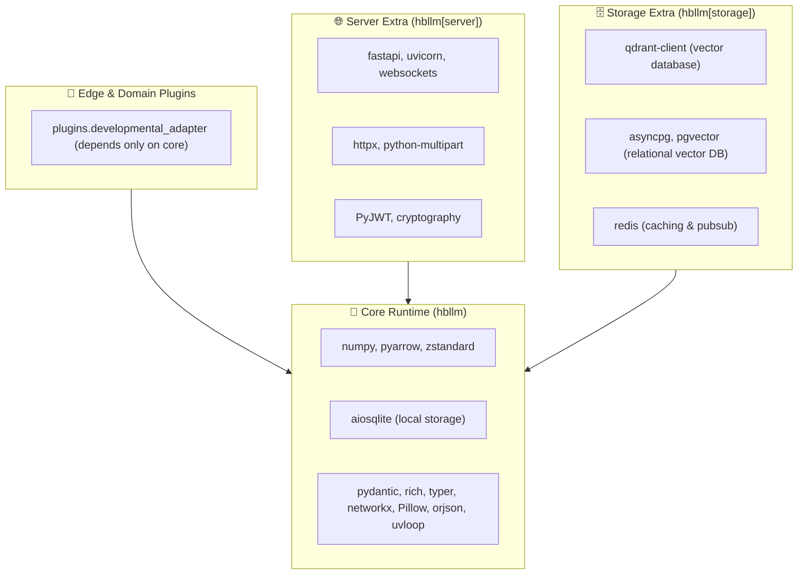

# Packaging & Dependency Boundaries Architecture

## 1. Overview

HBLLM is designed to run across diverse operational footprints: from lightweight robotics and edge devices (e.g. Raspberry Pi, Jetson Orin) with minimal resources to enterprise multi-tenant server deployments backed by distributed vector stores and message buses.

To prevent dependency creep and monolithic import overhead, the repository enforces a strict packaging and architectural boundary hierarchy between **core-runtime** dependencies and optional enterprise server/database extras.

---

## 2. Dependency Hierarchy



---

## 3. PEP 562 Lazy Loading Architecture

In monolithic Python packages, top-level imports in `__init__.py` trigger eager execution across child modules. Historically, importing an edge plugin like `plugins.developmental_adapter` transitively pulled in `fastapi`, `redis`, `qdrant-client`, `asyncpg`, and `cryptography`.

### Resolution
HBLLM core resolves this via **PEP 562 Lazy Module Exports** and the retirement of the monolithic `hbllm/brain` bus graph:
- `hbllm/memory/__init__.py`: Memory backend nodes (`MemoryNode`, `ConceptExtractor`) are mapped to lazy import tuples loaded via `__getattr__`.
- Top-level packages export `__getattr__` and `__dir__` instead of eagerly importing server or database extras:

```python
def __getattr__(name: str) -> Any:
    if name in _EXPORTS:
        mod_path, attr = _EXPORTS[name]
        mod = importlib.import_module(mod_path)
        val = getattr(mod, attr)
        globals()[name] = val
        return val
    raise AttributeError(f"module {__name__!r} has no attribute {name!r}")
```

### Result
- Directly importing `plugins.developmental_adapter` or `hbllm.hcir` loads **0** heavy server or vector database modules.
- Edge footprint memory overhead drops by $> 90\%$.
- Lazy resolution preserves fast startup across `hbllm.memory` and `hbllm.hcir`.

---

## 4. Automated Architectural Boundary Enforcement

To ensure boundaries are never violated by accidental imports in PRs, automated isolation and governance suites run under `tests/unit/architecture/` and `tests/unit/core/test_dependency_boundaries.py`:

1. **Layering & Boundary Isolation (`test_layering.py`, `test_dependency_boundaries.py`):**
   - `hbllm.hcir` never imports from `hbllm.serving`.
   - Core `hbllm` never imports from `plugins/`.
   - Importing `plugins.developmental_adapter` loads **0** blacklisted optional extras (`fastapi`, `uvicorn`, `redis`, `qdrant_client`, `asyncpg`, `pgvector`, `cryptography`).
   - Core `dependencies` in `pyproject.toml` remain lean without server or vector-DB extras.
2. **Zero-LLM Core & Substrate Hygiene (`test_m0_substrate_hygiene.py`):**
   - Enforces **`0` legacy `__path__.append` shadow shims** (`MAX_PATH_APPEND_SHIMS = 0`), shipped-wheel module resolution, and zero workspace-absent commit fallbacks.
   - Verifies via AST inspection that `hbllm/hcir/**` imports **zero** LLM client libraries or external LLM scaffolds (`openai`, `anthropic`, `litellm`, `transformers`, `plugins.llm_scaffold`, `hbllm.serving.provider`).
3. **Permanent Homoiconic & Syscall Ratchets (`test_homoiconic_invariants.py`):**
   - Bars hardcoded lexical/color keyword tables in `compiler.py` and `world/`.
   - Verifies strict `SyscallAllowlist(strict=True)` enforcement in `sys_execute`, executable `bytecode_stream` emission on all `SkillNode` producers, serving/driver Pure-HCIR routing, and system-prior preservation during `consolidate_node_budget()`.
4. **Single Composition Root & Persistence Hygiene (`test_single_composition_root.py`, `test_no_direct_sqlite.py`):**
   - Confirms runtime entry points compose through `build_cognitive_system()` and raw SQLite connections remain confined to `hbllm.persistence`, `hbllm.hcir.stores`, `hbllm.security`, and `hbllm.network.durable_bus`.
