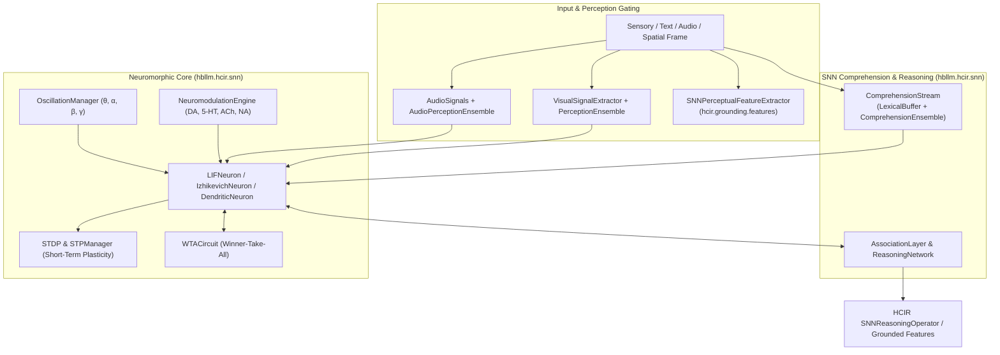

# SNN Cognitive Engine (`hbllm.hcir.snn`)

> **Core Thesis:** Continuous temporal integration, novelty gating, lateral competition, and online reward modulation require sub-millisecond spiking dynamics — not autoregressive LLM forward passes.

The core **SNN Cognitive Engine** lives directly inside **`hbllm.hcir.snn`**. It powers neuromodulation inside `build_cognitive_system()`, spiking visual/audio gating, and `SNNPerceptualFeatureExtractor` (`perception_mode="snn"`).

---

## 1. Architecture Overview



---

## 2. Core Neuromorphic Modules (`hbllm.hcir.snn`)

| Module | Key Classes | Role |
|---|---|---|
| `lif.py` | `LIFConfig`, `LIFNeuron`, `SpikingAccumulator` | Leaky Integrate-and-Fire neuron dynamics and spike accumulation |
| `neurons.py` | `SpikeEvent`, `BaseNeuron`, `IzhikevichConfig`, `IzhikevichNeuron` | Rich bursting/chattering spiking dynamics |
| `dendrite.py` | `DendriticConfig`, `DendriticNeuron` | Predictive-coding dendritic compartments |
| `network.py` | `SpikingNetwork`, `NeuronLayer`, `LayerProjection` | Multi-layer recurrent spiking network graph |
| `plasticity.py` | `STDP`, `STDPRule` | Spike-Timing-Dependent Plasticity weight updates |
| `stp.py` | `STPManager` | Tsodyks–Markram short-term synaptic depression and facilitation |
| `wta.py` | `WTACircuit` | Winner-Take-All lateral inhibition for sparse selection |
| `population.py` | `PopulationEncoder` | Rate/phase population coding from continuous states to spike trains |
| `oscillations.py` | `OscillationManager`, `OscillationBand`, `BrainTick` | $\theta$ (4–8 Hz), $\alpha$ (8–12 Hz), $\beta$ (13–30 Hz), $\gamma$ (30–80 Hz) rhythms |
| `neuromodulation.py` | `NeuromodulationEngine`, `NeuromodulatorState` | Wired into `build_cognitive_system()` (`signal_reward`, `signal_novelty`) |

---

## 3. Comprehension, Perception & Grounding Integration

### Comprehension Stream (`hbllm.hcir.snn.comprehension`)

`ComprehensionStream` (`stream.py`) combines `LexicalBuffer` (`lexical.py`), `ComprehensionEnsemble` (`ensemble.py`), and `SNNCalibrator` (`calibrator.py`) to compute calibrated `UnderstandingState` spike rates without LLM calls.

### Perception Gating (`hbllm.hcir.snn.perception`)

- **Visual Gating:** `VisualSignalExtractor` + `PerceptionEnsemble` (`visual_signals.py`, `visual_ensemble.py`) classify incoming frames into `PerceptionProcessingLevel` (`NONE`, `LOW`, `STANDARD`, `HIGH`, `URGENT`) across 5 LIF channels (scene, entity, motion, novelty, stability).
- **Audio Gating:** `AudioSignals` + `AudioPerceptionEnsemble` (`audio_signals.py`, `audio_ensemble.py`) gate acoustic frame processing.

### SNN Grounding Mode (`perception_mode="snn"`)

In `hbllm.hcir.grounding.features.feature_extractor`, `SNNPerceptualFeatureExtractor` extracts morphology-invariant spiking patch/contour features (`STDP`/membrane decay across `num_steps`) for `CorticalGroundingBridge` and `SNNTemporalPredictor` (`hbllm.hcir.world.predictors.snn`).

---

## 4. Biological Dynamics

### Leaky Integrate-and-Fire (`LIFNeuron`)

$$\tau_m \frac{dV_m}{dt} = -(V_m - V_{\text{rest}}) + R \cdot I(t)$$

When $V_m \ge V_{\text{thresh}}$, a spike is emitted and $V_m$ resets to $V_{\text{reset}}$ for refractory period $\tau_{\text{ref}}$.

### Spike-Timing-Dependent Plasticity (`STDP`)

$$\Delta w = \begin{cases} A_+ \exp(-\Delta t / \tau_+), & \Delta t > 0 \text{ (LTP)} \\ -A_- \exp(\Delta t / \tau_-), & \Delta t < 0 \text{ (LTD)} \end{cases}$$

### Neuromodulation (`NeuromodulationEngine`)

| Neurotransmitter | Cognitive State Influenced | High State Effect | Low State Effect |
|---|---|---|---|
| **Dopamine (DA)** | Reward expectation & novelty | Increases learning rate & exploration | Conservative exploitation |
| **Serotonin (5-HT)** | Risk aversion & patience | Suppresses impulsive actions | Permits exploratory branching |
| **Acetylcholine (ACh)** | Attention focus & memory encoding | Boosts sensory input gain | Prioritizes internal recall |
| **Noradrenaline (NA)** | Arousal & urgency threshold | Lowers spike threshold for rapid reflex | Elevates deliberation depth |

---

## 5. Integration Example

```python
import asyncio
from hbllm.hcir.snn.comprehension.stream import ComprehensionStream
from hbllm.hcir.snn.neuromodulation import NeuromodulationEngine


async def main() -> None:
    comprehension = ComprehensionStream()
    state = await comprehension.process_chunk("Urgent: verify database integrity immediately.")
    print(f"Understanding state: {state}")

    neuro = NeuromodulationEngine()
    neuro.signal_novelty(0.4)
    neuro.signal_reward(0.2)


asyncio.run(main())
```
