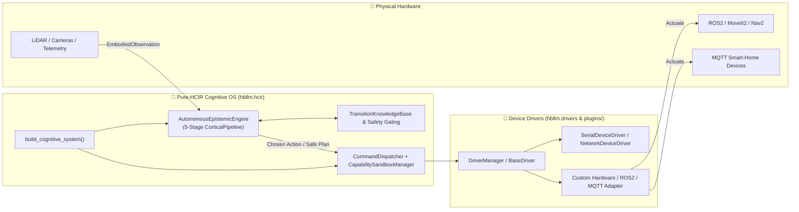

# Robotics & IoT Integration

HBLLM Core is a **hardware-independent cognitive engine** suited for robots, drones, and edge IoT deployments. Because the Pure-HCIR Cognitive OS (`hbllm.hcir`) runs deterministically on CPU with zero LLM dependencies and sub-45ms step latency, you can run full perception, causal world modeling, and safety gating directly on-device (Raspberry Pi 5, Jetson Orin, industrial IPCs).

---

## Architecture: Cognitive OS ↔ Hardware Driver



---

## Integration Pattern

1. **Wrap sensors as `EmbodiedObservation` frames (`hbllm.hcir.world.percept`):**
   Convert LiDAR occupancy grids, pose coordinates, or discrete telemetry into `EmbodiedObservation` inputs and call `system.engine.step(obs)`.
2. **Use `hbllm.drivers` or `plugins/` for I/O:**
   Hardware drivers (`DriverManager`, `SerialDeviceDriver`, `NetworkDeviceDriver` in `hbllm.drivers`) and simulator/robot bridges live strictly outside `hbllm.hcir/`.
3. **Register governed device actions via `CapabilityResolver`:**
   Wrap actuator commands behind `CapabilityPermissions` and `SandboxedCapabilityPolicy` (`hbllm.hcir.kernel.capability_sandboxing`) so `ConstitutionalVerifier` and collision-cone safety gating (`DeliberationStage`) screen every command before actuation.

---

## Minimal On-Device Robotics Loop

```python
from hbllm.hcir.world.percept import EmbodiedObservation, EpisodeBoundary, EpisodeBoundaryKind
from hbllm.runtime.bootstrap import CognitiveSystemConfig, build_cognitive_system

# Boot Pure-HCIR runtime locally (no cloud / no GPU required)
system = build_cognitive_system(
    CognitiveSystemConfig(
        world_id="rover_01",
        enable_grounding=True,
        perception_mode="snn",
    )
)

# Step from live occupancy grid or telemetry
obs = EmbodiedObservation(
    lattice=[[0, 0, 0], [0, 1, 0], [0, 0, 2]],
    available_actions=[1, 2, 3, 4],
    context_id="corridor_a",
    episode_id="run_0",
)
action, meta = system.engine.step(obs)
print(f"Dispatched safe motor action={action}, phase={meta.get('phase')}")
```

> **Legacy Node Bridges:** Earlier ROS2/MQTT MessageBus node implementations are archived in `experiments/legacy_actions/` (`ros2_node.py`, `iot_mqtt_node.py`). New integrations should register capabilities directly on `KernelServices.capability_resolver` or build a `DriverManager` adapter.

---

## Hardware & Latency Profile

- **Zero GPU required:** Runs natively on ARM64 (Raspberry Pi 5, Jetson Orin) and x86_64 CPUs.
- **Rust NEON / AVX2 Acceleration:** Compiling `rust/*` via `maturin develop --release` provides sub-millisecond graph snapshots and SIMD vector math.
- **Offline-first & Deterministic:** Survives internet loss cleanly and persists causal world knowledge (`TransitionKnowledgeBase`) in `SQLiteEventStore`.
