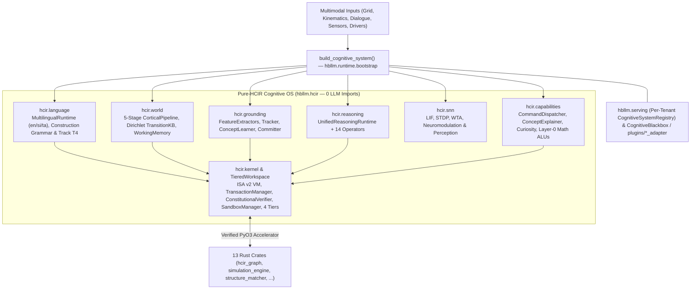

<!-- SEO Keywords: Pure-HCIR Cognitive OS, Neuro-Symbolic AI, Event-Sourced Graph Substrate, Active Inference, Symbol Grounding Engine, TransitionKnowledgeBase, Multilingual Non-LLM Parser, Python 3.11 AI Framework, Rust Acceleration, Multi-Tenant AI, Spiking Neural Networks -->

<div class="hero-title">🧠 HBLLM Core</div>
<div class="hero-subtitle">Pure-HCIR Event-Sourced Cognitive OS — deterministic world modeling, causal induction, multilingual language comprehension, and governed execution on your own hardware with zero LLM dependency in core.</div>

<div class="badges" markdown>

[](https://www.python.org/)
[](https://www.rust-lang.org/)
[](#)
[](api/benchmarks.md)
[](https://github.com/hbllm/hbllm-core/blob/master/LICENSE.md)

</div>

---

## Why Pure-HCIR Cognitive OS?

Most AI frameworks bolt prompts and vector databases onto an external LLM and treat the model as the brain. HBLLM Core flips this architecture: **the Human-Cognitive Intermediate Representation (`hbllm.hcir`) is the brain**, backed by formal transactions, constitutional governance, and zero-token causal inference.

1. **State Ownership Invariant:** Subsystems propose `TransactionOperation`s; `TransactionManager` + `ConstitutionalVerifier` commit reality atomically into the 4-tier `TieredWorkspace`.
2. **100% LLM-Free Core:** `hbllm/hcir/` enforces an AST-verified zero-LLM-import gate. World planning, causal discovery, language parsing/realization, and reasoning execute deterministically with **0 LLM tokens**.
3. **Domain-Agnostic General Intelligence:** All core mechanisms operate over universal spatial, causal, topological, and linguistic structures — environment adapters live strictly in `plugins/`.
4. **Native Rust Substrate:** 13 PyO3 crates accelerate persistent structural-sharing graph snapshots, BLAKE3 hashing, parallel counterfactual rollouts, subgraph isomorphism, SIMD math, and vector search.

<div class="feature-grid">
<div class="feature-card">
<h3>🧠 HCIR Cognitive OS Kernel</h3>
<p>12-opcode ISA v2 register-unification VM (<code>$r0..$r7</code>, <code>CallStack</code>, strict <code>SyscallAllowlist</code>), graded <code>UNIFY</code> / <code>ALPHA_CUT</code> <code>BRANCH</code>, 4-tier <code>TieredWorkspace</code>, <code>SQLiteEventStore</code>, <code>ConstitutionalVerifier</code>, and <code>ExecutiveRuntime</code>. <a href="architecture/hcir-kernel-os.md">Architecture &rarr;</a></p>
</div>
<div class="feature-card">
<h3>🌍 5-Stage Cortical World Model</h3>
<p>Perception &rarr; Assimilation &rarr; Simulation &rarr; Deliberation &rarr; Motor Dispatch over Dirichlet/Beta posteriors (<code>TransitionKnowledgeBase</code>), stateless <code>math.*</code> ALUs, and homoiconic <code>cortical_programs.py</code>. <a href="architecture/cortical-world-model.md">Architecture &rarr;</a></p>
</div>
<div class="feature-card">
<h3>👁️ Symbol Grounding Engine (SGE)</h3>
<p><code>handcrafted</code>, <code>snn</code>, and <code>learned</code> feature extractors, multi-prototype <code>ConceptLearner</code> (<code>mahalanobis_rbf</code>), scale-normalized adaptive relations, dual-channel <code>HCIRCommitter</code>, and <code>CorticalGroundingBridge</code>. <a href="architecture/grounding.md">Architecture &rarr;</a></p>
</div>
<div class="feature-card">
<h3>🗣️ Non-LLM Language &amp; Reading</h3>
<p><code>MultilingualLanguageRuntime</code> (<code>en</code>, <code>si</code>, <code>ta</code>), declarative <code>ConstructionNode</code> hedges and referent ranking, 2D epistemic verbalization, SymSpell normalizer, and Track T4 <code>ReadingCurriculumIngestor</code>. <a href="architecture/language-and-reading.md">Architecture &rarr;</a></p>
</div>
<div class="feature-card">
<h3>🧩 14 Composable Reasoning Operators</h3>
<p>Fuzzy modus ponens deduction, induction, abduction, declarative <code>RelationCompositionPolicy</code> spatial inference, temporal (Allen), causal, analogy, counterfactual, contradiction, simulation, active inference, embodied causal, SNN. <a href="architecture/cognitive-execution-runtime.md">Architecture &rarr;</a></p>
</div>
<div class="feature-card">
<h3>⚡ Neuromorphic SNN Engine</h3>
<p>LIF neurons, STDP plasticity, STP, WTA inhibition, cortical oscillations, <code>NeuromodulationEngine</code>, and low-latency spiking perception gating. <a href="architecture/snn-cognitive-engine.md">Architecture &rarr;</a></p>
</div>
<div class="feature-card">
<h3>🛠️ Governed Capabilities &amp; Curiosity</h3>
<p><code>CommandDispatcher</code>, <code>ConceptExplainer</code>, <code>EpistemicCuriosityController</code>, bipolar <code>BeliefConflictResolver</code>, stateless <code>math.*</code> / <code>math.fuzzy.*</code> ALUs, two-tier sandboxing, and <code>AutonomyTracker</code>. <a href="architecture/capabilities-and-curiosity.md">Architecture &rarr;</a></p>
</div>
<div class="feature-card">
<h3>🦀 13 Native Rust Crates</h3>
<p>Chunked structural-sharing graph, parallel Rayon simulation engine, subgraph structure matcher, AVX-512/NEON SIMD compute, and fast BPE tokenizer. <a href="api/rust-kernels.md">API &rarr;</a></p>
</div>
<div class="feature-card">
<h3>🛡️ Multi-Tenant Security &amp; Sandboxing</h3>
<p>Fail-closed <code>JWTAuthMiddleware</code>, <code>TenantGuard</code> isolation, two-tier process sandboxing (<code>run_sandboxed_command</code>), SSRF-guarded web fetch, <code>PIIRedactor</code>, and hash-chained <code>AuditTrail</code>. <a href="security.md">Security &rarr;</a></p>
</div>
</div>

---

## System Architecture



---

## Sealed Held-Out v2 Performance (`eval-phase3-final`)

Measured on `benchmarks/suites/heldout.yaml` (`n = 120` trials, commit `072b4cb1`, `2026-11-26`, see `reports/heldout/LEDGER.md`):

| Benchmark Dimension | Result | 95% Wilson CI |
|---|---|---|
| **Zero-Shot Solve Rate** | **94.2%** (`113 / 120`, `2` deaths) | `[0.8845, 0.9715]` |
| **Cross-Seed Transfer** | **90.35%** (`114` eps, `28,330` skills; `widened_dev`: `94.74%`) | `[0.8354, 0.9453]` |
| **Same-Layout Replay** | **100.0%** (`6/6` tasks `5/5`, `generality = 0.8979`) | — |
| **LLM Token Cost** | **0 tokens** | — |

---

## Quick Start

```bash
pip install -e .
hbllm diagnostics
```

```python
from hbllm.hcir.world.percept import EmbodiedObservation
from hbllm.runtime.bootstrap import CognitiveSystemConfig, build_cognitive_system

system = build_cognitive_system(CognitiveSystemConfig(world_id="demo", memory_dir=None))

system.process_dialogue("Water boils at 100 degrees Celsius.")
turn = system.process_dialogue("At what temperature does water boil?")
print(turn.response_text)

action, meta = system.engine.step(
    EmbodiedObservation(
        lattice=[[0, 0, 0], [0, 1, 0], [0, 0, 2]],
        available_actions=[1, 2, 3, 4],
    )
)
print(action, meta)
```

Continue to the **[Quick Start Guide](guides/quickstart.md)** or **[Architecture Overview](architecture/overview.md)**.
