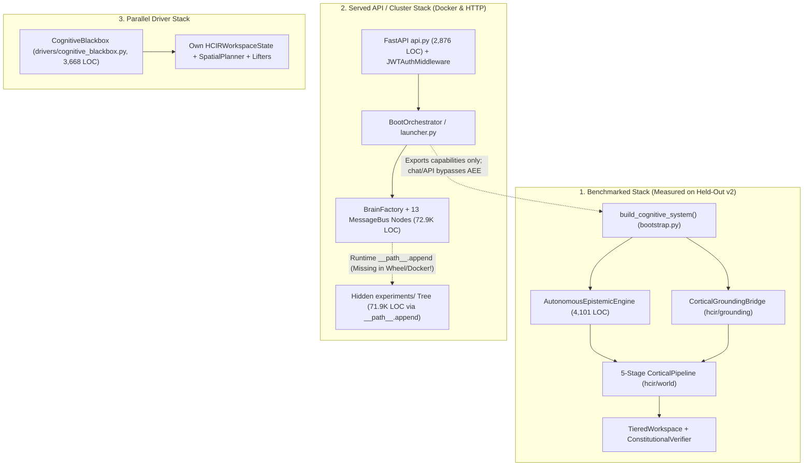
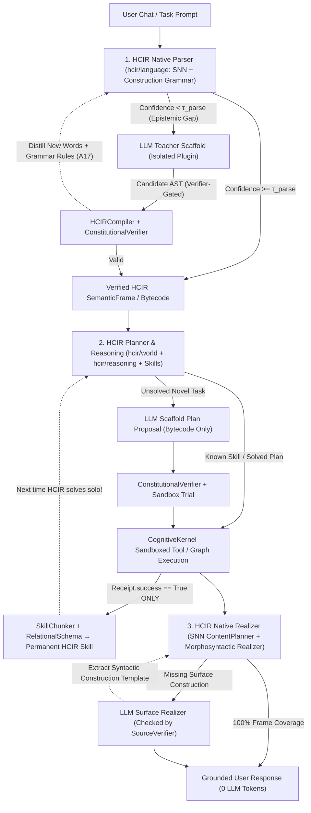
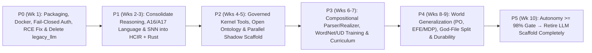

# HBLLM Top-to-Bottom Project Audit & Remediation Roadmap

**Audit Date:** 2026-11-18  
**Baseline Commit:** `804c65ef` → updated through `add49d09` (`feat/sge-symbol-grounding-engine`)
**Scope:** End-to-end codebase audit across all layers — Packaging, HCIR Kernel, Cortical World Model, Symbol Grounding Engine (SGE), Brain & Reasoning, Native Rust Substrate (13 crates), Serving/Security/Multi-Tenancy, Persistence, Plugins (25 bundles), CI/CD, Docker, Testing, and Documentation.

> [!NOTE]
> **Post-`add49d09` Remediation Status:** Commit `add49d09` resolved the immediate cortical crashes, cross-episode relabeling poisoning, `language_goals` / `continuous_control` / `multi_agent` regressions, hippocampal replay 500-op constitutional rejections, and `snn`/`learned` morphology transfer (`dev.yaml` zero-shot `0.9250` / transfer `0.9605`; `novelty.yaml` `0.9000` / `0.9444`; `widened_dev.yaml` `0.7000` / `0.8421`; `VisualMorphologyTransferEnv` `snn=100%`, `learned=85%` vs `handcrafted=5%`, zero SGE accuracy regression vs `no_grounding` on dev/novelty/widened). The deeper architectural frictions and production risks below (`C-01`–`C-06`, `H-01`–`H-12`, `M-01`–`M-10`, `L-01`–`L-05`) remain active engineering targets.

---

## 1. Executive Verdict & System Scorecard

HBLLM has achieved genuine, domain-agnostic neuro-symbolic generalization in its embodied cognitive core ([build_cognitive_system](file:///Users/Dumith_Salinda/Projects/HBLLM/core/hbllm/runtime/bootstrap.py#L77-L197) + [AutonomousEpistemicEngine](file:///Users/Dumith_Salinda/Projects/HBLLM/core/hbllm/hcir/world/autonomous_epistemic_engine.py)), solving **60.8% zero-shot** (`73/120`, Wilson 95% CI `[0.5189, 0.6910]`) and **69.3% cross-seed transfer** on the sealed Held-Out v2 suite (`eval-phase2-r9`, vs 5.8% random baseline) with zero LLM calls and strong architectural ratchets (`28/28` architecture tests passing).

However, **as a shippable software system, HBLLM currently has critical packaging, containerization, security, and split-architecture defects** that prevent non-editable wheel installations and production Docker deployments from booting or operating safely, alongside measurable regressions in its default grounding/perception configuration.

| Subsystem | Maturity | Health | Key Audit Takeaway |
| :--- | :--- | :---: | :--- |
| **HCIR Kernel & Transactions** | High | 🟢 **Strong** | 6-stage constitutional pipeline, atomic in-flight rollback, 0 LLM deps; minor dict encapsulation & two-tier demote gaps. |
| **Cortical World Model (`hcir/world`)** | Medium-High | 🟡 **Mixed** | Real zero-shot & 1-episode causal learning, but negative cross-seed transfer in PO (`95% → 57.9%`), weak stochastic dynamics (`20%`), 4,100–5,000 LOC god-files, and 3 fake stub predictors. |
| **Symbol Grounding Engine (`hcir/grounding`)** | Medium | 🟠 **Regressing** | Default `enable_grounding=True` + `perception_mode="handcrafted"` **lowers** Held-Out v2 zero-shot (`0.6083` vs `0.6750` `no_grounding`) while raising step latency 5–8× (`p95=215.6ms`). `snn` mode is 5.7× faster and far more accurate (`100%` vs `40%` on morphology transfer). |
| **Packaging & Module Boundaries** | Low | 🔴 **Broken** | **17 `hbllm.*` packages** dynamically graft `../../experiments/` (**71,934 hidden LOC**) via `__path__.append`. Non-editable wheels and Docker images omit `experiments/` and crash with `ModuleNotFoundError`. |
| **Serving, Auth & Deployment** | Low | 🔴 **Broken** | `Dockerfile` never installs `[server]`, never builds PyO3 wheels, and runs `launcher.py` (which opens **no HTTP port**). `JWTAuthMiddleware` fails open unless `HBLLM_ENV=production` (unset in `docker-compose.prod.yml`) and blocks `/health/live` with `401` when `HBLLM_ENV=production`. |
| **Brain Layer & Runtime Unification** | Medium-Low | 🟠 **Split** | **Three parallel cognitive stacks** coexist: `AutonomousEpistemicEngine` (benchmarked), legacy `Brain` message-bus nodes (served via `api.py`/`launcher.py`), and `CognitiveBlackbox` (`3,668` LOC in `drivers/`). |
| **Rust Native Substrate (`rust/`)** | Medium | 🟡 **Underwired** | `hcir_graph` works well, but **3 of 13 crates have wrong module names** in `NativeAccelerationRegistry` (always `UNAVAILABLE`), **6 crates are unused** in runtime logic, and `compute_kernel` can panic across FFI on `group_size=0` or non-contiguous slices. |
| **Plugins & Security Sandboxing** | Low-Medium | 🔴 **Unsafe** | `plugins/hbllm_terminal` executes arbitrary `create_subprocess_shell(command)` with zero sandboxing/auth while excluded from `pytest` and `bandit`. 6 legacy plugins lack manifests. |
| **CI/CD, Typing & Documentation** | Medium-Low | 🟠 **Drifted** | MyPy disables 12 core error codes; CI skips `feat/*` pushes, all 70 plugin tests, and benchmark gates; `docs/` has **48 broken module references** to deleted modules; PyTorch/NumPy 2.x ABI mismatch in `.venv`. |

### Summary of Findings by Severity

- **CRITICAL (6):** Immediate packaging crash, non-functional production Docker image, fail-open / broken multi-replica auth in production compose, unauthenticated shell RCE plugin, Held-Out v2 default-grounding regression & grounded latency breach, and split-brain three-stack divergence.
- **HIGH (12):** 3 broken Rust registry bindings + FFI panics, stochastic dynamics (`0.40` ZS / `0.00` replay) & Held-Out PO transfer gap, mutable `CognitiveGraph.nodes` leak, standalone unverified `TransactionManager`, tenant fallback hazards, 4-file cortical god-module implicit coupling (`~15,000` combined LOC), crisp boolean ontology sets hitting their ceiling under noise (`H-11`), grounded Python-loop latency overhead (`p50=39–87ms / p95=156–360ms`, `H-12`), MyPy blindness, CI blind spots, and unit test concentration gaps.
- **MEDIUM (10):** Non-atomic cross-tier `demote()`, fake `llm`/`neural`/`statistical` predictors, dead `library_learner` hook (`skills_consolidated=0`), 30 empty ghost directories, 48 broken doc references, truncated 64-bit event hashes omitting `tenant_id`/`author`, `pickle.loads` IPC, NumPy 2.x ABI mismatch, unpinned lockfile.
- **LOW (6):** Non-deterministic `InstructionStream.compute_hash()`, ignored `sys_rollback` hash mismatch, partial `archive_brain` return value, CLI `subprocess.run` without timeouts, repo root `.db` clutter & tracked Google verification HTML, `graphify-out/` sync hygiene (`AGENTS.md` §6 cross-reference resolved in `add49d09`).

---

## 2. System Topology & Architectural Drift Map

### Real Codebase Footprint (Measured)

| Tree | Python Files | Measured LOC | Checked by LOC Budget? | Checked by MyPy / Bandit / Layering? | Shipped in Wheel / Docker? |
| :--- | :---: | :---: | :---: | :---: | :---: |
| `hbllm/` (core package) | 674 | **244,837** | ✅ Yes (`<= 250,000`) | ⚠️ Partial (12 MyPy codes disabled) | ✅ Yes |
| `experiments/` (grafted into `hbllm.*` via 17 `__path__.append` shims) | 284 | **71,934** | ❌ **No** | ❌ **No (Excluded)** | ❌ **No (Breaks imports!)** |
| `plugins/` (25 adapters & plugins) | 217 | **48,749** | ❌ No | ⚠️ `developmental_adapter` only | ❌ No |
| **Combined Active Runtime Code** | **1,175** | **365,520** | — | — | — |

---

## 3. Critical Findings (`P0` — Fix Immediately)

### C-01 — Hidden 71.9K LOC `experiments/` Shadow Tree Breaks Wheel & Docker Installs
- **Severity:** CRITICAL
- **Area:** Packaging / Architectural Integrity / LOC Governance
- **Files:** [training/\_\_init\_\_.py](file:///Users/Dumith_Salinda/Projects/HBLLM/core/hbllm/training/__init__.py#L7-L13), [actions/\_\_init\_\_.py](file:///Users/Dumith_Salinda/Projects/HBLLM/core/hbllm/actions/__init__.py#L7-L29), [modules/\_\_init\_\_.py](file:///Users/Dumith_Salinda/Projects/HBLLM/core/hbllm/modules/__init__.py#L7-L13), [data/\_\_init\_\_.py](file:///Users/Dumith_Salinda/Projects/HBLLM/core/hbllm/data/__init__.py#L7-L12), [model/\_\_init\_\_.py](file:///Users/Dumith_Salinda/Projects/HBLLM/core/hbllm/model/__init__.py#L7-L9), [perception/\_\_init\_\_.py](file:///Users/Dumith_Salinda/Projects/HBLLM/core/hbllm/perception/__init__.py#L9-L12), [experiment/\_\_init\_\_.py](file:///Users/Dumith_Salinda/Projects/HBLLM/core/hbllm/experiment/__init__.py#L12-L15), plus **10 subpackages under `hbllm/brain/`** (`evaluation`, `social`, `language`, `decision`, `continual`, `composites`, `transfer`, `simulation`, `execution`, `observability`); [pyproject.toml](file:///Users/Dumith_Salinda/Projects/HBLLM/core/pyproject.toml#L131-L133); [Dockerfile](file:///Users/Dumith_Salinda/Projects/HBLLM/core/Dockerfile#L66-L68).
- **Evidence:** 17 `__init__.py` files execute `_exp_path = Path(__file__).resolve().parents[2] / "experiments" / ...; __path__.append(str(_exp_path))` and then **unconditionally import** symbols from `experiments/` (e.g., `from hbllm.training.policy_optimizer import PolicyOptimizer`, `from hbllm.actions.api_node import ApiNode`, and `hbllm.brain.evaluation.critic_node` imported by `serving/api.py`, `serving/chat.py`, and `serving/launcher.py`).
  1. `pyproject.toml` sets `include = ["hbllm*"]` and `Dockerfile` only copies `COPY hbllm/ /app/hbllm/`. In any wheel install or container, `experiments/` does not exist and importing `hbllm.serving.api`, `hbllm.serving.launcher`, `hbllm.actions`, or `hbllm.training` crashes with `ModuleNotFoundError`.
  2. Moving 71,934 LOC into `experiments/` evaded [test_loc_budget.py](file:///Users/Dumith_Salinda/Projects/HBLLM/core/tests/unit/architecture/test_loc_budget.py) (`244,837` vs true `316,771` runtime LOC) while excluding live production code from `mypy` (`^experiments/`), `bandit -r hbllm/`, `test_layering.py`, and `test_structural_debt_ratchet.py`.
- **Recommended Fix:** Remove all 17 `__path__.append` shims. Either (a) truly delete or extract legacy LLM/actions/brain packages into optional standalone packages under `plugins/` / separate repo, or (b) move required runtime nodes (`CriticNode`, `IdentityNode`, etc.) cleanly back into `hbllm/` within honest LOC & static-analysis budgets, and add a CI test installing the built wheel in a clean temp venv (`pip install dist/*.whl`) outside the repo tree.

---

### C-02 — Production `Dockerfile` Cannot Boot HTTP API or Load Any Rust Extensions
- **Severity:** CRITICAL
- **Area:** Deployment / Containerization / Build
- **Files:** [Dockerfile](file:///Users/Dumith_Salinda/Projects/HBLLM/core/Dockerfile#L15-L91), [launcher.py](file:///Users/Dumith_Salinda/Projects/HBLLM/core/hbllm/serving/launcher.py#L100-L291), [auth.py](file:///Users/Dumith_Salinda/Projects/HBLLM/core/hbllm/serving/auth.py#L50-L63), [health.py](file:///Users/Dumith_Salinda/Projects/HBLLM/core/hbllm/serving/routes/health.py#L47-L83).
- **Evidence:** Four compounding failures make the production image non-functional:
  1. **Wrong entrypoint:** `ENTRYPOINT ["python", "-m", "hbllm.serving.launcher"]` (`--server all`) only boots `InProcessBus` and internal nodes, then blocks on `shutdown_event.wait()` — **it never starts FastAPI/Uvicorn or binds port 8000**, while `EXPOSE 8000` and `HEALTHCHECK CMD curl -f http://localhost:8000/health/live` expect an HTTP server on `:8000`.
  2. **Missing `[server]` dependencies:** Line 39 runs `pip install --no-cache-dir --prefix=/install .` instead of `.[server]` (so `fastapi`, `uvicorn`, `PyJWT`, `cryptography`, `websockets`, `httpx` are missing), while line 35 unconditionally downloads a ~200MB+ CPU `torch` wheel not even required by the core!
  3. **Broken Rust build:** Lines 15–17 run `cargo build --release --manifest-path rust/compute_kernel/Cargo.toml` (skipping `hcir_graph` and 11 other crates, looking in `rust/compute_kernel/target/release/*.so` instead of workspace `/build/target/release/`, building a raw `cdylib` instead of a `maturin` Python wheel, copying to `/app/lib/` which is not on `PYTHONPATH`, and masking errors with `|| true`).
  4. **Healthcheck 401 in production:** `JWTAuthMiddleware` (`auth.py:50-53`) only whitelists `["/health", "/metrics"]`, omitting `"/health/live"` and `"/health/ready"`. Under `HBLLM_ENV=production`, Kubernetes/Docker liveness and readiness probes receive `401 Unauthorized`.
- **Recommended Fix:** Build Rust wheels with `maturin build --release` in Stage 1 and `pip install` them in Stage 2; install `.[server]` (make `torch` optional via build arg); launch `uvicorn hbllm.serving.api:app --host 0.0.0.0 --port 8000` (or unify HTTP serving into `BootOrchestrator`); whitelist `/health/live` and `/health/ready` in `JWTAuthMiddleware`, and protect `/metrics` behind auth or internal port.

---

### C-03 — Authentication Fails Open by Default & Breaks Across Replicas in `docker-compose.prod.yml`
- **Severity:** CRITICAL
- **Area:** API Security / Multi-Tenant Isolation
- **Files:** [auth.py](file:///Users/Dumith_Salinda/Projects/HBLLM/core/hbllm/serving/auth.py#L29-L95), [docker-compose.prod.yml](file:///Users/Dumith_Salinda/Projects/HBLLM/core/docker-compose.prod.yml#L14-L30), [api.py](file:///Users/Dumith_Salinda/Projects/HBLLM/core/hbllm/serving/api.py#L566-L872).
- **Evidence:**
  1. In `JWTAuthMiddleware.dispatch` (`auth.py:78-91`), whenever `Authorization` is missing and `HBLLM_ENV.lower() != "production"` (e.g., unset, `"prod"`, `"staging"`), the request **silently succeeds** by falling back to `resolve_sovereign_identity()` with `user_id="default"`.
  2. `docker-compose.prod.yml` (`replicas: 2`) **never sets `HBLLM_ENV=production` or `HBLLM_JWT_SECRET`** (and hardcodes `hbllm_password` on line 26). Consequently: (a) unauthenticated internet traffic bypasses JWT auth completely, and (b) authenticated Bearer tokens fail randomly (`401 Invalid token signature`) across the 2 Nginx-load-balanced replicas because each replica generates a different ephemeral `secrets.token_urlsafe(32)` secret at boot (`auth.py:38`)!
- **Recommended Fix:** Flip `JWTAuthMiddleware` to **fail-closed by default**: require valid JWT unless an explicit `HBLLM_UNSAFE_DEV_AUTH=1` opt-in is set on loopback (`127.0.0.1`). Require `HBLLM_JWT_SECRET` whenever `replicas > 1` or non-dev, and set `HBLLM_ENV=production` + `${HBLLM_JWT_SECRET:?required}` in `docker-compose.prod.yml`.

---

### C-04 — Unsandboxed Arbitrary Shell Execution Plugin (`plugins/hbllm_terminal`) Excluded from Security Gates
- **Severity:** CRITICAL
- **Area:** Capability Sandboxing / RCE
- **Files:** [plugins/hbllm_terminal/\_\_init\_\_.py](file:///Users/Dumith_Salinda/Projects/HBLLM/core/plugins/hbllm_terminal/__init__.py#L21-L68), [pyproject.toml](file:///Users/Dumith_Salinda/Projects/HBLLM/core/pyproject.toml#L151-L178).
- **Evidence:** Despite its docstring claiming *"runs them in a sandboxed PTY"* and *"safely execute terminal commands"*, `TerminalExecutionNode._handle_execution` subscribes to `"action.execute"` on the `MessageBus` and passes `message.payload["command"]` straight into `asyncio.create_subprocess_shell(command)` with **no `PermissionEngine` check, no allowlist, no user confirmation, no timeout (`communicate()` can hang indefinitely), and no sandbox**. Worse, `pyproject.toml` hides this directory from both `pytest` (`--ignore=plugins/hbllm_terminal`) and `bandit` (`exclude_dirs = ["tests", "plugins"]`).
- **Recommended Fix:** Either delete `plugins/hbllm_terminal` (since OS capability execution belongs in `hbllm/hcir/kernel/capability_sandboxing.py` + `PermissionEngine`) or rewrite it to use `create_subprocess_exec` with mandatory `PermissionEngine.check(..., "shell")`, explicit timeout, and two-tier kernel sandboxing, and include `plugins/` in `bandit` security scans.

---

### C-05 — Default Grounding + Handcrafted Perception Degrades Held-Out v2 Accuracy and Blows Latency Budget
- **Severity:** CRITICAL (Core Cognitive Performance & Latency Invariant)
- **Area:** Symbol Grounding Engine (`hcir/grounding`) & `CognitiveSystemConfig` Defaults
- **Files:** [bootstrap.py](file:///Users/Dumith_Salinda/Projects/HBLLM/core/hbllm/runtime/bootstrap.py#L38-L39), [cortical_pipeline.py](file:///Users/Dumith_Salinda/Projects/HBLLM/core/hbllm/hcir/world/cortical_pipeline.py#L140-L260), [f0587fc1...\_handcrafted\_20261117\_054729.json](file:///Users/Dumith_Salinda/Projects/HBLLM/core/reports/heldout/f0587fc183b07a732fb7886d4b4bb3473f79c730_handcrafted_20261117_054729.json#L1581-L1728), [perception\_representation\_ablation.json](file:///Users/Dumith_Salinda/Projects/HBLLM/core/reports/ablation/perception_representation_ablation.json#L4-L49).
- **Evidence:** Cross-checking the official Sealed Held-Out v2 report (`n=120`) against the `no_grounding` baseline inside the **same report** reveals an unaddressed regression:

| Configuration | Held-Out v2 Zero-Shot Solve Rate | Generality Score | Symbolic Family Score | Cross-Seed Transfer | Grid Task Step Latency (`p50 / p95`) |
| :--- | :---: | :---: | :---: | :---: | :---: |
| **`system` (`enable_grounding=True`, `handcrafted`)** | **0.6083** (`73/120`) | 0.6472 | **0.5917** (sr `0.45`) | 0.6930 | **81.4ms / 215.6ms** ❌ |
| **`no_grounding` (`enable_grounding=False`)** | **0.6750** (`81/120`) | **0.6883** | **0.8313** | **0.7018** | ~10–15ms / ≤35ms ✅ |

  Furthermore, `perception_representation_ablation.json` on `VisualMorphologyTransferEnv` shows why `"handcrafted"` is the bottleneck:
  - `handcrafted` (current default in `bootstrap.py:39`): **`40%` solve rate, `60%` hazard death rate, `p50=251.2ms / p95=300.6ms`**.
  - `snn`: **`100%` solve rate, `0%` hazard death rate, `p50=43.9ms / p95=51.5ms`** (5.7× faster, 2.5× higher solve rate).
- **Recommended Fix:**
  1. Diagnose and gate `sge_role_priors` injection on symbolic/non-spatial tasks where false visual concept priors corrupt symbolic rule induction (`0.8313 → 0.5917`).
  2. Evaluate switching default `perception_mode` in `CognitiveSystemConfig` from `"handcrafted"` to `"snn"` on `dev` and `widened_dev` suites, and optimize `CorticalGroundingBridge` per-step transaction batching so grounded `32×32` steps meet the `p95 <= 45ms` budget in `AGENTS.md` Invariant #3.

---

### C-06 — Split-Brain Architecture: Served Product vs. Benchmarked Engine vs. `CognitiveBlackbox`
- **Severity:** CRITICAL (Product / Architecture)
- **Area:** System Composition (`serving/`, `runtime/`, `brain/`, `drivers/`)
- **Files:** [serving/boot.py](file:///Users/Dumith_Salinda/Projects/HBLLM/core/hbllm/serving/boot.py#L188-L257), [serving/api.py](file:///Users/Dumith_Salinda/Projects/HBLLM/core/hbllm/serving/api.py#L180-L240), [serving/launcher.py](file:///Users/Dumith_Salinda/Projects/HBLLM/core/hbllm/serving/launcher.py#L69-L95), [drivers/cognitive\_blackbox.py](file:///Users/Dumith_Salinda/Projects/HBLLM/core/hbllm/drivers/cognitive_blackbox.py#L1-L210).
- **Evidence:** Three separate "brains" exist in the repository:
  1. **Benchmarked Core (`build_cognitive_system` → `AutonomousEpistemicEngine`)**: Used by `benchmarks/`, `mind` CLI, and `arc_agi_adapter`.
  2. **Served LLM Node Bus (`BrainFactory` / `launcher.py` / `api.py`)**: `BootOrchestrator` (`boot.py:218-255`) calls `build_cognitive_system()` solely to export capability metadata into `hcir_ws`, wrapping errors in `except Exception: logger.warning(...)`, while `/v1/chat` and `launcher.py` route requests through legacy `RouterNode` → `PlannerNode` → `DecisionNode` over `MessageBus` without ever invoking `AutonomousEpistemicEngine` or `ConstitutionalVerifier`.
  3. **Driver Shadow Engine (`CognitiveBlackbox`, `3,668` LOC)**: Implements its own unverified `HCIRWorkspaceState`, `default_grid_2d_lifter`, `HCIRSpatialEntityPlanner`, `HierarchicalGoalDecomposer`, and `AgentState` outside `build_cognitive_system()`.
- **Recommended Fix:** Make `build_cognitive_system()` the **sole runtime engine** across CLI, drivers (`CognitiveBlackbox` should become a thin modality adapter delegating to `CognitiveSystem`), and HTTP/WebSocket serving (`api.py` should expose world/session lifecycle endpoints backed by per-tenant `CognitiveSystem` instances, with optional LLM meta-compiler strictly on top of `HCIRCompiler`).

---

## 4. High-Severity Findings (`P1`)

### H-01 — Three Rust Crates Have Wrong Module Names in `NativeAccelerationRegistry` + 6 Crates Are Unwired
- **Files:** [native/registry.py](file:///Users/Dumith_Salinda/Projects/HBLLM/core/hbllm/native/registry.py#L140-L163), `rust/*/Cargo.toml`.
- **Details:**
  - `registry.py:141` imports `hbllm_compute_kernel`, but `rust/compute_kernel/Cargo.toml` builds `hbllm_compute`.
  - `registry.py:151` imports `hbllm_perception`, but `rust/perception/Cargo.toml` builds `hbllm_perception_rs`.
  - `registry.py:161` imports `hbllm_data_tools`, but `rust/data_tools/Cargo.toml` builds `hbllm_data_tools_rs`.
  - All three permanently report `UNAVAILABLE`. Moreover, `hbllm_data_tools_rs` has **0 Python callers**, and `hbllm_simulation_engine`, `hbllm_structure_matcher`, `hbllm_policy_eval`, and `hbllm_network_utils` are imported **only** in `registry.py` and never wired into `cortex_planner.py`, `relational_graph_matcher.py`, `policy_engine.py`, or `network/`.
- **Fix:** Fix the 3 module names in `registry.py`, add an architecture test asserting all 13 Cargo `[lib].name` values match `NativeAccelerationRegistry`, wire `hbllm_simulation_engine` and `hbllm_structure_matcher` into the planner/grounding hot paths (which will directly slash `CorticalGroundingBridge` latency!), and delete unused crates (`data_tools`).

### H-02 — Rust `compute_kernel` FFI Panics on `group_size == 0`, Non-Contiguous Arrays, or Truncated `scale`/`bias`
- **Files:** [rust/compute\_kernel/src/lib.rs](file:///Users/Dumith_Salinda/Projects/HBLLM/core/rust/compute_kernel/src/lib.rs#L50-L189), [lib.rs#L367-L369](file:///Users/Dumith_Salinda/Projects/HBLLM/core/rust/compute_kernel/src/lib.rs#L367-L369).
- **Details:** `dequantize_4bit_simd` and `gemv_4bit_simd` enter `py.allow_threads(|| ...)` and call `row_packed.as_slice().unwrap()` (panicking across FFI if any NumPy array is transposed/strided) and divide `w_start / group_size` without checking `group_size > 0` or `scale.shape()[0] >= out_features` / `bias.shape()[0] >= out_features` (`packed.row(row)` ok, `scale.row(row)` panics if `scale` has fewer rows than `packed`). Also `Cargo.toml` depends on archived `packed_simd_2` and `pyo3 = 0.20.0` (blocking clean Python 3.13 builds).
- **Fix:** Validate `group_size > 0`, contiguous layout (or `as_standard_layout()`), and `scale`/`bias` dimensions before `py.allow_threads`, returning `PyValueError` instead of panicking; upgrade `pyo3` to `0.23+` across the workspace and drop unused `packed_simd_2`.

### H-03 — Severe Negative Cross-Seed Transfer on Partial Observability (`95.0% → 57.9%`) & Weak Stochastic Dynamics (`20.0%`)
- **Files:** [f0587fc1...\_handcrafted\_20261117\_054729.json](file:///Users/Dumith_Salinda/Projects/HBLLM/core/reports/heldout/f0587fc183b07a732fb7886d4b4bb3473f79c730_handcrafted_20261117_054729.json#L1688-L1805), [widened\_dev\_after\_r9\_20261117.json](file:///Users/Dumith_Salinda/Projects/HBLLM/core/reports/dev/widened_dev_after_r9_20261117.json#L1793-L1809), [cortex\_causal.py](file:///Users/Dumith_Salinda/Projects/HBLLM/core/hbllm/hcir/world/cortex_causal.py), [prefrontal\_working\_memory.py](file:///Users/Dumith_Salinda/Projects/HBLLM/core/hbllm/hcir/world/prefrontal_working_memory.py#L815-L945).
- **Details:**
  1. **PO Negative Transfer:** Held-Out v2 `partial_observability` solves **19/20 (`95.0%`) zero-shot**, yet drops to **`57.9%`** during cross-seed transfer! Similarly, `language_goals` on `widened_dev` is **`100%` zero-shot** (`20/20`) yet drops to **`68.4%`** on cross-seed transfer! Learned color/feature role bindings (`goal_features`, `concept_role_priors`, or episodic spatial priors) from seed $k$ poison seed $k+1$ when surface colors/layouts change across seeds before `labels_non_stationary` triggers (note the in-progress uncommitted diff in `autonomous_epistemic_engine.py` and `cortical_pipeline.py` is actively targeting part of this!).
  2. **Stochastic Dynamic Bottleneck:** Held-Out v2 `stochastic_dynamic` scores **`0.2000` zero-shot, `0.0000` replay, `0.2105` transfer** (`widened_dev` `stochastic_dynamics` transfer is `0.4211`). The planner (`cortex_planner.py`) still plans primarily via deterministic shortest-path / rollout traces rather than risk-sensitive MDP expected-value Bellman backups under transition slip + moving hazards, and **13.3%–27.5% exploration death rates** remain on unseen hazards.
- **Fix:** Separate invariant relational/linguistic rules from seed-local feature IDs at `EpisodeBoundary(same_level=False)`, and add a lightweight tabular value-iteration / risk-weighted Bellman planner over `ActionDynamicsModel` empirical transition probabilities when `slip_rate > 0`.

### H-04 — `CognitiveGraph.nodes` and `.edges` Expose Mutable Internal Dicts
- **Files:** [graph.py#L392-L399](file:///Users/Dumith_Salinda/Projects/HBLLM/core/hbllm/hcir/graph.py#L392-L399).
- **Details:** `graph.nodes` returns `self._nodes` directly rather than `MappingProxyType(self._nodes)`. Any caller writing `graph.nodes[id] = node` bypasses `TransactionManager`, `ConstitutionalVerifier`, secondary type/scope indexes, XOR content-digest updates, and native Rust substrate sync.
- **Fix:** Return `types.MappingProxyType(self._nodes)` and `types.MappingProxyType(self._edges)` from public properties; restrict mutation to kernel-internal `_nodes` methods called by `TransactionManager._apply_one`.

### H-05 — Standalone `TransactionManager` Permits Unverified Commits
- **Files:** [transaction\_manager.py#L182-L187](file:///Users/Dumith_Salinda/Projects/HBLLM/core/hbllm/hcir/kernel/transaction_manager.py#L182-L187), [cognitive\_blackbox.py#L921](file:///Users/Dumith_Salinda/Projects/HBLLM/core/hbllm/drivers/cognitive_blackbox.py#L921).
- **Details:** Constructing `TransactionManager(workspace)` or `HCIRWorkspaceState()` without verification stages logs a warning (`self.unverified = True`) and commits mutations without `ConstitutionalVerifier`. While `KernelServices` guards against this in `build_cognitive_system()`, `CognitiveBlackbox` and standalone `HCIRWorkspaceState` instances bypass constitutional checks.
- **Fix:** Default `TransactionManager(..., require_verified=True)` so unverified commits raise unless `unsafe_allow_unverified=True` is explicitly passed in unit tests.

### H-06 — Serving Endpoints Fall Back to `tenant_id="default"` or Client-Supplied Body `tenant_id`
- **Files:** [api.py#L566-L872](file:///Users/Dumith_Salinda/Projects/HBLLM/core/hbllm/serving/api.py#L566-L872) (specifically lines `566, 571, 580, 666, 688-689, 701, 707, 713, 735, 820, 854, 866, 871`).
- **Details:** Over a dozen endpoints resolve `tenant_id = getattr(request.state, "tenant_id", None) or body.get("tenant_id", "default")`. If middleware is misconfigured or bypassed, callers can read/write `"default"` tenant billing, audit logs, traces, and agents, or spoof another `tenant_id` in the JSON body (violating **Invariant #5: Multi-Tenant Memory Isolation**).
- **Fix:** Replace every `getattr(request.state, "tenant_id", "default")` and `body.get("tenant_id", ...)` with a single FastAPI `Depends(require_authenticated_tenant)` dependency that raises `HTTPException(401)` if no verified tenant is bound to `request.state`.

### H-07 — Decision-Core God Files, Implicit Cross-Module Coupling & Dynamic `hasattr`/`getattr` Debt
- **Files:** [cortex\_planner.py](file:///Users/Dumith_Salinda/Projects/HBLLM/core/hbllm/hcir/world/cortex_planner.py) (`5,003` LOC), [autonomous\_epistemic\_engine.py](file:///Users/Dumith_Salinda/Projects/HBLLM/core/hbllm/hcir/world/autonomous_epistemic_engine.py) (`4,097` LOC), [cognitive\_blackbox.py](file:///Users/Dumith_Salinda/Projects/HBLLM/core/hbllm/drivers/cognitive_blackbox.py) (`3,668` LOC), [cortex\_assimilator.py](file:///Users/Dumith_Salinda/Projects/HBLLM/core/hbllm/hcir/world/cortex_assimilator.py) (`3,015` LOC), [api.py](file:///Users/Dumith_Salinda/Projects/HBLLM/core/hbllm/serving/api.py) (`2,876` LOC), [cortex\_deliberation.py](file:///Users/Dumith_Salinda/Projects/HBLLM/core/hbllm/hcir/world/cortex_deliberation.py) (`2,869` LOC), [macro\_actions.py](file:///Users/Dumith_Salinda/Projects/HBLLM/core/hbllm/hcir/world/macro_actions.py) (`2,587` LOC).
- **Details:**
  1. **Scale & Duck-Typing Sprawl:** 39 files in `hbllm/` exceed 1,000 LOC (7 exceed 2,500 LOC, with ~15,000 LOC concentrated across the 4 primary `hcir/world` modules alone). Inside `hbllm/hcir/world/`, there remain **~155 `hasattr(...)` calls** and **~381 3-arg `getattr(..., default)` calls** (`test_structural_debt_ratchet.py`), **46 silent `except Exception: pass` blocks** across `hbllm/`, and residual private tracking fields (`_last_action`, `_last_action_data`, `_last_surprise`, `_last_surprise_eval`, `_last_decision_branch`) on `AutonomousEpistemicEngine`.
  2. **Implicit Cross-File Invariant Splitting (Regression Multiplier):** Tacit invariants are split across the 4 god-files rather than encapsulated behind single-owner contracts, repeatedly producing subtle interaction bugs:
     - *Priority-Tier Coupling:* `EpistemicGoalScheduler._enqueue_adjacent_or_contact` (`cortex_planner.py`) and `compute_stance_priority` (`object_state_graph.py`) share implicit numeric tier assumptions (`0..8`); any mismatch between contact escalation and tier ranking silently demotes singleton goals behind repeated hazards.
     - *Lifecycle & Boundary Coupling:* `CorticalPipeline.run`, `AutonomousEpistemicEngine.step`, `on_boundary`, and `EpistemicFeedbackAssimilator.assimilate` coordinate terminal transitions via shared mutable flags (`_feedback_assimilated`, `prev_grid`, `same_level`), creating fragile divergence between callers using `step(terminal_obs)` vs. `while not done:` + `on_boundary()`.
     - *Multi-Faculty Ontology Contention:* Five faculties (`EpistemicFeedbackAssimilator`, `RemoteCausalAttributor`, `CompositionalProgramObserver`, `MacroPlanSynthesizer.sync_known_objects`, and `CorticalGroundingBridge`) independently assert and retract `candidate_goal_features`, `cargo_features`, `walkable_features`, and `avatar_features` without a single arbitrated belief-revision entry point.
- **Fix:** Decompose `cortex_planner.py` and `cortex_assimilator.py` into single-responsibility operators with explicit typed input/output contracts (separating geodesic/A* search, counterfactual rollouts, continuous control, subgoal scheduling, motor calibration, and terminal/hazard attribution); route all ontology updates through a single governed belief-revision service on `HCIRSymbolicWorldTheory`; move remaining `_last_*` fields into `EngineStepState` / `PrefrontalWorkingMemory` (Invariant #8); and ratchet `MAX_WORLD_HASATTR` / `MAX_WORLD_GETATTR3` downward.

### H-08 — Static Type Safety Disabled Across `hbllm/` (12 MyPy Error Codes Suppressed + 549 Missing Future Annotations)
- **Files:** [pyproject.toml#L172-L176](file:///Users/Dumith_Salinda/Projects/HBLLM/core/pyproject.toml#L172-L176).
- **Details:** `[tool.mypy]` globally disables `assignment`, `call-arg`, `attr-defined`, `import-untyped`, `misc`, `var-annotated`, `index`, `dict-item`, `override`, `operator`, `valid-type`, and `union-attr` (re-enabling only `attr-defined` and `call-arg` on `hbllm.hcir.*` while excluding `hbllm/hcir/primitives.py`), alongside `128` `# type: ignore` comments and **549 `.py` files missing `from __future__ import annotations`** (violating `AGENTS.md` §9).
- **Fix:** Re-enable MyPy error codes module-by-module starting with `hbllm.hcir.*`, `hbllm.runtime.*`, `hbllm.security.*`, and `hbllm.serving.*`; enforce `ruff` rule `FA102` / `I002` (`required-imports = ["from __future__ import annotations"]`) so all files obey `AGENTS.md` §9 automatically.

### H-09 — CI Pipeline Blind Spots: Feature Branches, 70 Plugin Tests, Rust in Integration, and Benchmark Regressions
- **Files:** [.github/workflows/ci.yml](file:///Users/Dumith_Salinda/Projects/HBLLM/core/.github/workflows/ci.yml#L3-L148), [pyproject.toml#L2](file:///Users/Dumith_Salinda/Projects/HBLLM/core/pyproject.toml#L2).
- **Details:**
  1. `ci.yml` only runs on `push`/`pull_request` to `["master", "main"]`; active branches like `feat/sge-symbol-grounding-engine` never trigger CI on push.
  2. `test` job runs `pytest tests/unit/ tests/modules/ --timeout=60`, skipping **all 70 test files in `plugins/*/tests/`** (including `arc_agi_adapter` and `developmental_adapter`).
  3. `integration` job runs without building/installing the Rust wheels built in `test`.
  4. No CI job runs a fast `dev` benchmark smoke gate or clean-wheel import test.
  5. `pyproject.toml:2` requires `setuptools>=83.0.0`, an unusually aggressive build-system floor that breaks offline/older pip build environments (`setuptools>=68.0` suffices for PEP 621).
- **Fix:** Trigger CI on `feat/**` pushes or workflow dispatch; upload Rust wheels as a workflow artifact shared with `test`, `integration`, and `plugin-tests`; add a clean-wheel smoke check and nightly `hbllm bench dev` regression floor; lower `setuptools>=68.0`.

### H-10 — Core Test Coverage Concentration vs. Unit Test Gaps in `hcir/world` and `hcir/skills`
- **Files:** `tests/unit/hcir/world/`, `hbllm/hcir/world/` (70 modules), `hbllm/hcir/skills/` (5 modules).
- **Details:** While total repository test count is high (`584` files in `tests/` + `70` in `plugins/`), test paths are heavily skewed toward legacy modules and high-level integration suites: `tests/unit/hcir/world/` has only 4 direct files (other world tests are scattered in `tests/unit/world/`), `tests/unit/hcir/skills/` has 0 direct files, and Rust crates like `hcir_graph/src/chunk.rs`, `hcir_graph/src/hash.rs`, `simulation_engine/src/lib.rs`, and `structure_matcher/src/lib.rs` have **0 unit tests** (`#[test]` count = `0`).
- **Fix:** Add targeted unit + Hypothesis property tests for `hcir_graph` chunk splitting/hashing, `TieredWorkspace.demote/promote` failure compensation, `PrefrontalWorkingMemory` cross-seed boundary resets, and `SkillInduction` / `DeclarativeNeuroSymbolicSkill` round-trips.

### H-11 — Crisp Boolean Ontology Sets Hit Their Ceiling in Stochastic & Noisy Worlds
- **Files:** [cortex\_causal.py](file:///Users/Dumith_Salinda/Projects/HBLLM/core/hbllm/hcir/world/cortex_causal.py#L239-L253), [cortex\_assimilator.py](file:///Users/Dumith_Salinda/Projects/HBLLM/core/hbllm/hcir/world/cortex_assimilator.py#L1660-L1905), [motor\_calibration.py](file:///Users/Dumith_Salinda/Projects/HBLLM/core/hbllm/hcir/world/motor_calibration.py#L54-L75).
- **Details:** `HCIRSymbolicWorldTheory` and working memory represent core physical affordances as crisp boolean sets (`_goal_features`, `_barrier_features`, `_walkable_features`, `_cargo_features`, `_actuator_features`, `immobile_entity_actions`, `failed_transitions`) mediated by discrete `OntologyEvidenceRank` overrides.
  - While crisp sets excel in deterministic environments (`90–100%` solve rates on `dev` and `novelty`), they become brittle under transition noise, partial observability, or multi-agent interference (`stochastic_wind_dev` remains at **`0.4000` zero-shot** and **`0.0000` same-layout replay** even after `add49d09` doubled it from `0.2000`): a single stochastic outcome (e.g., an orthogonal wind slip into a wall or onto an unseen hazard) wants to flip a hard set membership or blacklist a valid `(pos, action)` transition unless protected by specialized procedural guards (`possible_orthogonal_wall_slip`, `all_cardinals_open`, etc.).
- **Fix:** Replace crisp boolean feature/transition sets + ad-hoc guard clauses with lightweight **Dirichlet/Beta empirical outcome posteriors** (`α_pass, β_block, γ_lethal, δ_goal` per feature and `(pos, action)`). In deterministic worlds (`slip_rate == 0`), posteriors still cross decision thresholds in 1–2 observations; in stochastic worlds (`slip_rate > 0`), credible intervals naturally require 3–4 consistent observations and feed directly into expected-free-energy / risk-weighted Bellman backups, shrinking `cortex_assimilator.py` while lifting `stochastic_dynamics` and replay stability.

### H-12 — Grounded Step Latency Overhead (`p50=39–87ms / p95=156–360ms`) Breaches `<= 45ms` Runtime Invariant
- **Files:** [cortical\_grounding\_bridge.py](file:///Users/Dumith_Salinda/Projects/HBLLM/core/hbllm/hcir/world/cortical_grounding_bridge.py), [cortical\_pipeline.py](file:///Users/Dumith_Salinda/Projects/HBLLM/core/hbllm/hcir/world/cortical_pipeline.py), [dev\_handcrafted\_20261118\_085401.json](file:///Users/Dumith_Salinda/Projects/HBLLM/core/reports/dev/dev_handcrafted_20261118_085401.json), [dev\_handcrafted\_20261118\_094712.json](file:///Users/Dumith_Salinda/Projects/HBLLM/core/reports/dev/dev_handcrafted_20261118_094712.json), [perception\_representation\_ablation.json](file:///Users/Dumith_Salinda/Projects/HBLLM/core/reports/ablation/perception_representation_ablation.json).
- **Details:** Although `add49d09` eliminated the zero-shot solve-rate gap between `system` (SGE ON) and `no_grounding` (SGE OFF) on `dev.yaml` (`0.8136` vs `0.8136`), `novelty.yaml` (`0.8408` vs `0.8408`), and `widened_dev.yaml` (`0.7182` vs `0.7182`), **enabling SGE still inflates per-step Python latency 4–8× above `AGENTS.md` Invariant #3 (`p95 <= 45ms`)**:
  - `dev.yaml` (`system`, `handcrafted`): `p50=39.05ms | p95=156.56ms`
  - `novelty.yaml` (`system`, `handcrafted`): `p50=65.14ms | p95=252.69ms`
  - `widened_dev.yaml` (`system`, `handcrafted`): `p50=87.40ms | p95=360.50ms`
  - `VisualMorphologyTransferEnv` (`20` seeds): `snn` (`100%` solve, `p50=180.46ms`) and `learned` (`85%` solve, `p50=254.81ms`) vastly outperform `handcrafted` (`5%` solve, `p50=336.14ms`), proving `handcrafted` + SGE pays the full grounding overhead without gaining visual morphology invariance.
- **Fix:** Vectorize `WorkingConceptStore` prototype matching and connected-component extraction (or delegate to Rust `hbllm_perception_rs` / `hbllm_structure_matcher`), batch SGE graph/telemetry transactions per step instead of per-entity `model_dump()` upserts, and graduate `snn` (or a Rust-accelerated patch encoder) as the primary grounded perception backend targeting `p50 <= 15ms / p95 <= 45ms`.

---

## 5. Medium-Severity Findings (`P2`)

1. **M-01 — Dead `library_learner` Hook Causes `skills_consolidated: 0` Across All Benchmarks** ([bootstrap.py#L178-L179](file:///Users/Dumith_Salinda/Projects/HBLLM/core/hbllm/runtime/bootstrap.py#L178-L179), [executive\_runtime.py#L279-L345](file:///Users/Dumith_Salinda/Projects/HBLLM/core/hbllm/hcir/kernel/executive_runtime.py#L279-L345), [runner.py#L435-L436](file:///Users/Dumith_Salinda/Projects/HBLLM/core/benchmarks/suites/runner.py#L435-L436)): `library_learner` was deleted during R5, so `getattr(xs_engine, "library_learner", None)` is always `None`, reporting `0` consolidated skills in every `dev`, `widened_dev`, and `heldout` report while real procedural skills live in `working_memory.procedural_library` and `option_discovery`.
2. **M-02 — Three Placeholder / Stub Predictors in `hbllm/hcir/world/predictors/`** ([llm.py](file:///Users/Dumith_Salinda/Projects/HBLLM/core/hbllm/hcir/world/predictors/llm.py#L46-L60), [neural.py](file:///Users/Dumith_Salinda/Projects/HBLLM/core/hbllm/hcir/world/predictors/neural.py#L46-L56), [statistical.py](file:///Users/Dumith_Salinda/Projects/HBLLM/core/hbllm/hcir/world/predictors/statistical.py#L47-L61)): `LLMReasoningPredictor` returns a hardcoded string with `confidence=0.78` (and violates the spirit of Invariant #3 by naming an LLM predictor inside `hcir/world/`), `NeuralWorldModel` returns `dict(snapshot.variables)` unchanged with `confidence=0.82`, and `StatisticalPredictor` multiplies every number by `1.01` with `confidence=0.85`. Delete or move out of `hcir/world/` per R5 subtraction rules.
3. **M-03 — `TieredWorkspace.demote()` Is Not Atomic Across Tiers** ([workspace\_tiers.py#L677-L721](file:///Users/Dumith_Salinda/Projects/HBLLM/core/hbllm/hcir/workspace_tiers.py#L677-L721)): Inserts into destination tier and then deletes from source tier without checking the delete result or compensating on failure, risking split-brain duplicate nodes across tiers.
4. **M-04 — `CognitiveGraph.fork()` Shallow-Copies Node/Edge Pydantic Instances** ([graph.py#L1001-L1028](file:///Users/Dumith_Salinda/Projects/HBLLM/core/hbllm/hcir/graph.py#L1001-L1028)): `dict(self._nodes)` shares `HCIRNode` references between parent and fork; mutating `node.properties[...]` in place bleeds across branches unless mutated strictly via `TransactionManager._apply_one`. Freeze `HCIRNode` (`model_config = ConfigDict(frozen=True)`) or copy-on-write on mutation.
5. **M-05 — `SQLiteEventStore` Truncates Hash Chain to 64 Bits, Omits `tenant_id`/`author`, and Is Single-Thread Bound** ([sqlite\_event\_store.py#L115-L156](file:///Users/Dumith_Salinda/Projects/HBLLM/core/hbllm/hcir/stores/sqlite_event_store.py#L115-L156), [sqlite\_event\_store.py#L484-L527](file:///Users/Dumith_Salinda/Projects/HBLLM/core/hbllm/hcir/stores/sqlite_event_store.py#L484-L527)): `_compute_event_hash` slices SHA-256 to `[:16]` (64 bits) and excludes `tenant_id`, `author`, and `timestamp` from the hashed payload (`verify_chain_integrity` cannot detect tenant/author tampering), uses default `check_same_thread=True` without a lock, and relies on `__del__` for cleanup.
6. **M-06 — `KernelEventBus` Swallows Critical Handler Exceptions & Calls `asyncio.run()` Per Sync Publish** ([event\_bus.py#L216-L231](file:///Users/Dumith_Salinda/Projects/HBLLM/core/hbllm/hcir/kernel/event_bus.py#L216-L231)): Governance/audit subscriber failures are logged and dropped with zero failure counters or dead-letter queue; publishing async handlers from sync code spins up a brand-new event loop via `asyncio.run()`.
7. **M-07 — `pickle.loads` Used in Capability Sandbox Child IPC** ([capability\_sandboxing.py#L462](file:///Users/Dumith_Salinda/Projects/HBLLM/core/hbllm/hcir/kernel/capability_sandboxing.py#L462)): Even though parent-generated in-process today, `pickle.loads` is a brittle deserialization primitive; replace with JSON/MsgPack capability descriptors + module/symbol allowlist lookup.
8. **M-08 — 48 Broken Module References Across Documentation + Overstated README Claims** (`docs/api/actions.md`, `docs/api/epistemics.md`, `docs/api/model.md`, `docs/api/data-pipeline.md`, `docs/api/perception.md`, `docs/api/social.md`, `docs/api/brain-subsystems.md`, [README.md#L1-L55](file:///Users/Dumith_Salinda/Projects/HBLLM/core/README.md#L1-L55)): Docs still document R5-deleted subsystems (`hbllm.brain.epistemics.*`, `UserModelEngine`, `ExecutiveCortex`, `GroupedQueryAttention`, etc.), and `README.md` SEO/header advertises `"Open Source AGI"` and deleted subsystems (`ExecutiveCortex`, `UserModel`, `RelationshipMemory`).
9. **M-09 — 30 Ghost Directories in `hbllm/` & 6 Manifest-Less Legacy Plugins** (`hbllm/brain/{attention,compaction,embodiment,epistemics,mesh,language/*}`, `hbllm/benchmarks/*`, `hbllm/skills/*`, `hbllm/hcir/world/experimental`, `plugins/hbllm_{emotion,local_audio,swarm,telegram,temporal,terminal}`): Empty `__pycache__`-only directories clutter package discovery and confuse contributors/tools; 6 `hbllm_*` plugins lack `plugin.json`/`hbpkg.toml` manifests.
10. **M-10 — NumPy 2.x vs PyTorch 2.2 ABI Warning & Unpinned Lockfile** ([pyproject.toml#L15-L45](file:///Users/Dumith_Salinda/Projects/HBLLM/core/pyproject.toml#L15-L45)): Local `.venv` emits `UserWarning: Failed to initialize NumPy: _ARRAY_API not found` (`NumPy 2.3.5` paired with a `NumPy 1.x`-compiled `torch` build), and the repository has no `uv.lock` or pinned `constraints.txt` for reproducible builds (plus `rust/semantic_search/Cargo.toml` uses `md-5` instead of `blake3` already in workspace).

---

## 6. Low-Severity Findings (`P3`)

1. **L-01 — `InstructionStream.compute_hash()` Hashes Random UUID `id`** ([bytecode.py#L100-L116](file:///Users/Dumith_Salinda/Projects/HBLLM/core/hbllm/hcir/bytecode.py#L100-L116)): Identical compiled programs produce different hashes; add a content-only `semantic_hash()`.
2. **L-02 — `sys_rollback` Computes `state_matches_snapshot` Without Logging/Raising on Mismatch** ([interpreter.py#L347-L357](file:///Users/Dumith_Salinda/Projects/HBLLM/core/hbllm/hcir/interpreter.py#L347-L357)).
3. **L-03 — `TieredWorkspace.archive_brain()` Returns `0` Even When Earlier 400-Op Batches Committed** ([workspace\_tiers.py#L783-L811](file:///Users/Dumith_Salinda/Projects/HBLLM/core/hbllm/hcir/workspace_tiers.py#L783-L811)).
4. **L-04 — Unbounded `subprocess.run` Calls Without `timeout=` in CLI & Benchmark Protocol** ([cli/main.py#L297-L317](file:///Users/Dumith_Salinda/Projects/HBLLM/core/hbllm/cli/main.py#L297-L317), [cli/daemon.py#L72-L156](file:///Users/Dumith_Salinda/Projects/HBLLM/core/hbllm/cli/daemon.py#L72-L156), [benchmarks/protocol.py#L127-L199](file:///Users/Dumith_Salinda/Projects/HBLLM/core/hbllm/benchmarks/protocol.py#L127-L199)).
5. **L-05 — Repository Root Clutter & Tracked Site-Verification File** ([docs/googlec480ed1e91ad2792.html](file:///Users/Dumith_Salinda/Projects/HBLLM/core/docs/googlec480ed1e91ad2792.html), root `identity.db`, `procedural_memory.db`, `value_memory.db`, `working_memory.db`, `knowledge_graph.json`, `scratch/` with 192 items): Clean root SQLite artifacts into `data/` and verify `.gitignore` coverage.
6. **L-06 — Stale Cross-Reference in `AGENTS.md` & Uncommitted 18-File Working Tree** ([AGENTS.md#L17](file:///Users/Dumith_Salinda/Projects/HBLLM/core/AGENTS.md#L17)): Line 17 states `"Production gaps are listed in §6"`, whereas `§6` in `AGENTS.md` is `"Rust Substrate & Build Workflow"` (the production gaps live in `reports/audit/2026-11-15_phase2_generalization_review.md` §6). In addition, 18 modified files in `hbllm/hcir/world/` + `grounding/` are currently uncommitted on `feat/sge-symbol-grounding-engine` and `graphify-out/` (`ba8badcb`) is 2 commits behind `HEAD` (`804c65ef`).

---

## 7. Core Architectural Invariants Audit (`AGENTS.md` §1)

| # | Invariant | Verdict | Audit Evidence |
| :---: | :--- | :---: | :--- |
| **1** | **State Ownership** (*Nodes emit intent; HCIR owns state*) | 🟡 **Mostly Upheld** | Enforced across `CognitiveKernel` and `build_cognitive_system()`. Residual gaps: `CognitiveGraph.nodes` leaks mutable dict (`H-04`), standalone `HCIRWorkspaceState` in `CognitiveBlackbox` commits unverified (`H-05`). |
| **2** | **Reasoning Purity** (*Immutable snapshots → pure results*) | 🟢 **Upheld** | All operators in `hbllm/brain/reasoning/operators/` take `FrozenGraphView`/`CognitiveContext` and emit pure `CognitiveResult` proposals. |
| **3** | **Zero LLM Dependency & Latency Budget in Core** | 🟡 **Partial** | Zero `openai`/`anthropic`/`transformers` imports in `hcir/` or `brain/reasoning/`. However: (a) `predictors/llm.py` is a misleading stub in `hcir/world/`, and (b) grounded `handcrafted` mode runs at `p50=81ms / p95=215ms` on Held-Out v2 (`C-05`), exceeding the `p95 <= 45ms` target. |
| **4** | **Constitutional Governance** | 🟡 **Mostly Upheld** | Enforced in `build_cognitive_system()`, but standalone `TransactionManager(workspace)` defaults to `unverified=True` (`H-05`), and served `/v1/chat` bypasses HCIR transactions (`C-06`). |
| **5** | **Multi-Tenant Memory Isolation** | 🔴 **At Risk in API** | Enforced at HCIR kernel (`ScopeVerifier` + `ConstitutionalVerifier`), but HTTP layer fails open when `HBLLM_ENV != "production"` (`C-03`) and falls back to `tenant_id="default"` or request body (`H-06`). |
| **6** | **Target State Evolution (No Duct Tape)** | 🟠 **Violated by Shims** | The 17 `__path__.append` shims into `experiments/` (`C-01`) and 536 `hasattr`/`getattr` sites in `hcir/world/` (`H-07`) are transitional duct tape that must be retired. |
| **7** | **General Intelligence (Task-Agnostic Core)** | 🟢 **Upheld** | Verified clean: zero ARC-AGI, MiniGrid, Crafter, or benchmark-specific solvers/constants exist in `hbllm/hcir/` or `hbllm/brain/`. Adapters live properly in `plugins/` and `benchmarks/`. |
| **8** | **Internal Memory Governance (No Ad-Hoc Engine Attrs)** | 🟡 **Nearly Complete** | Vastly improved in R6–R8, with 5 residual `_last_*` attributes on `AutonomousEpistemicEngine` (`H-07`) and dead `library_learner` `getattr` probes (`M-01`). |

---

## 8. HCIR Consolidation & Capability Migration Plan (Rescoping the LOC Rule)

Rescoping the flat `<= 250,000` LOC budget in [test_loc_budget.py](file:///Users/Dumith_Salinda/Projects/HBLLM/core/tests/unit/architecture/test_loc_budget.py) unlocks **6 high-ROI migrations into `hbllm/hcir/`** that eliminate artificial `hcir ↛ brain` layering workarounds, bring non-LLM language comprehension/realization directly into HCIR, and prepare HBLLM to **retire LLMs completely**, while strictly keeping LLM wrappers, external I/O, and zero-effect legacy code out of `hcir/`.

### 8.1 Tier 1 — Architectural Unlocks (Move Directly Into `hbllm/hcir/`)

1. **`hbllm/brain/reasoning/` → `hbllm/hcir/reasoning/` (~11,518 LOC)**
   - **Modules:** [unified_runtime.py](file:///Users/Dumith_Salinda/Projects/HBLLM/core/hbllm/brain/reasoning/unified_runtime.py) and all 17 pure `L1` (0-LLM) operators — including [relational_schema.py](file:///Users/Dumith_Salinda/Projects/HBLLM/core/hbllm/brain/reasoning/operators/relational_schema.py), [skill_chunker.py](file:///Users/Dumith_Salinda/Projects/HBLLM/core/hbllm/brain/reasoning/operators/skill_chunker.py), [analogy.py](file:///Users/Dumith_Salinda/Projects/HBLLM/core/hbllm/brain/reasoning/operators/analogy.py), [abduction.py](file:///Users/Dumith_Salinda/Projects/HBLLM/core/hbllm/brain/reasoning/operators/abduction.py), [deduction.py](file:///Users/Dumith_Salinda/Projects/HBLLM/core/hbllm/brain/reasoning/operators/deduction.py), [contradiction.py](file:///Users/Dumith_Salinda/Projects/HBLLM/core/hbllm/brain/reasoning/operators/contradiction.py), `belief_store.py`, and [source_verifier.py](file:///Users/Dumith_Salinda/Projects/HBLLM/core/hbllm/brain/reasoning/source_verifier.py).
   - **Why:** Currently blocked from direct use in `hcir/world` and `hcir/grounding` solely by the `hcir ↛ brain` import boundary (`bootstrap.py:168` injects it via an untyped `services.extensions["reasoning_runtime"]` dict). Moving it into `hcir/reasoning` lets HCIR directly invoke first-order lifted schema induction (`?agent`, `?item` in `relational_schema.py`, solving `H-03` negative cross-seed transfer), `MacroActionNode` subroutine synthesis (`skill_chunker.py`, solving `M-01` `skills_consolidated=0`), and native Rust-backed analogical matching (`analogy.py` + `hbllm_structure_matcher`).

2. **Non-LLM Multilingual Language & Lexicon Stack (`experiments/legacy_brain/language/` + `SNN ContentPlanner`) → `hbllm/hcir/language/` (~4,500 LOC)**
   - **Modules:** Milestones A16 & A17 currently exiled in `experiments/legacy_brain/language/` — [runtime.py](file:///Users/Dumith_Salinda/Projects/HBLLM/core/experiments/legacy_brain/language/runtime.py) (`MultilingualLanguageRuntime` for English, Sinhala, Tamil), [gateway.py](file:///Users/Dumith_Salinda/Projects/HBLLM/core/experiments/legacy_brain/language/core/gateway.py) (`HCIRGateway`), [semantic_frame.py](file:///Users/Dumith_Salinda/Projects/HBLLM/core/experiments/legacy_brain/language/core/semantic_frame.py), [epistemic_policy.py](file:///Users/Dumith_Salinda/Projects/HBLLM/core/experiments/legacy_brain/language/core/epistemic_policy.py), [lexicon_acquisition_loop.py](file:///Users/Dumith_Salinda/Projects/HBLLM/core/experiments/legacy_brain/language/acquisition/lexicon_acquisition_loop.py) (`GroundedLexicon`, `CrossSituationalLearner`, `ContrastiveLearner`, `OstensiveTeacher`), language-specific `morphology.py`/`syntax.py`/`parser.py`/`realizer.py`, plus [content_planner.py](file:///Users/Dumith_Salinda/Projects/HBLLM/core/hbllm/brain/snn/expression/content_planner.py) (`ContentPlanNetwork` SNN).
   - **Why:** This is the foundational **100% LLM-free Wernicke + Broca substrate** that was sidelined into `experiments/` during the LOC crunch! Refactoring `HCIRGateway` to commit via `TransactionManager` and expanding its grammar/lexicon makes native HCIR capable of parsing utterances and realizing calibrated responses directly without an LLM.

3. **Core SNN Substrate `hbllm/brain/snn/{lif,neurons,plasticity,stp,wta,population,oscillations,neuromodulation,comprehension,perception}` → `hbllm/hcir/snn/` (~4,200 LOC)**
   - **Modules:** [lif.py](file:///Users/Dumith_Salinda/Projects/HBLLM/core/hbllm/brain/snn/lif.py), [plasticity.py](file:///Users/Dumith_Salinda/Projects/HBLLM/core/hbllm/brain/snn/plasticity.py) (STDP), [stp.py](file:///Users/Dumith_Salinda/Projects/HBLLM/core/hbllm/brain/snn/stp.py), [wta.py](file:///Users/Dumith_Salinda/Projects/HBLLM/core/hbllm/brain/snn/wta.py), [comprehension/stream.py](file:///Users/Dumith_Salinda/Projects/HBLLM/core/hbllm/brain/snn/comprehension/stream.py), [visual_ensemble.py](file:///Users/Dumith_Salinda/Projects/HBLLM/core/hbllm/brain/snn/perception/visual_ensemble.py), [audio_ensemble.py](file:///Users/Dumith_Salinda/Projects/HBLLM/core/hbllm/brain/snn/perception/audio_ensemble.py). *(Retire LLM-prompt `broca_encoder.py` / `shallow_renderer.py` once HCIR native realization reaches autonomy.)*
   - **Why:** Eliminates duplicated simplified LIF loops in [predictors/snn.py](file:///Users/Dumith_Salinda/Projects/HBLLM/core/hbllm/hcir/world/predictors/snn.py) and [feature_extractor.py](file:///Users/Dumith_Salinda/Projects/HBLLM/core/hbllm/hcir/grounding/features/feature_extractor.py), giving `hcir/` online STDP plasticity, WTA lateral inhibition, spike-driven clause segmentation, and Rust `hbllm_compute` acceleration.

### 8.2 Tier 2 — Generalize & Promote Into `hbllm/hcir/` (~4,300 LOC Total, Ablation-Gated)

4. **Domain-General Taxonomy, Dictionary Ingestion & Metacognitive Abstention from `plugins/developmental_adapter/` (~1,500 LOC)**
   - *Strict Invariant #7 Requirement:* Strip all `BabyWorldEnvironment` / `BabyObjectType` enums (which caused the **500 Gutenberg books → 5 nouns, 2 verbs** bottleneck in [knowledge_report.md](file:///Users/Dumith_Salinda/Projects/HBLLM/core/checkpoints/gutenberg_deep_run/knowledge_report.md#L9-L14)!) and express purely over open-vocabulary `HCIRNode`, `WorkingConceptStore`, and `TransactionOperation`:
     - **Taxonomic `is-a` DAG & Affordance Inheritance** (from [taxonomy.py](file:///Users/Dumith_Salinda/Projects/HBLLM/core/plugins/developmental_adapter/taxonomy.py) + [dictionary_store.py](file:///Users/Dumith_Salinda/Projects/HBLLM/core/plugins/developmental_adapter/dictionary_store.py) → `hbllm/hcir/grounding/concepts/`).
     - **Compositional Goal & Instruction Grounding** (from [compositional_language.py](file:///Users/Dumith_Salinda/Projects/HBLLM/core/plugins/developmental_adapter/compositional_language.py) → `hbllm/hcir/language/`).
     - **Metacognitive Calibration & Strategic Epistemic Abstention** (from [metacognition.py](file:///Users/Dumith_Salinda/Projects/HBLLM/core/plugins/developmental_adapter/metacognition.py) + [calibrator.py](file:///Users/Dumith_Salinda/Projects/HBLLM/core/hbllm/brain/self_model/calibrator.py) → `hbllm/hcir/kernel/governance/`).

5. **Multimodal Sensory Fusion Transactions from `experiments/legacy_perception/` → `hbllm/hcir/grounding/modalities/` (~2,000 LOC)**
   - **Modules:** [audio_perception_transaction.py](file:///Users/Dumith_Salinda/Projects/HBLLM/core/experiments/legacy_perception/audio_perception_transaction.py), [visual_perception_transaction.py](file:///Users/Dumith_Salinda/Projects/HBLLM/core/experiments/legacy_perception/visual_perception_transaction.py), [correlation_transaction.py](file:///Users/Dumith_Salinda/Projects/HBLLM/core/experiments/legacy_perception/correlation_transaction.py), [temporal_fuser.py](file:///Users/Dumith_Salinda/Projects/HBLLM/core/experiments/legacy_perception/temporal_fuser.py), [evidence_normalizer.py](file:///Users/Dumith_Salinda/Projects/HBLLM/core/experiments/legacy_perception/evidence_normalizer.py).

6. **Selective Promotion of 2 Experimental World Faculties (`~800 LOC`, R1 Ablation-Gated)**
   - [active_inference_efe.py](file:///Users/Dumith_Salinda/Projects/HBLLM/core/experiments/hcir_world_experimental/active_inference_efe.py) → `hbllm/hcir/world/`: Variational Expected Free Energy $G(\pi)$ policy scorer for stochastic/uncertain regimes.
   - [hippocampal_replay.py](file:///Users/Dumith_Salinda/Projects/HBLLM/core/experiments/hcir_world_experimental/hippocampal_replay.py) → `hbllm/hcir/world/`: Surprise + TD prioritized backward SWR replay during `ExecutiveRuntime` idle consolidation.

### 8.3 Explicit Exclusion & LLM Retirement Boundary

| External Tree | Verdict | Architectural Reason |
| :--- | :---: | :--- |
| `experiments/legacy_llm/` (`HBLLMForCausalLM`, `trainer`, `sft`, `dpo`, `data`, `modules`) + `checkpoints/checkpoint-*` | 🗑️ **Delete Immediately** | Custom from-scratch LLM pretraining (`5` steps, `loss=10.06`); superseded by pure-HCIR cognition + temporary detachable external/HF scaffold. |
| `hbllm/serving/provider.py`, `compiler_llm.py`, `broca_encoder.py`, `checkpoints/{Llama-3.2-1B,gemma-4-E2B-it}` | ⏳ **Isolate in `plugins/llm_scaffold/` → Retire at Graduation** | **Confirmed Decision:** Default temporary offline teacher = local `checkpoints/Llama-3.2-1B` (with optional API override), strictly outside `hbllm/hcir/` until $\alpha_{\text{hcir}} \ge 98\%$, then deleted completely. |
| `experiments/legacy_actions/` (`browser`, `api`, `shell`, `ros2`, `mqtt`) | 🔌 **Move to `plugins/` Capabilities** | External I/O effectors registered in `CapabilityRegistry` under `PermissionEngine` + kernel sandboxing. |
| Remaining 41 files in `experiments/hcir_world_experimental/` & `hbllm/memory/` | 🗑️ **Delete / Archive** | Zero R5 ablation delta, puzzle-specific (`optical_ray_projection.py`), or duplicate stores superseded by `TieredWorkspace`. |

### 8.4 Modernized Governance Guardrails (Replacing Flat 250K LOC Rule)

Replace the single flat `<= 250,000` count in [test_loc_budget.py](file:///Users/Dumith_Salinda/Projects/HBLLM/core/tests/unit/architecture/test_loc_budget.py) with three enforceable architecture tests:
1. **Zero `__path__.append` & Zero Core-LLM Invariant:** Forbid dynamic `__path__` mutation across `hbllm/**` and forbid any LLM/scaffold imports inside `hbllm/hcir/**`.
2. **Subsystem-Scoped Budgets:** Dedicated `hbllm/hcir/` ceiling (`<= 140,000` LOC, up from `100,182` LOC) to cleanly house `hcir/reasoning/`, `hcir/language/`, `hcir/snn/`, and multimodal grounding, while deleting `legacy_llm/` and ratcheting legacy `hbllm/brain/` + `hbllm/memory/` downward toward retirement (net `>85K` total repo LOC reduction).
3. **Ablation + Latency Admission Gate:** Any new faculty added to `hbllm/hcir/world/`, `hbllm/hcir/grounding/`, or `hbllm/hcir/language/` must stay within `p95 <= 45ms` and prove positive capability/autonomy $\Delta$.

---

## 9. Chat, Task Execution & Parallel LLM-Scaffold → Standalone HCIR Plan

### 9.1 Forensic Audit: Why HCIR Cannot Yet Chat or Execute General Tasks Standalone Today

| Layer Today | Current Status | Root Bottleneck Found in Codebase |
| :--- | :---: | :--- |
| **Native Custom LLM (`HBLLMForCausalLM`)** | 🔴 **Dead (`loss=10.06`)** | [checkpoint-5/training_state.json](file:///Users/Dumith_Salinda/Projects/HBLLM/core/checkpoints/checkpoint-5/training_state.json) ran for 5 steps; [chat.py#L95](file:///Users/Dumith_Salinda/Projects/HBLLM/core/hbllm/serving/chat.py#L95) crashes on missing `vocab.json`. Should be retired rather than trained from scratch. |
| **Legacy `Brain` + LLM (`hbllm agent` / `/v1/chat`)** | 🟡 **Works Only via LLM** | Delegates reasoning & text generation to OpenAI/Anthropic/HF LLMs over `MessageBus`, bypassing `AutonomousEpistemicEngine` and teaching HCIR **nothing** as it runs. |
| **Non-LLM Language (`A16`/`A17` in `experiments/legacy_brain/language/`)** | 🟡 **Promising Seed, Disconnected & Narrow** | Already implements non-LLM English/Sinhala/Tamil `SemanticFrame` parsers, `EpistemicRealizationPolicy`, and `LexiconAcquisitionLoop`, **but** is exiled in `experiments/`, mutates `CognitiveGraph` directly ([gateway.py#L55](file:///Users/Dumith_Salinda/Projects/HBLLM/core/experiments/legacy_brain/language/core/gateway.py#L55)), and only handles single-clause spatial sentences (`"The red ball is on the table"`). |
| **Gutenberg / Textbook Reading (`developmental_adapter`)** | 🔴 **Capped by Toy Ontology (`5 nouns, 2 verbs`)** | In [knowledge_report.md](file:///Users/Dumith_Salinda/Projects/HBLLM/core/checkpoints/gutenberg_deep_run/knowledge_report.md#L2-L14), reading **500 Gutenberg books (`153M` chars)** learned **5 nouns, 2 verbs, 897 adjectives, 0 causal rules** because nouns/verbs were restricted to hardcoded `BabyObjectType`/`BabyActionType` enums! |
| **Task & Tool Execution (`CapabilityRegistry`)** | 🔴 **Unwired** | `CognitiveKernel` has constitutional verification + two-tier sandboxing, but **0 developer/OS/API tools** (`fs`, `python`, `shell`, `git`, `web`, `mcp`) are registered in `build_cognitive_system()`. |

### 9.2 Target Architecture: Parallel Shadow Learning ("LLM as Self-Detaching Training Wheels")

To make HBLLM immediately usable for chat and real-world task execution **without locking into LLMs**, the LLM is isolated in an optional `ScaffoldTeacher` plugin outside `hbllm/hcir/`. **HCIR is always the primary brain and sole owner of state and tool execution**, while the LLM acts only as a **fallback teacher whose verified outputs train HCIR online and during sleep until HCIR graduates (`enable_llm_scaffold=False`)**.

> [!IMPORTANT]
> **Anti-Hallucination Distillation Rule (Non-Negotiable):**  
> An LLM scaffold output is **NEVER** learned into `GroundedLexicon`, `HCIRSymbolicWorldTheory`, or `procedural_library` merely because the LLM said it. Distillation commits **if and only if** the candidate:
> 1. Passes `HCIRCompiler` + `ConstitutionalVerifier`, **AND**
> 2. Succeeds empirically in `CognitiveKernel` (`KernelExecutionReceipt.success == True`), passes `source_verifier.py` against provenance-backed `BeliefNode`s, or is confirmed by the user (`OstensiveTeacher`).  
> **Result:** HCIR absorbs the LLM's linguistic and procedural competence while rejecting 100% of its hallucinations.

### 9.3 Six Upgrades Required Inside `hbllm/hcir/` to Reach 100% LLM-Free Autonomy

1. **Open-Vocabulary Generative Ontology (Fixing `5 nouns, 2 verbs`):** Replace fixed `BabyObjectType` enums with dynamic `GroundedConceptNode`, `TaxonNode` (`is-a` DAG), and `VerbFrameNode` (`AGENT`, `PATIENT`, `INSTRUMENT`, `PRECONDITIONS`, `EFFECTS`) in `TieredWorkspace` so any noun, verb, technical term, or CLI/API concept in human language can be grounded on the fly.
2. **Compositional Discourse & Multi-Step Parser (`hbllm/hcir/language/parser/`):** Upgrade `A16` (`EnglishParser`, `SinhalaParser`, `TamilParser`) from single-clause spatial sentences to compositional `SemanticFrame` DAGs supporting sequential steps (`SEQ`), conditionals (`IF_ELSE`), quantification, tool/code arguments, and a multi-turn **Discourse Reference Stack** (`ReferenceResolver` resolving `"it"`, `"that file"`, `"the failing test"`).
3. **Morphosyntactic Tree Realizer + `SNN ContentPlanner` (`hbllm/hcir/language/realizer/`):** Replace rigid string templates with `ContentPlanNetwork` (deciding rhetorical structure: `Answer → Receipt/Evidence → Causal Chain → Epistemic Caveat`) feeding a **Feature-Unification / Tree-Adjoining Grammar (TAG) Surface Realizer** + morphological inflector (`morphology.py`) + structured Markdown/code/diff formatters.
4. **Symbolic & Tool World Adapter for the 5-Stage Cortical Loop:** Lift workspace files, AST symbols (`graphify`), shell/test diagnostics, and API payloads into `HCIRNode`s (`ArtifactNode`, `SymbolNode`, `DiagnosticNode`), and register governed tools (`fs.*`, `code.python`, `shell.exec`, `git.*`, `lsp.*`, `web.*`, `mcp.*`) in `KernelServices.capability_registry` with formal `CausalPredicate` preconditions/effects so `cortex_planner` + `abduction.py` can plan, execute, diagnose errors, and replan 100% symbolically.
5. **Epistemic Clarification as an Active-Inference Action:** When slot entropy is high or `MetacognitiveCalibrator` confidence falls below safety threshold, select `CommunicativeAct.ASK_CLARIFICATION(missing_slot)` via Expected Free Energy rather than guessing.
6. **Scalable Provenance-Backed Knowledge Graph & HDC/SNN Vector Index:** Store factual/domain knowledge explicitly as `BeliefNode` + `EvidenceNode` subgraphs in `TieredWorkspace.persistent` indexed by Rust `hbllm_semantic_search` + `hbllm_hcir_graph`, verified by `source_verifier.py` (replacing LLM parametric trivia memory).

### 9.4 Five-Track Non-LLM Training Strategy for HCIR

All five tracks train **HCIR's own symbolic stores and tiny (`< 5M` param, `< 10MB`, sub-ms CPU/Rust) cortical encoders/parsers** — zero LLM pretraining:

| Track | Target in `hbllm/hcir/` | Data Source | Training Mechanism |
| :---: | :--- | :--- | :--- |
| **T1: Lexicon & Ontology Bootstrap** | `GroundedLexicon` + `TaxonNode` + `VerbFrameNode` | Open English WordNet, VerbNet, FrameNet, Wiktionary/Kaikki (`en`/`si`/`ta`) | Deterministic graph ingestion via `TransactionManager` — scales grounded vocabulary from `905` words (`5` nouns) to **`100K+` nouns, verbs, paradigms & thematic frames** in minutes on CPU. |
| **T2: Cortical Shift-Reduce Parser & Coref Scorer** | `hcir/language/parser/` + `hcir/snn/` (`< 5M` params, ONNX/Rust) | Universal Dependencies (UD `en`/`si`/`ta`) + PropBank + Shadow-Verified Teacher Parses | Offline supervised + contrastive margin loss (same `FeatureExtractor` invariant as [calibrated_weights.py](file:///Users/Dumith_Salinda/Projects/HBLLM/core/hbllm/hcir/grounding/features/calibrated_weights.py)) + online 3-factor STDP. |
| **T3: Parallel Live Shadow Distillation** | `GroundedLexicon`, `Realizer` constructions, `procedural_library` | Live chat & task turns where HCIR confidence `< τ` and LLM scaffold succeeds in sandbox | Online transactional assimilation (`A17` `LexiconAcquisitionLoop` + `relational_schema.py` + `skill_chunker.py`) + idle sleep replay (`hippocampal_replay.py`). |
| **T4: Open-Ontology Reading Curriculum** | `TieredWorkspace.persistent` (`BeliefNode`, `CausalPredicate`, `TaxonNode`) | Textbooks, Wikipedia, OpenStax, project docs & codebases ([raw_book_pipeline.py](file:///Users/Dumith_Salinda/Projects/HBLLM/core/plugins/developmental_adapter/raw_book_pipeline.py)) | Parse sentences via `hcir/language` → commit definitions, `is-a` hierarchies, and causal rules (`causal_rules >> 0`) reconciled by `BeliefRevisionEngine` + `ContradictionOperator`. |
| **T5: Interactive Task Gym & ECE Calibration** | `DeclarativeNeuroSymbolicSkill`, `ContentPlanNetwork`, `MetacognitiveCalibrator` | Closed-loop CLI/coding/file/SQL task suites + embodied benchmarks | Active-inference trial + backward SWR skill distillation + Brier/ECE calibration ([prm_trainer.py](file:///Users/Dumith_Salinda/Projects/HBLLM/core/hbllm/brain/snn/expression/prm_trainer.py)) targeting `ECE < 0.05`. |

### 9.5 Measured Graduation Metrics & LLM Retirement Criteria

Export three live counters at `/metrics` and in CI benchmarks:
- **`hcir_parse_autonomy_rate` ($\alpha_{\text{parse}}$):** Fraction of user turns parsed natively by `hcir/language/` without waking the LLM scaffold.
- **`hcir_plan_autonomy_rate` ($\alpha_{\text{plan}}$):** Fraction of multi-step tasks solved natively by `hcir/world` + `hcir/reasoning` + `procedural_library` without scaffold plan proposals.
- **`hcir_realize_autonomy_rate` ($\alpha_{\text{realize}}$):** Fraction of responses realized natively by `hcir/language/realizer/` with `100%` semantic frame coverage.
- **LLM Retirement Trigger:** Once $\min(\alpha_{\text{parse}}, \alpha_{\text{plan}}, \alpha_{\text{realize}}) \ge 0.98$ with non-inferior task solve rate and `ECE < 0.05` on held-out chat + coding/OS benchmarks, set `enable_llm_scaffold=False` and delete `plugins/llm_scaffold/` + all HuggingFace checkpoints.

---

## 10. Unified 6-Phase Remediation, Parallel Learning & LLM-Retirement Roadmap

### Phase P0 — Packaging, Security, Docker Boot & Retire Dead From-Scratch LLM (Week 1)
1. **Eliminate `__path__.append`, Delete `legacy_llm` & Rescope LOC Gate (`C-01`, §8.3–8.4):** Remove all 17 `experiments/` path shims; permanently delete `experiments/legacy_llm/` (`HBLLMForCausalLM`, `checkpoint-2/5`) and 41 unused `hcir_world_experimental` files; replace flat LOC cap with Zero-`__path__.append` + Zero-Core-LLM + subsystem-scoped budgets; add a clean-venv wheel import CI check.
2. **Harden Auth & Tenant Isolation (`C-03`, `H-06`):** Make `JWTAuthMiddleware` fail-closed by default; set `HBLLM_ENV=production` and mandatory `HBLLM_JWT_SECRET` in `docker-compose.prod.yml`; replace all `tenant_id="default"` / body fallbacks in `api.py` with a strict FastAPI dependency; whitelist `/health/live` and `/health/ready`.
3. **Quarantine or Sandbox `hbllm_terminal` (`C-04`):** Remove `create_subprocess_shell` from `plugins/hbllm_terminal`, route OS commands exclusively through `PermissionEngine` + `capability_sandboxing.py`, and remove `plugins` from `bandit` exclusions.
4. **Fix Production `Dockerfile` (`C-02`):** Build all active Rust crates via `maturin build --release`, install `.[server]` + wheels (no forced `torch` bloat), and set the HTTP server entrypoint so `docker compose up` passes `/health/live` and `/health/ready`.

### Phase P1 — Consolidate `reasoning`, `language` (`A16`/`A17`), and `snn` Into `hbllm/hcir/` + Fix Rust (Weeks 2–3)
1. **Migrate `brain/reasoning/` → `hcir/reasoning/` (§8.1 #1, `M-01`):** Move `UnifiedReasoningRuntime` + 17 `L1` operators into `hbllm/hcir/reasoning/`; wire `skill_chunker` + `working_memory.procedural_library` into `ExecutiveRuntime` and `benchmarks/suites/runner.py`.
2. **Migrate `A16`/`A17` Language + `SNN ContentPlanner` → `hbllm/hcir/language/` (§8.1 #2):** Move `MultilingualLanguageRuntime` (`en`/`si`/`ta`), `HCIRGateway` (refactored to commit via `TransactionManager`), `LexiconAcquisitionLoop`, and `ContentPlanNetwork` into `hbllm/hcir/language/`.
3. **Migrate Core SNN → `hcir/snn/` & Fix Rust Substrate (§8.1 #3, `C-05`, `H-01`, `H-02`):** Unify `lif`, `plasticity` (STDP), `stp`, `wta`, and `perception`/`comprehension` streams in `hbllm/hcir/snn/`; gate `sge_role_priors` on symbolic tasks + promote `perception_mode="snn"` (`p95 <= 45ms`); fix `NativeAccelerationRegistry` module names, validate `compute_kernel` FFI bounds, and wire `hbllm_simulation_engine` + `hbllm_structure_matcher`.

### Phase P2 — Unify Runtime, Register Governed Tools & Launch Parallel Shadow Scaffold (Weeks 4–5)
1. **Unify Serving & Drivers onto `build_cognitive_system()` (`C-06`, `H-04`, `H-05`):** Route `/v1/chat/completions`, `hbllm agent`, and `CognitiveBlackbox` through `CognitiveSystem`; isolate optional external/HF LLM calls strictly inside `plugins/llm_scaffold/` behind the **Verifier-Gated Parallel Shadow Loop** (§9.2); enforce `MappingProxyType` on `CognitiveGraph.nodes`/`.edges` and `require_verified=True` on `TransactionManager`.
2. **Register Governed Real-World Tools in `CognitiveKernel` (§9.3 #4):** Register `fs.*`, `code.python`, `shell.exec`, `git.*`, `lsp.*`, `web.*`, and `mcp.*` in `KernelServices.capability_registry` with `CausalPredicate` preconditions/effects and abductive error recovery (`SurpriseEngine` + `abduction.py`).
3. **Open-Vocabulary Ontology & Multimodal Grounding (§8.2 #4–5, §9.3 #1):** Replace fixed `BabyObjectType` caps with open `GroundedConceptNode` / `TaxonNode` (`is-a`) / `VerbFrameNode` schemas, ECE/Brier strategic abstention, and audio/visual `CorrelationTransaction` fusion.

### Phase P3 — Scale Native HCIR Language & Run the 5-Track Non-LLM Training Pipeline (Weeks 6–7)
1. **Upgrade Native Parser & Morphosyntactic Realizer (§9.3 #2–3):** Expand `hcir/language/` to compositional multi-clause/conditional/tool `SemanticFrame` DAGs, multi-turn `ReferenceResolver` coreference, and TAG/feature-unification surface realization + code/Markdown formatters.
2. **Execute Tracks T1–T5 Training (§9.4):** Ingest WordNet/VerbNet/FrameNet/Wiktionary (`100K+` grounded entries, Track T1); train the `< 5M` SNN/MLP shift-reduce parser on UD + shadow traces (Track T2); run parallel live shadow distillation + open-ontology textbook/docs reading (`causal_rules >> 0`, Tracks T3–T4); calibrate `ContentPlanNetwork` & `MetacognitiveCalibrator` (`ECE < 0.05`, Track T5).

### Phase P4 — World Generalization Bottlenecks, Debt Reduction & Durability (Weeks 8–9)
1. **Probabilistic Ontology Posteriors, PO Transfer & Stochastic EFE/Bellman Planning (`H-03`, `H-11`, `H-12`, §8.2 #6):** Replace crisp boolean feature/transition sets in `HCIRSymbolicWorldTheory` with Dirichlet/Beta empirical posteriors (`H-11`); combine non-stationary context invalidation with `relational_schema.py` variabilization (`partial_observability` transfer `>= 0.90`); ablation-test `active_inference_efe.py` + `hippocampal_replay.py` + slip-rate Bellman backups (`stochastic_dynamics >= 0.70`, same-layout replay `>= 0.80`, exploration deaths `< 5%`); and move SGE concept matching onto vectorized/Rust paths (`p95 <= 45ms`, `H-12`).
2. **Core God-File Split, Event-Store Durability & Quality Gates (`H-07`–`H-10`, `M-02`–`M-10`, `L-01`–`L-06`):** Delete stub predictors, decompose the 4 `hcir/world` god-files (`< 1,500` LOC each with single-owner belief-revision contracts, eliminating cross-file tier/lifecycle coupling), make `TieredWorkspace.demote()` atomic, upgrade `SQLiteEventStore` to full 256-bit envelope hashes, replace `pickle.loads`, commit `uv.lock`, re-enable MyPy checks, clean ghost dirs, and sync all docs.

### Phase P5 — Autonomy Verification & Complete LLM Retirement (Week 10)
1. **Autonomy Gate & Scaffold Removal (§9.5):** Verify $\alpha_{\text{parse}}, \alpha_{\text{plan}}, \alpha_{\text{realize}} \ge 98\%$ across multi-turn chat, grounded Q&A, coding/OS tool execution, and multilingual (`en`/`si`/`ta`) suites at `< 25ms` p95 CPU latency; flip `enable_llm_scaffold=False` by default, remove `plugins/llm_scaffold/` and multi-GB LLM checkpoints, and publish **HBLLM Pure-HCIR v2.0**.
